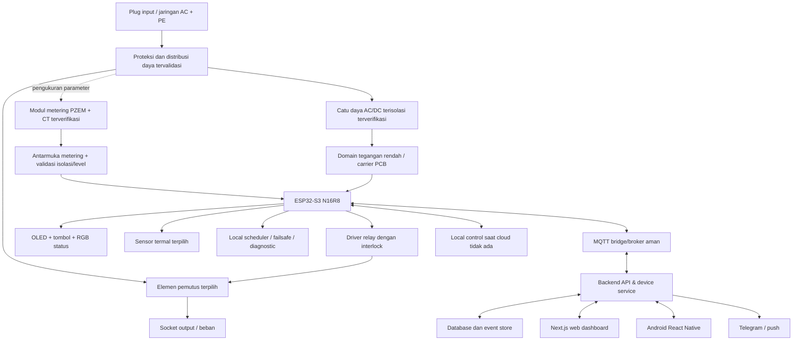
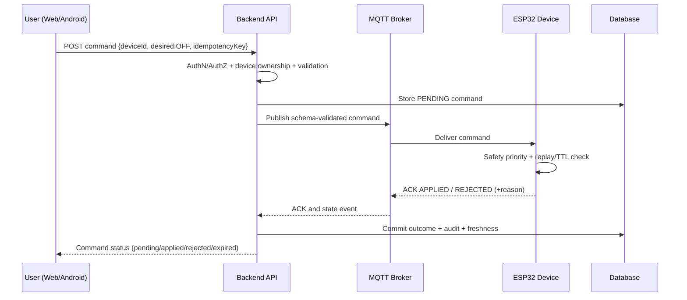

# PRODUCT REQUIREMENTS DOCUMENT (PRD)
## ESP32-S3 IoT Smart Plug / Smart Outlet — Rekayasa Hardware, Firmware, Web, Android, dan Deployment

**Jenis dokumen:** Master PRD dan instruksi pelaksanaan untuk OpenCode CLI / coding agent.  
**Bahasa keluaran proyek:** Bahasa Indonesia untuk dokumentasi; kode dan identifier boleh berbahasa Inggris.  
**Tanggal penyusunan:** 15 November 2026.  
**Versi PRD:** 1.0 — *pre-execution; keputusan hardware belum disetujui*.  
**Status proyek saat PRD diterbitkan:** `AWAITING_USER_DECISIONS`.  
**Target lingkungan:** Windows 11 + OpenCode CLI; tool lokal, Python, EDA/CAD, serta stack web/mobile.  
**Pemisahan wajib:** Fase 1 = hardware engineering dan firmware dasar; Fase 2 = integrasi software, IoT, web, Android, dan deployment.

> **INSTRUKSI PRIORITAS UNTUK OPENCODE:** Baca seluruh dokumen ini sebelum bekerja. PRD ini adalah kontrak pekerjaan, bukan bukti bahwa desain aman atau telah diuji. MULAI dengan mengajukan kuesioner pra-eksekusi kepada pengguna. Jangan memilih atau membeli komponen tambahan, menetapkan spesifikasi listrik final, mendesain rangkaian mains sebagai siap produksi, atau mengaktifkan fase berikutnya tanpa keputusan/gate yang relevan. Setelah persetujuan, kerjakan secara otonom seluruh tugas digital yang tidak memerlukan izin khusus. Jangan mengarang hasil pengujian.

---

## 00. Ringkasan eksekutif dan mandat

Bangun satu sistem **IoT Smart Plug / Smart Outlet berbasis ESP32-S3 N16R8** yang mengukur dan mengendalikan beban listrik rumah tangga melalui tombol fisik, OLED, RGB NeoPixel, jaringan lokal, web, dan aplikasi Android. Sistem menyediakan metering (V, A, W, kWh, faktor daya, frekuensi bila tersedia), histori konsumsi, estimasi biaya berdenominasi IDR, otomasi, diagnostik, serta notifikasi. Operasi inti lokal **tidak bergantung pada server cloud**. Backend/cloud dipakai untuk sinkronisasi aman, histori panjang, multi-device, akses internet, dan push notification.

Target adalah desain yang **dapat ditelusuri dari requirement → part-number → datasheet → schematic → netlist → PCB → wiring → enclosure → firmware → API → UI → test → handoff**, bukan sekadar gambar yang tampak selesai. Produk direncanakan untuk lingkungan distribusi listrik rumah tangga Indonesia sekitar 230 VAC/50 Hz, namun desain, batas rating dan kesesuaian regulasinya **wajib diverifikasi**. Batas nominal stopkontak, kelas proteksi, ukuran enclosure, dan komponen belum boleh dianggap final sebelum pengguna menjawab pertanyaan dan engineer memvalidasinya.

### 00.1 Yang harus benar-benar dibuat

- Berkas riset, BOM, matriks keputusan, tautan sumber, register asumsi/risiko dan bukti persetujuan.
- Proyek native KiCad (`.kicad_pro`, `.kicad_sch`, `.kicad_pcb`) beserta source generator Python bila digunakan; wiring WireViz YAML; GPIO mapping.
- Geometri casing parametrik CadQuery, STEP, STL, fit-check, assembly view, penggambaran letak semua modul.
- Firmware ESP32-S3 yang dapat di-*build*, diuji pada level unit/integration dengan mock, dan di-*flash* jika hardware tersedia.
- Web Next.js, backend/API, database, kontrak MQTT, aplikasi Android React Native/Expo, sistem autentikasi, logging, notifikasi, integrasi, dan deployment yang dapat direproduksi.
- Laporan ERC/DRC dan pengujian digital nyata; daftar pengujian fisik yang **belum** dilakukan harus berstatus `BLOCKED` atau `UNVERIFIED`.
- Dokumentasi pemula yang lengkap, aman, dapat ditindaklanjuti, dan laporan penyerahan engineering.

### 00.2 Arti 'selesai' dan ruang lingkup klaim

`DIGITAL_COMPLETE` hanya berarti artefak digital wajib telah dihasilkan dan validasi digital yang mungkin dilakukan telah lulus. `ENGINEERING_REVIEW_REQUIRED` berarti desain belum mendapatkan sign-off insinyur kompeten. `HARDWARE_VALIDATION_REQUIRED` berarti bukti uji fisik belum tersedia. `READY_FOR_FABRICATION` hanya boleh diberikan setelah pemeriksaan keselamatan dan manufaktur yang dipersyaratkan. `READY_FOR_USE` hanya boleh diberikan setelah pengujian fisik, keamanan, dan persyaratan regulasi dipenuhi. Status-status ini **tidak saling menggantikan** dan harus dilaporkan per-subsystem maupun keseluruhan.

### 00.3 Prinsip non-negotiable

1. Keselamatan listrik dan kepatuhan > fakta/datasheet > kebenaran teknis > reliabilitas > maintainability > dimensi > biaya > kecepatan.
2. Modul komersial **tidak otomatis** lebih aman daripada rangkaian diskrit; sertifikasi, isolasi, termal, dan pemasangan harus diperiksa pada **sistem**.
3. Sensor arus CT 100 A bukan izin untuk mengalirkan 100 A melalui plug, socket, relay, terminal, atau PCB.
4. Relay optocoupler belum tentu merupakan sakelar keselamatan. Optocoupler pada input tidak menjamin jarak isolasi PCB, rating kontak, kesesuaian kategori beban, maupun proteksi independen.
5. Sisi AC mains dan logika SELV/tegangan rendah tidak boleh tercampur. Pengujian pada jaringan PLN tidak boleh didelegasikan kepada pemula tanpa prosedur dan pengawasan kompeten.
6. Tidak boleh ada otomatisasi software yang dapat mengaktifkan beban ketika **hard fault** atau *lockout* masih aktif.
7. Nilai performa dan batas proteksi harus berasal dari analisis dan bukti pengujian, bukan angka acak yang dibuat demi mengisi PRD.
8. OpenCode boleh menyelesaikan kerja digital secara otonom, tetapi **tidak boleh menganggap persetujuan pengguna diam-diam diberikan** untuk komponen, pembelian, perubahan OS berisiko, pemakaian kredensial, atau pelepasan desain 230 VAC.

---

## 01. Kuesioner wajib SEBELUM eksekusi

**ATURAN AGEN:** Tampilkan kuesioner berikut pada pesan pertama ketika PRD ini dijalankan. Izinkan pengguna menjawab format ringkas misalnya `Q01=B; Q02=A; ...`. Tandai jawaban sebagai `CONFIRMED`, `OPEN`, atau `INCOMPATIBLE`. **Jangan melanjutkan pemilihan BOM final dan desain mains sebelum pertanyaan safety-critical dijawab.** Jika jawaban pengguna saling bertentangan, jelaskan konflik dan rekomendasikan pilihan yang dapat dibuktikan. Pertanyaan yang dijawab dengan “minta rekomendasi” mengizinkan *riset opsi*, **bukan** finalisasi berisiko tanpa persetujuan.

### 01.1 Pertanyaan spesifikasi perangkat (wajib)

**Q01 — Bentuk produk akhir:**  
A. Smart plug langsung menempel pada stopkontak dinding; B. Smart outlet *inline* (kotak dengan kabel input); C. Stopkontak pintar meja/ekstensi dengan satu soket; D. Minta rekomendasi setelah studi dimensi dan keselamatan.  
Dampak: bentuk enclosure, strain relief, bobot, orientasi, ruang mekanik, dan akses plug.

**Q02 — Jenis soket output dan plug input:**  
A. Type F/Schuko dengan protective earth; B. Type E/F kombinasi ber-ground sesuai produk yang tersedia; C. Standar lain yang ditentukan pengguna; D. Minta analisis kompatibilitas Indonesia.  
Dampak: kesesuaian konektor, kemampuan menerima steker, pembumian, pembalikan orientasi plug, aturan switching. Semua komponen harus memiliki identitas model dan datasheet/rating.

**Q03 — Arus beban maksimum TARGET, bukan hasil sertifikasi:**  
A. Maksimum 6 A; B. Maksimum 10 A; C. Maksimum 16 A; D. Tentukan setelah evaluasi part/rating.  
Default belum ditetapkan. Jika memilih 16 A, biaya, dimensi, termal, switching, fuse, terminal, dan pengujian harus dinilai ulang. Rating akhir = nilai terendah yang diturunkan dari sistem dan bukti.

**Q04 — Jenis beban yang harus didukung:**  
A. Resistif (lampu/pemanas sesuai rating); B. Campuran elektronik rumah tangga termasuk adaptor SMPS; C. Beban motor/induktif; D. Semua jenis dengan pembatasan eksplisit.  
Beban induktif, inrush, *power supply* kapasitif dan siklus switching memerlukan penilaian tersendiri. Jangan menjanjikan semua beban aman.

**Q05 — Konfigurasi pemutusan konduktor:**  
A. Tinjau pemutusan dua kutub karena plug Type F dapat dibalik; B. Satu kutub hanya jika terbukti memenuhi arsitektur keselamatan dan pemasangan; C. Minta engineer memilih dari studi standar.  
Pilihan pengguna bukan pengganti keputusan insinyur; PE **tidak pernah** diputus relay.

**Q06 — Batas ukuran fisik target:**  
A. Panjang ≤100 mm, lebar ≤100 mm, tinggi ≤50 mm; B. Maksimum 150 × 100 × 70 mm; C. Utamakan keselamatan dan servisabilitas, dimensi fleksibel; D. Masukkan dimensi sendiri.  
Angka ini hanya target mekanik, bukan syarat memaksa komponen berbahaya menjadi terlalu rapat.

**Q07 — Target biaya bahan BOM (tidak termasuk alat lab dan ongkir jika tidak disebut):**  
A. Rp350.000–500.000; B. Rp500.000–750.000; C. Fleksibel sampai tervalidasi; D. Anggaran lain.  
Bandingkan biaya unit prototipe vs biaya manufaktur, jangan mengganti komponen keselamatan dengan produk tak terlacak hanya untuk mencapai target.

**Q08 — Status board ESP32-S3 N16R8:**  
A. Sudah memiliki board — akan mengirim foto sisi depan-belakang; B. Akan membeli model resmi Espressif DevKitC-1; C. Board pihak ketiga/clone — kirim penjual, model, dan revisi; D. Belum pasti.  
**Wajib** memverifikasi board, revision, USB pin, strapping pins, tegangan IO, LED RGB dan dimensi. Jangan menetapkan GPIO48/38 sebagai kebenaran universal.

**Q09 — Modul PZEM-004T V4 Open CT:**  
A. Sudah ada; foto PCB/label/CT akan disediakan; B. Akan membeli dari sumber yang dapat diverifikasi; C. Terbuka pada alternatif metering yang lebih ringkas/aman; D. Butuh perbandingan varian.  
Pastikan versi V4, jenis CT split/open, firmware/protokol, konektor UART, skema isolasi, dan dimensi barang **yang sebenarnya**.

**Q10 — Relay/pemutus daya:**  
A. Modul relay optocoupler dua kutub/dua kontak bila sesuai; B. Mekanisme pemutus lain yang memenuhi rating; C. Lakukan studi dan ajukan 2–3 alternatif; D. Sudah ada relay tertentu — pengguna mengirim kode part.  
Jangan menganggap relay SPDT tunggal sebagai DPST/double-pole; pastikan *contact arrangement* dan mode gagal.

**Q11 — Bentuk penempatan modul:**  
A. Carrier PCB untuk modul yang dapat dilepas; B. Modul pada dudukan mekanik terpisah, PCB hanya low-voltage control; C. Hybrid; D. Pilih berdasar isolasi, dimensi, dan kemudahan produksi.  
Header biasa tidak boleh dipilih hanya demi kemudahan pada jalur mains/arus besar. Gunakan konektor sesuai rating atau koneksi mekanik/terminal yang tepat.

**Q12 — Target keselamatan dan penggunaan:**  
A. Prototipe akademik di laboratorium berpengawasan; B. Uji lapangan terbatas setelah verifikasi keselamatan; C. Produk konsumen untuk dipasarkan (perlu penilaian standar dan regulasi formal); D. Belum ditentukan.  
Untuk A tidak otomatis boleh dihubungkan ke PLN tanpa *review* dan prosedur uji.

### 01.2 Pertanyaan pengalaman pengguna dan software

**Q13 — Layar:** A. OLED I²C kecil; B. OLED ukuran lebih besar; C. Layar lain; D. Perbandingan teknis dan biaya.  
**Q14 — Indikator:** A. NeoPixel built-in jika ada; B. LED RGB eksternal di panel; C. Keduanya; D. Pilih berdasar ketersediaan/akses visual.  
**Q15 — Pengaturan koneksi pertama:** A. BLE; B. SoftAP; C. BLE + fallback SoftAP; D. Rekomendasi keamanan/UX.  
**Q16 — Mode lokal offline:** A. Wi-Fi LAN dengan aplikasi; B. Kontrol fisik + jadwal tersimpan; C. A+B dengan RTC tervalidasi; D. Minta desain yang paling tangguh.  
**Q17 — Akses internet/cloud:** A. Self-host VPS; B. Managed cloud; C. Hybrid lokal + cloud; D. Bandingkan biaya/keamanan sebelum memilih.  
**Q18 — Akun pengguna:** A. Single-user; B. Multi-user satu rumah dengan peran; C. Multi-tenant banyak pemilik/perangkat; D. Mulai sederhana namun siapkan evolusi.  
**Q19 — Notifikasi utama:** A. Telegram; B. Android push; C. Keduanya; D. Lihat biaya/kelayakan.  
**Q20 — Home Assistant:** A. MQTT Discovery; B. Integrasi API spesifik; C. Keduanya jika relevan; D. Opsional di tahap akhir.  
**Q21 — Kebutuhan histori:** A. Lokal pendek + cloud panjang; B. Hanya lokal; C. Cloud dengan backup; D. Rekomendasi durasi simpan dan biaya.  
**Q22 — Stack backend:** A. Next.js + layanan backend terpisah TypeScript; B. Next.js API sebagai bagian monolit yang terukur; C. Self-host dengan Docker Compose; D. Pilih melalui ADR (*architecture decision record*).  
**Q23 — Stack firmware:** A. ESP-IDF; B. Arduino-ESP32; C. Bandingkan berbasis OTA, security, recovery dan maintainability; D. Sudah memiliki basis firmware.  
**Q24 — Android:** A. React Native + Expo development build/EAS bila diperlukan; B. React Native CLI/bare; C. Pilih berdasarkan akses native BLE/notifications dan kemampuan APK lokal.  
**Q25 — Kebijakan penyalaan kembali setelah listrik pulih:** A. Selalu OFF; B. Kondisi sebelumnya (setelah pemeriksaan keselamatan); C. Pengaturan pengguna dengan default OFF; D. Minta analisis risiko.  
**Q26 — Kapasitas engineering/fasilitas uji:** A. Hanya komputer, belum ada alat lab; B. Ada multimeter & beban uji aman; C. Ada lab dan pembimbing/personel kompeten; D. Rinci daftar fasilitas.  
**Q27 — Persetujuan tahapan:** A. Setujui Fase 1 dulu; B. Fase 1, setelah sign-off lanjut Fase 2; C. Kedua fase digital boleh diproses paralel, tetapi keputusan keselamatan tetap wajib; D. Atur ulang.  
**Q28 — Komponen yang sudah dimiliki:** A. Tulis daftar/nomor model; B. Belum ada; C. Minta inventaris awal; D. Belum diketahui.

### 01.3 Cara mengelola jawaban

- Tulis `docs/decisions/USER_ANSWERS.md` dan `docs/decisions/USER_ANSWERS.yaml`, berisi setiap Q, opsi, tanggal, alasan, batasan, dan siapa menyetujui.
- Tulis `docs/decisions/OPEN_QUESTIONS.md` untuk hal yang belum terjawab; beri severity `BLOCKER_SAFETY`, `BLOCKER_DESIGN`, `NON_BLOCKER`.
- Jangan mendesain keselamatan *berdasarkan default tak dikonfirmasi*. Untuk keputusan non-kritis, agen boleh menyusun opsi/analisis yang jelas bertanda `PROVISIONAL`.
- Lakukan riset komponen tambahan; berikan **minimal dua alternatif** untuk fungsi penting bila tersedia dan ajukan tabel ringkas berisi risiko, harga tanggal riset, dimensi, dan sumber. Setelah pengguna memilih, baru kunci `COMPONENT_APPROVALS.yaml`.
- Setiap revisi jawaban yang mengubah arus, beban, bentuk plug/socket, atau ukuran wajib memicu *impact analysis* terhadap semua artefak turunan.
- Jawaban Q27 tidak boleh menghapus kewajiban *safety gate* atau persetujuan pengeluaran uang.

---

## 02. Batasan produk, pengguna, dan tujuan

### 02.1 Pengguna sasaran

- Mahasiswa/engineer pengembang: mengakses seluruh diagnostik engineering, log, BOM, dan laporan.
- Pengguna rumah tangga: ON/OFF aman, data konsumsi dan biaya, jadwal, notifikasi, mudah dipasangkan.
- Pengelola beberapa perangkat: pengelompokan per ruangan, histori perangkat terpisah, status online/offline yang benar.
- Petugas teknis: inspeksi fault, audit perangkat, OTA, dan prosedur reset aman.

### 02.2 Masalah yang diselesaikan

Pengguna tidak dapat dengan mudah mengetahui berapa energi yang dikonsumsi perangkat terpasang, tidak punya kontrol dari jarak jauh yang aman, dan kesulitan memahami *standby consumption*, pola konsumsi, serta batas biaya. Sistem harus memberi data yang **dapat dipercaya** sekaligus mempertahankan kontrol lokal ketika internet/server bermasalah.

### 02.3 Sasaran keberhasilan produk

1. Pengukuran V/A/W/kWh/PF tampil di lokal dan tersinkron ke web/Android tanpa menyamakan pembacaan mentah dengan jaminan akurasi meter legal.
2. Perintah ON/OFF menghasilkan **acknowledgment berdasarkan kondisi aktual teramati**, bukan sekadar pesan berhasil dikirim.
3. Otomasi lokal berlanjut tanpa cloud ketika jam valid dan kondisi aman.
4. Kehilangan sensor, restart mendadak, kehilangan jaringan, stuck relay, atau kerusakan serius tidak menghasilkan klaim kondisi aman palsu.
5. Pengguna dapat mengetahui status `ONLINE`, `STALE`, `OFFLINE`, `FAULT`, dan `LOCKED_OUT` secara konsisten.
6. Semua lintasan teknis dapat direproduksi dari repositori bersih mengikuti panduan.
7. Semuanya terdokumentasi dalam Bahasa Indonesia, dengan penjelasan istilah, wiring yang konsisten, dan status validasi.

### 02.4 Di luar ruang lingkup atau perlu keputusan tambahan

- Sertifikasi komersial atau klaim legal sebagai produk siap dijual tidak diperoleh otomatis dari PRD.
- Alat **bukan** pengganti MCB/RCD/RCBO instalasi dan bukan alat ukur resmi penagihan PLN.
- Pengujian arus/tegangan berbahaya dan uji lab formal tidak dilakukan oleh OpenCode melalui komputer.
- Pencetakan 3D umum bukan sertifikasi tahan api/isolasi listrik.
- Kontrol beban kritis (alat medis, keselamatan jiwa, otomasi industri) dilarang tanpa analisis dan sertifikasi khusus.
- Performa proteksi lonjakan/surge bukan fitur nyata jika hanya ada peringatan tegangan; memerlukan desain proteksi dan uji tersendiri.
- Kondisi kontak relay yang sesungguhnya belum tentu dapat ditentukan hanya dari state coil. Jika klaim *actual output state* diperlukan, desain feedback terverifikasi.

## 03. Analisis kelayakan dan batas design freeze

Sebelum mendesain CAD final, buat `research/FEASIBILITY_STUDY.md` yang menjawab: apakah seluruh modul muat; apakah jarak isolasi, ventilasi, pengamanan soket dan terminal, jalur PE, pemutusan konduktor, serta biaya layak; apakah suplai DC cukup; apakah PZEM dan CT dapat dipasang dengan benar; apakah modul relay dan terminal memadai; apakah kabel/connector dapat ditahan dari tarikan; apakah area OLED dan tombol bebas dari bagian berbahaya; dan bagaimana layanan USB/debug dilindungi selama perangkat pada mains.

Untuk **setiap** pertanyaan: tulis temuan, sumber primer, perhitungan/metode, alternatif, risiko residu, dan `GO / REDESIGN / BLOCKED`. Jika target dimensi dan anggaran tidak realistis, prioritaskan keselamatan dan ajukan perubahan dengan bukti. Jangan menghasilkan desain penuh yang tampak pasti padahal syarat fisik belum ada. Bentuk *mock geometry* boleh dibuat dengan label `UNVERIFIED_DIMENSIONS` dan tidak boleh dipakai sebagai bukti *fit*.

### 03.1 Design freeze berlapis

- `F0 REQUIREMENTS_FROZEN`: Q kritis, target arus/beban, format input-output, dan kebutuhan sudah ditandatangani.
- `F1 PARTS_APPROVED`: MPN/modul/revisi/tautan sumber disetujui, termasuk komponen keselamatan; jangan mengunci footprint sebelum ini.
- `F2 ELECTRICAL_ARCH_APPROVED`: review arsitektur proteksi, isolasi dan aliran energi oleh personel kompeten.
- `F3 ELECTRO_MECHANICAL_FROZEN`: schematic/wiring/PCB/enclosure mutually consistent; ERC/DRC dan mechanical fit terdokumentasi.
- `F4 FABRICATION_RELEASED`: hanya setelah sign-off kesesuaian dan safety review; manufacturing ZIP baru boleh diberi label release.
- `F5 PHYSICAL_VALIDATED`: pengujian fisik sesuai prosedur dan fasilitas aman, catatan hasil/kalibrasi, sign-off.
- `F6 SYSTEM_RELEASED`: software, cloud, Android, OTA, dokumentasi, dan semua gate wajib lulus.

---

## 04. Arsitektur sistem yang diinginkan

### 04.1 Arsitektur konseptual fungsional (BUKAN wiring mains)



**Penting:** Diagram di atas menjelaskan hubungan fungsi, bukan persetujuan bahwa satu kabel/sirkuit dapat dihubungkan langsung. Schematic final diturunkan dari datasheet, penilaian isolasi dan konfigurasi plug/socket yang disetujui. CT harus ditempatkan pada konduktor yang benar sesuai desain meter, bukan asal dipasang pada seluruh kabel multi-konduktor.

### 04.2 Lapisan dan sumber kebenaran

| Lapisan | Tanggung jawab | Sumber kebenaran |
|---|---|---|
| Fisik dan proteksi independen | Sekering/proteksi termal, isolasi, PE, rating pemutus | Desain disetujui + verifikasi fisik |
| ESP32 device controller | Local state machine, proteksi berbasis sensor, scheduler, relay, OLED | `device_state` dan event sequence |
| Metering | Sampel V/A/W/kWh/PF dan kualitas data | Bacaan bertimestamp dari modul yang teridentifikasi |
| LAN | Kontrol sah ketika cloud offline | Device ACK final dan hasil observasi |
| MQTT | Event transport + command | Skema versi dan idempotency key |
| Backend | Auth, audit, histori, sinkronisasi, multi-device | DB status terkonfirmasi dengan freshness |
| Web/Android | Presentasi data dan perintah pengguna | API dan stream event; bukan cache optimistis permanen |

### 04.3 Persyaratan non-fungsional awal

- **NFR-01** Boot tidak boleh otomatis ON selama startup belum valid; default awal OFF kecuali desain yang ditandatangani menentukan lain.
- **NFR-02** Disconnect Internet tidak boleh menghilangkan tombol fisik/lockout dan fungsi lokal.
- **NFR-03** Rate/timeout polling metering ditentukan lewat uji kemampuan modul, bukan diklaim `real-time` dengan latensi rekaan.
- **NFR-04** Sinkronisasi wajib mempunyai time source, timezone (`Asia/Jakarta` untuk default UI Indonesia), UTC di backend, seq/event ID, dan penanganan jam tidak valid.
- **NFR-05** Kendali berbahaya harus idempotent dan boleh ditolak karena fault, clock invalid, provisioning atau stale state.
- **NFR-06** Error, timeout, sensor unplug, UART CRC, jaringan hilang, storage penuh, dan kehilangan daya harus dapat didiagnosis.
- **NFR-07** Privacy: jangan mencatat SSID password/token dalam log dan tangkapan layar.
- **NFR-08** Security: default deny, least privilege, pemisahan tenant, transport terenkripsi untuk koneksi di luar trusted LAN, provisioning aman.
- **NFR-09** Ada dokumentasi alternatif jika layanan cloud atau akses Google Play/Firebase/EAS tidak tersedia.
- **NFR-10** Semua artefak native dapat dibuka dengan versi tool yang dikunci; uji membuka/import, bukan hanya `file exists`.
- **NFR-11** Semua hasil gambar dan diagram manusia dapat dibaca pada resolusi biasa, dengan judul, legend, unit, net name, serta tidak ada cable crossing ambigu.
- **NFR-12** Target waktu respons/akurasi/retensi/rate notifikasi **ditentukan lewat baseline dan uji**, bukan angka absolut tanpa dasar.


---

## 05. Matriks kebutuhan fitur lengkap (80 fitur asli)

**Keterlacakan:** Penomoran daftar pengguna melompat dari 36 ke 38 sehingga berisi **80 fitur**, bukan 81. Angka asli tetap dicantumkan pada kolom `Asal` untuk mencegah salah rujuk, sementara `FR-001` s.d. `FR-080` adalah ID persyaratan internal stabil. Semua fitur harus ditautkan ke source code, uji, issue, dan deliverable; prioritas `P0` = wajib untuk kesiapan lingkup yang bersangkutan, `P1` = penting, `P2` = opsional bila anggaran/waktu terbatas. `F1+F2` berarti driver/operasi dasar F1 dan integrasi UX/server F2. Status awal **UNVERIFIED** untuk semuanya.

### 05.1 Monitoring dan pengukuran listrik

| ID | Asal | Fase | Prioritas | Fitur dan arti | Kriteria penerimaan / uji |
|---|---:|---|---|---|---|
| `FR-001` | 1 | F1+F2 | P0 | **Real-time Voltage Monitoring** — Mengukur tegangan listrik (V). | Bacaan V muncul di OLED dan API; nilai, unit, timestamp, validitas dan stale ditampilkan; bandingkan dengan referensi terkalibrasi pada uji fisik berizin. |
| `FR-002` | 2 | F1+F2 | P0 | **Real-time Current Monitoring** — Mengukur arus listrik (A). | Bacaan A berubah sesuai beban pada simulasi/mock, validasi data out-of-range, dan pada uji nyata bandingkan dengan meter referensi yang cocok. |
| `FR-003` | 3 | F1+F2 | P0 | **Real-time Power Monitoring** — Mengukur daya aktif (W). | Daya aktif W diperoleh dari register meter yang benar; hindari perhitungan V×I jika tidak menyatakan apparent power; tes beban dummy. |
| `FR-004` | 4 | F1+F2 | P0 | **Energy Consumption Monitoring** — Menghitung energi listrik (kWh). | Akumulator energi kWh tidak mundur tanpa reset eksplisit; rollover/reset/counter reconnect tidak menggandakan histori atau menghapus audit. |
| `FR-005` | 5 | F1+F2 | P1 | **Power Factor Monitoring** — Mengestimasi faktor daya (PF). | PF diperoleh dari data meter terverifikasi dan divisualisasikan 0..1 jika sesuai protokol; nilai invalid tidak ditampilkan sebagai angka pasti. |
| `FR-006` | 6 | F2 | P0 | **Electricity Cost Calculator** — Mengestimasi biaya listrik dalam rupiah. | Biaya IDR = selisih energi terverifikasi × tarif efektif per interval; aturan pembulatan, zona waktu dan periode tagihan diuji. |
| `FR-007` | 7 | F2 | P0 | **Custom Electricity Tariff** — Mengatur tarif listrik per kWh. | Tarif rupiah/kWh dapat diatur per pengguna/perangkat; perubahan tarif historis tidak diam-diam merevisi biaya masa lalu. |
| `FR-008` | 8 | F2 | P0 | **Energy History** — Menyimpan riwayat konsumsi listrik. | Histori bertimestamp dapat diambil terurut, difilter, tanpa duplikasi sesudah reconnect dan restart. |
| `FR-009` | 9 | F2 | P1 | **Energy Analytics** — Grafik konsumsi harian, mingguan, dan bulanan. | Grafik harian/mingguan/bulanan memiliki satuan, agregasi konsisten serta menandai data hilang; uji dataset fixture. |
| `FR-010` | 10 | F2 | P1 | **Peak Power Tracking** — Mencatat penggunaan daya tertinggi. | Nilai puncak W dan rentang waktunya dicatat, direset hanya dengan tindakan eksplisit dan event audit. |
| `FR-011` | 11 | F2 | P1 | **Energy Budget Monitoring** — Memantau pemakaian terhadap anggaran listrik. | Budget kWh atau IDR dan persentase konsumsi tampil; periodisasi serta perubahan nilai budget terdefinisi. |
| `FR-012` | 12 | F2 | P2 | **Energy Data Export** — Mengekspor data ke CSV (fitur opsional). | CSV valid UTF-8 header jelas, unit, timezone, kWh/IDR, aman terhadap formula injection dan data terfilter. |

### 05.2 Kontrol dan otomasi

| ID | Asal | Fase | Prioritas | Fitur dan arti | Kriteria penerimaan / uji |
|---|---:|---|---|---|---|
| `FR-013` | 13 | F2 | P0 | **Remote ON/OFF** — Kontrol perangkat melalui internet. | Perintah jarak jauh diautentikasi, memiliki command ID, TTL, ACK dan hasil state terkonfirmasi; offline tidak diklaim sukses. |
| `FR-014` | 14 | F1+F2 | P0 | **Local ON/OFF** — Kontrol melalui jaringan lokal tanpa internet. | Kontrol di LAN bekerja dengan cloud diblokir; akses tetap terotorisasi; fault lockout selalu menang. |
| `FR-015` | 15 | F1 | P0 | **Physical ON/OFF Button** — Kontrol menggunakan tombol fisik. | Debounce tombol fisik; satu aksi satu event; saat lockout tombol tidak menyalakan; aksi panjang untuk reset dipisah aman. |
| `FR-016` | 16 | F1+F2 | P0 | **Scheduled ON/OFF** — Jadwal menyala dan mati otomatis. | Jadwal ON/OFF tersimpan dan dieksekusi hanya jika jam valid, device aman, tanpa duplikasi saat restart. |
| `FR-017` | 17 | F1+F2 | P1 | **Weekly Scheduling** — Jadwal berdasarkan hari dalam seminggu. | Jadwal hari tertentu melewati pergantian hari/minggu dan perubahan zona waktu secara deterministik. |
| `FR-018` | 18 | F1+F2 | P0 | **Countdown Timer** — Mematikan perangkat setelah waktu tertentu. | Countdown dapat dimulai/dibatalkan, status bertahan/recover sesuai spesifikasi, habis waktu memberi OFF tanpa race. |
| `FR-019` | 19 | F1+F2 | P1 | **Automatic Standby Detection** — Mendeteksi perangkat dalam mode standby. | Standby dikenali sesudah daya berada di bawah ambang selama durasi terkonfigurasi; hysteresis/false positive diuji. |
| `FR-020` | 20 | F1+F2 | P1 | **Automatic Standby Cut-off** — Mematikan perangkat standby berdasarkan persetujuan pengguna. | Standby cut-off nonaktif secara default dan butuh opt-in; fault priority dan penolakan perintah saat kondisi tidak pasti diuji. |
| `FR-021` | 21 | F1+F2 | P1 | **Idle Detection** — Mendeteksi perangkat yang tidak aktif. | Idle mode dibedakan dari standby berdasarkan rule terdokumentasi dan log alasan serta threshold. |
| `FR-022` | 22 | F1+F2 | P1 | **Power Threshold Automation** — Otomasi berdasarkan batas konsumsi daya. | Otomasi ambang memakai filter, hysteresis, durasi dan override safety; tidak terjadi relay chatter. |
| `FR-023` | 23 | F1+F2 | P0 | **Power Recovery Settings** — Mengatur kondisi perangkat setelah listrik kembali. | Saat power restore output default OFF; opsi lain hanya jika disetujui dan aman; simulasi brownout/reboot diuji. |
| `FR-024` | 24 | F1+F2 | P0 | **Offline Scheduling** — Jadwal berjalan tanpa internet selama informasi waktu valid. | Jadwal offline berlangsung hanya saat RTC/waktu valid; saat invalid status blocked tercatat dan ON otomatis dilarang. |
| `FR-025` | 25 | F1+F2 | P0 | **Automation Priority Management** — Mengatur prioritas perintah ketika terjadi konflik. | Tabel prioritas perintah dan konflik diuji: hard fault > emergency/manual OFF > local safety > user OFF > eligible ON. |

### 05.3 Proteksi dan keamanan listrik

| ID | Asal | Fase | Prioritas | Fitur dan arti | Kriteria penerimaan / uji |
|---|---:|---|---|---|---|
| `FR-026` | 26 | F1 | P0 | **Overcurrent Protection** — Perlindungan terhadap arus berlebih. | Proteksi arus independen ditentukan berdasarkan rantai rating; simulasi software threshold diuji, uji trip fisik wajib oleh personel kompeten. |
| `FR-027` | 27 | F1 | P0 | **Overtemperature Protection** — Perlindungan terhadap suhu berlebihan. | Overtemp memicu OFF/lockout sesuai kebijakan; sensor hilang dinilai fail-safe; trip aktual memerlukan verifikasi fisik. |
| `FR-028` | 28 | F1+F2 | P0 | **Overvoltage Warning** — Peringatan tegangan terlalu tinggi. | Tegangan tinggi memicu warning pada mock dan notifikasi, tanpa mengklaim surge suppression; jika disconnect diminta, harus dirancang khusus. |
| `FR-029` | 29 | F1+F2 | P0 | **Undervoltage Warning** — Peringatan tegangan terlalu rendah. | Tegangan rendah memicu warning dengan hysteresis; pembacaan out-of-range meter diberi status invalid dan tidak disalahartikan. |
| `FR-030` | 30 | F1 | P0 | **Surge Protection** — Perlindungan terhadap lonjakan tegangan transien. | Ada studi surge, koordinasi proteksi dan komponen disetujui; fitur tidak boleh ditandai implemented tanpa hardware dan uji sesuai desain. |
| `FR-031` | 31 | F1 | P0 | **Thermal Cutoff** — Pemutusan akibat temperatur berbahaya secara independen. | Thermal cut-off fisik independen MCU di-review untuk trip, lokasi sensing dan fail-mode; tanpa uji fisik status BLOCKED. |
| `FR-032` | 32 | F1 | P0 | **Fuse Protection** — Proteksi arus menggunakan sekering. | Fuse beserta breaking capacity, karakteristik waktu-arus, mounting, akses servis dan koordinasi proteksi ditinjau. |
| `FR-033` | 33 | F1 | P0 | **Fail-Safe Startup** — Menjaga output tetap OFF selama proses startup yang belum aman. | Output tetap OFF pada reset, flashing, boot dan brownout; GPIO tidak floating memicu coil tanpa sengaja; diuji mock dan bench aman. |
| `FR-034` | 34 | F1 | P0 | **Sensor Failure Detection** — Mendeteksi sensor rusak atau pembacaan tidak valid. | CRC/timeout sensor/suhu abnormal memicu state invalid, alarm atau lockout sesuai risiko; tidak menampilkan nilai lama sebagai live. |
| `FR-035` | 35 | F1+F2 | P0 | **Electrical Fault Logging** — Mencatat kejadian gangguan listrik. | Event fault berisi severity, sebab, waktu, sumber, state, dan action; bertahan pada reboot yang sesuai kapasitas. |
| `FR-036` | 36 | F1 | P0 | **Fault Lockout** — Mencegah perangkat kembali ON selama gangguan kritis belum diselesaikan. | Critical fault membuat ON ditolak sampai penyebab selesai dan reset otoritatif, dicatat audit; bypass cloud dilarang. |

### 05.4 Antarmuka dan pengalaman pengguna

| ID | Asal | Fase | Prioritas | Fitur dan arti | Kriteria penerimaan / uji |
|---|---:|---|---|---|---|
| `FR-037` | 38 | F1 | P0 | **OLED Display** — Menampilkan daya, tegangan, arus, kWh, biaya, dan status. | OLED menampilkan W,V,A,kWh,IDR,status bergantian; saat sensor invalid tampil peringatan, bukan angka menyesatkan. |
| `FR-038` | 39 | F1 | P1 | **OLED Page Navigation** — Berpindah halaman informasi menggunakan tombol. | Navigasi halaman via tombol atau kombinasi disetujui; tidak mengganggu ON/OFF; tes debounce dan aksesibilitas. |
| `FR-039` | 40 | F1 | P1 | **RGB NeoPixel Status Indicator** — Indikator kondisi perangkat berdasarkan warna. | RGB warna/status berasal dari tabel pusat; terverifikasi pin NeoPixel board revision atau LED eksternal. |
| `FR-040` | 41 | F1 | P2 | **RGB Engineering Debug Mode** — Pola kedipan khusus untuk debugging. | Mode debug hanya melalui tindakan berwenang dan mempunyai timeout; pola tak ambigu dengan fault merah. |
| `FR-041` | 42 | F1 | P0 | **RGB Fault Indicator** — Peringatan gangguan menggunakan LED merah. | Fault LED memiliki prioritas tertinggi, tetap tampil saat kondisi UI biasa; mapping fault vs warning diuji. |
| `FR-042` | 43 | F1+F2 | P2 | **RGB Night Mode** — Mengurangi kecerahan indikator pada malam hari. | Night mode membatasi brightness berdasarkan pengaturan/waktu valid; fault kritis tetap terlihat. |
| `FR-043` | 44 | F2 | P0 | **Web Dashboard** — Monitoring dan kontrol melalui browser. | Dashboard responsif menampilkan telemetry, charts, controls, settings, states dengan loading/error/empty dan protected routes. |
| `FR-044` | 45 | F2 | P0 | **Android Application** — Monitoring dan kontrol melalui aplikasi Android. | APK terbangun dan berfungsi pada Android device/emulator yang didukung; pairing, kontrol, grafik, offline UI diuji. |
| `FR-045` | 46 | F2 | P1 | **Device Naming** — Memberi nama perangkat. | Nama perangkat lolos validasi panjang/karakter dan tampil konsisten di web, Android, MQTT/device; escaping aman. |
| `FR-046` | 47 | F2 | P0 | **Device Status Dashboard** — Menampilkan status ON/OFF, online/offline, dan waktu pembaruan. | ON/OFF, online/offline/stale, last-seen dan waktu sinkron jelas; cloud OFFLINE tidak otomatis berarti relay OFF. |
| `FR-047` | 48 | F1+F2 | P1 | **Engineering Diagnostics Dashboard** — Menampilkan informasi teknis untuk pemeriksaan perangkat. | Panel engineer menampilkan firmware hash, RSSI, uptime, error count, sensor health, reconnect dan tanpa membocorkan rahasia. |

### 05.5 Konektivitas dan integrasi IoT

| ID | Asal | Fase | Prioritas | Fitur dan arti | Kriteria penerimaan / uji |
|---|---:|---|---|---|---|
| `FR-048` | 49 | F1 | P0 | **Wi-Fi Connectivity** — Terhubung ke Wi-Fi 2,4 GHz. | Wi-Fi 2.4 GHz tersambung pada test access point; credential disimpan aman dan berstatus gagal jika tidak tersambung. |
| `FR-049` | 50 | F1+F2 | P1 | **BLE Provisioning** — Konfigurasi Wi-Fi melalui Bluetooth. | BLE pairing hanya pada mode terbatas dan berautentikasi; setelah pairing window ditutup; tes replay/unauthorized pairing. |
| `FR-050` | 51 | F1+F2 | P1 | **SoftAP Setup** — Konfigurasi jaringan melalui access point ESP32. | SoftAP provisioning dibatasi waktu, sandi unik, tidak menjadi AP tak terlindungi; kredensial tidak bocor di log. |
| `FR-051` | 52 | F2 | P0 | **Hybrid Local-Cloud Control** — Kontrol lokal dan melalui internet. | Control cloud dan LAN tidak bertentangan; dedup command, ACK, safety priority dan skenario failover diuji. |
| `FR-052` | 53 | F1+F2 | P0 | **MQTT Integration** — Komunikasi menggunakan MQTT. | MQTT topic/payload schema versioned; QoS/retained policy benar, replay & duplicate message tidak mengganti safe state. |
| `FR-053` | 54 | F2 | P1 | **Home Assistant Integration** — Integrasi ekosistem smart home. | Home Assistant discovery/entities memiliki device ID unik, availability, state sync; kontrol HA tetap tunduk lockout. |
| `FR-054` | 55 | F2 | P0 | **REST API** — Integrasi dengan aplikasi atau layanan eksternal. | OpenAPI untuk setiap endpoint + auth/validation/rate limit; contract test web/Android/backend. |
| `FR-055` | 56 | F2 | P0 | **Real-time Data Synchronization** — Sinkronisasi data antara ESP32, web, dan Android. | State memakai event version/sequence/time dan freshness; reconnect melakukan reconcile, bukan blind overwrite. |
| `FR-056` | 57 | F1 | P0 | **Wi-Fi Auto Reconnection** — Menghubungkan ulang Wi-Fi secara otomatis. | Wi-Fi disconnect memicu exponential backoff+jitter, tetap menjalankan fungsi lokal, tidak watchdog-loop terus-menerus. |
| `FR-057` | 58 | F1+F2 | P1 | **Offline Data Buffering** — Menyimpan sementara data ketika internet terputus. | Buffer offline dibatasi kapasitas, memakai durable queue jika perlu, preserve ordering, dedup sesudah reconnect. |
| `FR-058` | 59 | F2 | P0 | **Cloud Database** — Penyimpanan data perangkat pada server. | DB terprovisi, migrasi dan backup/restore diuji dengan fixture; tenant data terisolasi. |
| `FR-059` | 60 | F2 | P1 | **Multi-Device Management** — Mengelola beberapa smart plug melalui satu akun. | Pengguna sah dapat menambah, mengganti nama, melihat, mencabut perangkat; antar user tidak bisa mengakses device lain. |

### 05.6 Analitik pintar dan notifikasi

| ID | Asal | Fase | Prioritas | Fitur dan arti | Kriteria penerimaan / uji |
|---|---:|---|---|---|---|
| `FR-060` | 61 | F2 | P1 | **Power Anomaly Detection** — Mendeteksi pola konsumsi listrik tidak normal. | Detektor anomali memiliki baseline eksplisit, parameter dapat dijelaskan, false-positive test, tidak mengklaim AI tanpa model/evaluasi. |
| `FR-061` | 62 | F2 | P1 | **Historical Pattern Analysis** — Menganalisis kebiasaan penggunaan listrik. | Analisis pola berbasis agregasi histori terdefinisi; dataset tidak cukup diberi pesan yang benar. |
| `FR-062` | 63 | F1+F2 | P0 | **High Power Alert** — Peringatan saat daya melewati batas. | Alert daya tinggi muncul saat ambang+durasi terlampaui; throttle dan dedup mencegah spam. |
| `FR-063` | 64 | F1+F2 | P0 | **High Temperature Alert** — Peringatan kenaikan temperatur. | Alert suhu tinggi muncul saat threshold terlampaui; tidak tertunda hingga cloud jika keselamatan memerlukan OFF lokal. |
| `FR-064` | 65 | F2 | P1 | **Standby Consumption Alert** — Peringatan konsumsi listrik saat standby. | Alert standby muncul setelah durasi dan threshold efektif, pengguna dapat mengubah threshold serta menonaktifkan. |
| `FR-065` | 66 | F2 | P1 | **Energy Budget Alert** — Peringatan ketika penggunaan mendekati anggaran. | Alert anggaran ketika crossing threshold; tidak terkirim berulang setiap refresh pada periode yang sama. |
| `FR-066` | 67 | F2 | P1 | **Telegram Notification** — Mengirim notifikasi melalui Telegram. | Telegram bot memiliki token di secret store, opt-in/chat binding aman, rate limit dan retry; tes dengan sandbox akun. |
| `FR-067` | 68 | F2 | P1 | **Android Push Notification** — Notifikasi langsung ke smartphone. | Push token Android dirotasi/dicabut saat logout, notifikasi action tidak menyalakan perangkat tanpa autentikasi. |
| `FR-068` | 69 | F2 | P0 | **Event History** — Riwayat tindakan, perintah, dan kejadian perangkat. | Event history berisi perintah, actor, source, ACK, fault dan correlation ID; filter/pagination berjalan. |

### 05.7 Firmware, keamanan digital, dan pemeliharaan

| ID | Asal | Fase | Prioritas | Fitur dan arti | Kriteria penerimaan / uji |
|---|---:|---|---|---|---|
| `FR-069` | 70 | F1+F2 | P0 | **OTA Firmware Update** — Memperbarui firmware tanpa kabel USB. | OTA aman memvalidasi versi, hash/signature sesuai desain; tidak mengaktifkan beban otomatis; tes image berhasil/rusak. |
| `FR-070` | 71 | F1+F2 | P0 | **OTA Rollback** — Kembali ke firmware sebelumnya jika pembaruan gagal. | Partisi dan rollback ESP-IDF dikonfigurasi; validasi/rollback image baru diuji tanpa menghapus jalur pemulihan. |
| `FR-071` | 72 | F1+F2 | P0 | **Firmware Integrity Verification** — Memverifikasi keaslian dan integritas firmware. | Integritas image diverifikasi sesuai mekanisme platform; signed OTA/secure boot diputuskan pada security plan. |
| `FR-072` | 73 | F1 | P0 | **Watchdog System** — Mendeteksi dan menangani task firmware yang berhenti. | Watchdog melaporkan task hang dan recovery yang tidak memicu ON; tes fault injection task. |
| `FR-073` | 74 | F2 | P0 | **Secure Authentication** — Autentikasi pengguna. | Auth session dan device credentials aman; uji invalid, expired, brute-force dan reset/revoke. |
| `FR-074` | 75 | F2 | P0 | **Role-Based Access Control** — Pengaturan hak akses pengguna. | Peran owner/admin/viewer atau model disetujui diterapkan di API/backend, bukan sekadar menyembunyikan tombol di UI. |
| `FR-075` | 76 | F2 | P0 | **Encrypted Communication** — Komunikasi menggunakan TLS/HTTPS. | HTTPS/WSS/MQTT TLS dengan certificate verification; dilarang insecure TLS disable untuk rilis. |
| `FR-076` | 77 | F1+F2 | P0 | **Device Pairing Security** — Mengamankan proses pendaftaran perangkat. | Pairing butuh proof-of-possession, kode unik/masa berlaku dan klaim single owner; race/replay/claim attack diuji. |
| `FR-077` | 78 | F1+F2 | P0 | **Command Validation** — Memvalidasi perintah sebelum dieksekusi. | Firmware menolak command malformed, stale, unauthorized, wrong device, forbidden under lockout dan replay. |
| `FR-078` | 79 | F2 | P0 | **Activity and Audit Logging** — Mencatat aktivitas pengguna dan sistem. | Audit immutable/logical append untuk kegiatan penting; tidak ada token/password/PII berlebihan; retention terdokumentasi. |
| `FR-079` | 80 | F1+F2 | P0 | **Factory Reset** — Mengembalikan konfigurasi perangkat melalui prosedur aman. | Factory reset memerlukan prosedur fisik/otorisasi, menghapus kredensial dan binding, tidak melepas lockout akibat fault fisik. |
| `FR-080` | 81 | F1+F2 | P0 | **Device Diagnostics** — Pemeriksaan status firmware, koneksi, dan sensor. | Diagnostik firmware/sensor/relay/network/storage menghasilkan status nyata dengan mock/bench evidence dan error yang dapat ditindaklanjuti. |

### 05.8 Standar penerimaan umum untuk setiap feature

Untuk **setiap** `FR-nnn` wajib dibuat entri machine-readable `requirements/traceability.yaml` yang memuat `id`, `source_id`, `description`, `priority`, `phase`, `implementation_paths`, `test_ids`, `status`, `evidence`, `blocked_by`, `risk_ids`, `last_verified_at` dan `reviewer`. Semua kriteria di atas minimal; engineer menambahkan angka target setelah mendapatkan benchmark dan keputusan pengguna. `PASS` tidak boleh diberi hanya karena tabel diisi.

**Jenis bukti yang wajib dibedakan:** `STATIC_ANALYSIS`, `UNIT_TEST`, `INTEGRATION_TEST`, `HIL_SAFE_BENCH`, `PHYSICAL_MAINS_LAB`, `DOCUMENT_REVIEW`, `SECURITY_TEST`, `USER_ACCEPTANCE`. Setiap bukti wajib menyatakan data input, versi software/fixture, hasil aktual, operator, tanggal, artefak, serta keterbatasan.

---

# FASE 1 — HARDWARE ENGINEERING, FIRMWARE LOKAL DAN BERKAS MANUFAKTUR

## 06. Fase 1: riset BOM, evaluasi komponen, persetujuan

### 06.1 Komponen awal yang diminta pengguna

| Kelompok | Kandidat awal | Status | Catatan yang wajib diverifikasi |
|---|---|---|---|
| MCU | ESP32-S3 N16R8 development board | `USER_PREFERENCE; NOT_VERIFIED` | Model/revisi nyata; 16 MB flash/8 MB PSRAM jika board cocok; posisi header; pin strapping; GPIO LED internal; USB; antena; konsumsi |
| Switching | Relay module ber-optocoupler | `USER_PREFERENCE; ENGINEERING_REVIEW_REQUIRED` | MPN relay, jumlah pole, AC utilization category, contact rating dan inrush, PCB isolation, catu coil, *fail-open*, rating terminal, umur operasi |
| Metering | Peacefair PZEM-004T V4 split/open CT | `USER_PREFERENCE; REVISION_NOT_VERIFIED` | Identitas V4, CT supplied, manual resmi modul actual, pin serial, level I/O, izolasi, protokol, dimensi, toleransi, suhu, availability |
| Plug/socket | Type F/E-F atau lainnya | `AWAITING_Q02` | Standard/sertifikasi, ground contacts, ukuran, material, orientasi, retention, rating konektor, kesesuaian sistem lokal |

**Catatan riset pra-PRD:** Dokumentasi Espressif membedakan DevKitC-1 revisi awal (RGB pada GPIO48) dan v1.1 (RGB pada GPIO38). Detail board **pihak ketiga** tidak boleh disimpulkan dari informasi DevKitC-1. Dokumentasi PZEM V4 yang tersedia di beberapa pemasok belum otomatis merupakan manual resmi batch yang dibeli. Perbedaan versi dan spesifikasi isolasi harus dibuktikan pada sampel fisik.

### 06.2 Daftar fungsi yang memerlukan riset komponen tambahan

OpenCode harus mencari dan membandingkan **2–3 kandidat** apabila tersedia, lalu **meminta persetujuan untuk pemilihan final** komponen yang belum disebut pengguna. Berikut bukan persetujuan MPN atau instruksi untuk menggabungkan semua komponen sekaligus:

1. **Catu daya AC/DC terisolasi:** modul ber-dokumen dan memenuhi kebutuhan input line serta output DC; evaluasi isolation withstand, leakage, thermal, no-load, short-circuit, derating, mounting, dokumentasi keselamatan.
2. **Proteksi arus independen:** fuse, fuse holder, atau solusi yang sah; bandingkan karakteristik time-current, breaking capacity dan koordinasi proteksi.
3. **Proteksi surge:** varistor/MOV atau jaringan proteksi lain hanya setelah riset integrasi, perhitungan surge, *end-of-life* dan kondisi gagal, serta penilaian standar.
4. **Thermal protection hardware:** thermal cutoff sekali pakai, thermostat atau elemen safety sesuai desain; letak sensor dan proteksi terhadap kegagalan pemanasan kontak/terminal.
5. **Sensor suhu:** sensor digital/analog sesuai suhu lingkungan, akurasi/response time, rangkaian pullup/ESD, titik thermal monitoring dan redundansi bila perlu.
6. **OLED:** ukuran, interface I²C/SPI, pengontrol (mis. SSD1306/SH1106 bila benar), tegangan, tampilan yang terbaca melalui jendela casing.
7. **Input fisik:** tombol/aktuator terisolasi secara mekanik yang sesuai akses pengguna dan lingkungan.
8. **RGB NeoPixel eksternal:** jika LED built-in tidak tampak saat enclosed; jenis, level logic, daya, diffuser dan posisi.
9. **Regulator DC/DC atau LDO:** bila dibutuhkan untuk domain 3,3 V/5 V; budget arus *worst case*, dropout/thermal, efisiensi.
10. **Serial isolation / level conversion:** hanya sesuai pembuktian karakteristik PZEM nyata; jangan menyatukan ground high-voltage dan low-voltage tanpa bukti.
11. **Relay driver interface:** transistor/MOSFET/diode/opto/logic level/interface serta gagal saat boot, sesuai modul terpilih.
12. **Terminal, konektor, wire harness:** ketahanan mekanik, temperatur, penampang, rating, derating, creepage dan locking; terminal AC dan low voltage dibedakan.
13. **Jalur PE dan pengikatnya:** elemen koneksi protective earth yang sesuai aplikasi, tahan getaran, tidak mudah terlepas, dan prosedur uji kontinuitas.
14. **PCB material/stackup dan ketebalan copper:** dari kemampuan manufaktur serta hasil *trace sizing* arus/thermal; tidak menetapkan default tanpa analisis.
15. **Enclosure material:** opsi produk *rated* dan alternatif prototype; flame retardancy, insulasi, tahan panas/impact, aging dan metode assembly.
16. **Baut, insert, spacer, standoff, gland/strain-relief, gasket:** jangan menciptakan lintasan konduktif berbahaya atau mengurangi jarak isolasi.
17. **RTC/timekeeping (jika offline schedule perlu):** bandingkan SNTP holdover vs RTC eksternal ber-battery/supercap; estimasi drift dan penanganan time-invalid.
18. **USB/debug access:** desain service interface aman; layanan debugging pada mains harus dilarang sampai tervalidasi isolasi dan prosedur.
19. **Opsional feedback keadaan kontak:** sensor konfirmasi output bila ingin mengklaim keadaan kontak aktual alih-alih `commanded_state`.
20. **Label keselamatan:** label rating, serial ID, warnings, IP rating jika disertifikasi, kode QR pairing bukan secret yang dipublikasi bebas.

### 06.3 Kriteria penilaian komponen

Setiap kandidat diberi *evidence score* dan alasan pemilihan; minimal periksa: fungsi, identitas pabrikan MPN, datasheet/revisi, rating sesuai aplikasi, suhu lingkungan, toleransi/akurasi, karakteristik *failure*, isolasi, ukuran tiga dimensi, bentuk konektor, kecocokan dengan board dan protokol, kemampuan supply Indonesia, harga + tanggal + mata uang, jumlah minimum, sumber autentik, ketersediaan pengganti, risiko counterfeit, proses pemasangan, kualitas dokumentasi, serta risiko sertifikasi.

**Tidak boleh** memberikan skor tinggi kepada part dengan datasheet tidak diketahui hanya karena murah/populer. Jangan menyajikan URL marketplace sebagai pengganti datasheet. URL pembelian dan URL teknis disimpan terpisah. Jika modul berisiko tidak mempunyai *traceable manufacturer datasheet*, hasil evaluasi harus menandai `DOCUMENTATION_DEFICIENT` dan mempertimbangkan alternatif.

### 06.4 BOM elektronik + BOM mekanik + BOM manufaktur

Output:
- `research/COMPONENT_RESEARCH.md` narasi pembanding dan rekomendasi bertingkat.
- `research/candidates.csv` semua alternatif; jangan hanya pemenang.
- `bom/BOM_MASTER.csv`, `bom/BOM_MASTER.md`, `bom/BOM_MASTER.yaml` dan `bom/BOM_SUMMARY.json`.
- `bom/BOM_ELECTRICAL.csv`, `bom/BOM_MECHANICAL.csv`, `bom/BOM_TOOLS_AND_TEST.csv`, `bom/BOM_CONSUMABLES.csv`.
- `bom/PROCUREMENT_LINKS.csv`, `bom/ALTERNATES.md`, `bom/COMPONENT_APPROVALS.yaml`.
- `research/datasheets/MANIFEST.md` plus PDF resmi yang secara legal dan teknis dapat diunduh; bila tidak, tautan terverifikasi dan alasan.
- `research/UNKNOWN_SPECIFICATIONS.md` untuk semua parameter yang belum diperoleh.

**Skema minimum per BOM row:** `item_id`, `reference_designators`, `category`, `description`, `manufacturer`, `manufacturer_part_number`, `module_revision`, `qty_per_unit`, `unit`, `price_idr_per_unit`, `tax_shipment_included`, `total_idr`, `price_checked_at`, `seller`, `seller_url`, `datasheet_url`, `datasheet_revision`, `approved_status`, `alternative_mpn`, `footprint_id`, `mechanical_model`, `supplier_stock_status`, `rating_verified`, `notes`, `source_evidence`.

Gunakan rumus `line_total = qty × unit_price`, `BOM_subtotal = Σ line_total`. Buat skenario *prototype 1 unit* dan *batch 10 unit* hanya bila harga aktual tersedia. Tampilkan komponen yang sudah dimiliki terpisah antara *market cost* dan *cash-out cost*. Kosongkan harga yang belum diketahui; **dilarang menaruh Rp0 untuk unknown**. Jangan menampilkan tautan pembelian atau harga rekaan. Target awal Rp350.000–500.000 hanya optimasi, bukan syarat keselamatan.

### 06.5 Rencana pengadaan dan *incoming inspection*

`docs/hardware/PROCUREMENT_AND_INCOMING_QC.md` harus memiliki daftar cek identifikasi part/revisi, foto depan-belakang, konektor/label, marking sensor dan CT, pemeriksaan visual kerusakan, dimensi terukur, ketertelusuran batch serta pemeriksaan keselamatan **tanpa menghubungkan mains**. Bila part yang dikirim berbeda, karantina dan revisi design freeze. Bukti *incoming QC* menjadi input penyelesaian gap di CAD/footprint/3D.

---

## 07. Fase 1: keselamatan listrik dan standar evaluasi

### 07.1 Domain listrik dan batas ketidakpastian

Arsitektur harus memisahkan: (a) sisi plug/input 230 VAC, (b) distribusi/output AC dengan switching, (c) metering mains dan CT, (d) catu daya DC terisolasi, (e) sisi MCU dan HMI yang boleh disentuh. Setiap lintasan isolasi ditandai pada schematic dan layout; tanda optocoupler bukan bukti isolasi lengkap. PZEM dapat memiliki pengukuran di mains dan UART terisolasi dalam beberapa variannya, tetapi isolasi dan koneksi **varian terpilih** harus diperiksa dari sumber yang benar.

### 07.2 Rujukan standar untuk *applicability assessment*, bukan klaim sertifikasi

OpenCode membuat `safety/STANDARD_APPLICABILITY_MATRIX.md` dan meminta pemeriksaan engineer/regulatory specialist terkait edisi terkini, klasifikasi produk, serta SNI/ketentuan Indonesia yang berlaku. Titik awal riset standar:

- IEC 60884-1:2022 (+ koreksi yang berlaku) — plugs and socket-outlets untuk rumah tangga/serupa; relevansi terhadap tipe aksesori dan rancangan input-output harus ditinjau.
- IEC 60664-1:2020 + Amendment 1:2025 — koordinasi isolasi: creepage, clearance dan solid insulation; nilai tidak boleh dipilih tanpa kategori overvoltage, pollution degree, material group, working voltage, altitude serta konstruksi.
- IEC 61058-1:2026 — switches for appliances; untuk perangkat pemutus terpilih, penilaian penerapannya tergantung arsitektur produk/standar akhir.
- Standar relay, fuse, catu daya, EMC, surges, flammability, komponen protective earth, enclosure dan proteksi lingkungan: **dicari berdasarkan klasifikasi desain**, bukan daftar nomor yang dibuat-buat.
- Ketentuan SNI, sertifikasi kelistrikan, pengujian laboratorium, label dan penjualan di Indonesia: harus diverifikasi dengan lembaga yang relevan sebelum klaim komersial.

Catat standar yang berlaku/tidak berlaku/belum diketahui beserta justifikasi, edisi dan sumber. Dokumen IEC lengkap dapat berlisensi berbayar; tidak boleh mengunduh atau mereproduksi materi tidak sah. Halaman abstrak bukan pengganti memeriksa klausul teknis penuh bila dibutuhkan.

### 07.3 Hazards dan penilaian risiko awal

| Hazard | Skenario kegagalan | Pencegahan/mitigasi yang harus dikaji | Bukti / gate |
|---|---|---|---|
| Electric shock | Kontak langsung/tak langsung; casing/USB menyentuh mains | Insulation barriers, verified AC/DC isolation, PE, touch-proof mechanics, creepage/clearance | Engineer safety review + physical dielectric tests bila diwajibkan |
| Overcurrent/short-circuit | Kabel/PCB panas dan terbakar | Fuse/overcurrent devices, fault current capability, terminal/wire rating, coordination | Analisis + uji berlisensi kompeten |
| Overheating | Relay terminal, socket contact, supply, enclosure hot spot | Thermal sensors independent cutoff, derating, thermal layout, qualified materials | Thermography/thermal rise lab |
| Relay contact welding | Beban tetap ON walaupun command OFF | Rating inrush/beban, feedback opsional, definisi fail state, manual disconnect guidance | FMEA + validasi kontak |
| Reversible plug polarity | SPST dapat meninggalkan konduktor bertegangan | Pilihan isolasi/pemutusan yang benar untuk sistem plug reversible, PE uninterrupted | Design review |
| PE discontinuity | Housing/ground contact tidak berfungsi | Kontinuitas PE, konektor tahan longgar, routing permanen; **tidak melalui relay/fuse** | Physical PE continuity test |
| Surge/transient | Kerusakan PSU/MCU dan kebakaran | Surge coordination network yang dibuktikan, mode gagal proteksi, spacing | Analisis dan pengujian terkait |
| Sensor failure | Arus/suhu salah, kontrol tidak menghentikan bahaya | Independent protections; timeout/CRC invalidation, conservative lockout | Fault injection + physical tests |
| Faulty OTA | Boot-loop, relay pulih ON tak sengaja | Dual OTA, signed image, rollback, boot default OFF | Firmware tests |
| Compromised network | Perintah ON ilegal, kredensial bocor | Authentication, TLS, secure provisioning, authorization, device revocation | Security audit |
| Mechanical stress | Kabel tercabut/baut merusak isolasi | Strain relief, fastening, barrier, clearance check | Mechanical fit and tests |
| Human misuse | Beban di atas rating atau socket adapter berantai | Label jelas, limits, allowed load documentation | User manual + test plan |

### 07.4 Dokumen perhitungan/analisis keselamatan WAJIB

1. `safety/ELECTRICAL_RATING_CHAIN.md`: minimum rating yang membatasi perangkat dari plug, socket, relay, PCB, terminal, kabel, fuse, derating, enclosure, suhu ambient, beban. Jangan memakai rating CT sebagai rating output.
2. `safety/ISOLATION_PLAN.md`: *boundary map*, rangkaian supply, PCB area isolation, isolation working voltage, ground policy, interfaces, USB debug restrictions.
3. `safety/CLEARANCE_CREEPAGE_WORKSHEET.md`: input kategori lokasi, pollution degree, material, rated impulse, ketinggian; nilai diturunkan dari standar yang benar, disertai sign-off engineer.
4. `safety/PROTECTION_COORDINATION.md`: tabel selektivitas/koordinasi fuse vs rating konduktor dan downstream, thermal cutoff, surge, failure modes, keterbatasan software trip.
5. `safety/THERMAL_RISK_AND_DERATING.md`: daya hilang pada relay/terminal/PSU, kondisi ambient, heat flow, hotspot, kebutuhan ruang dan bukti pengujian.
6. `safety/FAILURE_MODE_AND_EFFECTS_ANALYSIS.md`: FMEA minimal probabilitas/severity/detection (jangan angka kuantitatif palsu), mekanisme deteksi dan mitigasi.
7. `safety/POLARTY_AND_EARTH_ASSESSMENT.md`: penanganan steker Type F reversibel, dua kutub bila dipilih, status PE continuous.
8. `safety/REGULATORY_PLAN_INDONESIA.md`: klasifikasi produk, standar/metode uji, lab, dokumen dan kebutuhan sertifikasi bila pasar konsumen.
9. `safety/RESIDUAL_RISK_REGISTER.csv`: ID, bahaya, kontrol, evidence, severity, owner, status, tindakan.
10. `safety/REVIEW_SIGNOFF_TEMPLATE.md`: nama/kualifikasi reviewer, tanggal, revisi, pernyataan sign-off, temuan terbuka.

**Hard blocker:** Tanpa sign-off desain dan pengujian listrik oleh personel kompeten, jangan ubah manufacturing files menjadi `RELEASED_FOR_PRODUCTION`, jangan nyatakan layak penggunaan jaringan listrik dan jangan menyajikan langkah pengujian PLN bertegangan untuk orang awam.

---

## 08. Fase 1: schematic, konektor, GPIO dan wiring

### 08.1 Schematic native KiCad

Buat `hardware/kicad/smartplug.kicad_pro` dan `.kicad_sch` dengan hirarki blok yang terbaca dan nilai REF/DES konsisten. Bagi sheet sesuai sistem dan risiko: `AC_INPUT_OUTPUT`, `SAFETY_AND_SWITCH`, `AC_DC_POWER`, `PZEM_AND_CT`, `LOW_VOLTAGE_CONTROL`, `ESP32S3_CARRIER`, `DISPLAY_AND_BUTTONS`, `TEMP_SENSING`, `SERVICE_AND_DEBUG` jika diperlukan. Tidak semua blok harus berada pada satu PCB; schematic menunjukkan modul off-board, konektor dan interface sebagai bagian sistem nyata.

- Simbol: resmi/vendor bila tersedia, custom versioned bila perlu; simbol tidak boleh menyembunyikan kontak relay yang tidak ada.
- Datasheet untuk setiap parameter penting; semua node dan sinyal harus memiliki nama konsisten.
- Input-output: label input voltage domain/nominal dan batas rating yang diverifikasi.
- *Net classes*: `MAINS_LIKE`, `PROTECTIVE_EARTH`, `SELV`, `SIGNAL_ISOLATED`, sesuai batas fisik; jangan pakai istilah ini untuk mengklaim SELV sebelum divalidasi.
- ESP32-S3 board harus direpresentasikan dengan footprint dan header yang sesuai board nyata; bukan footprint generik hanya karena pin pitch mirip.
- PZEM modul wajib menunjukkan secara eksplisit pin metering, CT interface, UART VCC/GND, batas isolasi dan konektor off-board; jangan menggambar koneksi UART yang belum cocok versi fisik.
- Tombol, RGB, OLED, suhu harus memiliki referensi, pullup/pulldown, device power budgeting dan port nyata.
- State relay pada power-off/boot/USB-only harus dianalisis; jangan menganggap optocoupled relay automatically OFF when pin floats.
- Segmen mains dan low-voltage ditempatkan pada sheet/layout yang meminimalkan ambiguitas; gunakan label/warning yang mudah dibaca.
- Alokasi GPIO harus menghindari pin flash/PSRAM, strapping, USB, JTAG, UART console dan LED internal konflik yang bergantung pada board/revisi.

### 08.2 Circuit-Synth dan otomasi

`hardware/generators/generate_schematic.py` memakai Circuit-Synth **jika kompatibel dengan versi KiCad yang terpasang**, dan disertai `requirements.lock`/`uv.lock` serta petunjuk menjalankan. Buktikan bahwa model Python menghasilkan schematic yang dapat dibuka dan diperiksa, bukan hanya menulis file kosong. Bila generator tidak mampu menghasilkan bentuk hierarkis yang memenuhi keterbacaan, boleh menyelesaikan dengan KiCad API/CLI/MCP secara terverifikasi dan mendokumentasikan deviasi toolchain di ADR. Pastikan *round-trip* tidak menghapus revisi manual; ada *canonical source of truth* yang diputuskan.

### 08.3 GPIO map

Buat `hardware/interfaces/gpio_map.yaml`, `.csv`, `.md` dengan kolom: `function`, `board_pin_name`, `physical_header`, `esp_gpio`, `direction`, `voltage_level`, `external_pull`, `boot_default`, `hazard_if_high`, `peripheral`, `firmware_define`, `schematic_ref`, `test`, `verified_board_revision`.

Aturan: **jangan mengisi nomor GPIO final sebelum board fisik/revisinya jelas**. RGB built-in pada Espressif DevKitC-1 awal dan v1.1 berbeda; lihat panduan Espressif. Semua GPIO aman pada power-up harus diuji dengan *safe low voltage fixture*. USB native lines dan strapping pins dikecualikan atau diberi justifikasi.

### 08.4 WireViz wiring harness

Gunakan `hardware/wiring/main_harness.yaml` plus sub-harness `display`, `metering`, `controller` dan `AC_HARNESS_ENGINEER_REVIEW.yaml` bila segmentasi diperlukan. Hasil: `.svg`, `.png`, `.pdf`, `.md` dengan wire ID, *from/to*, connector part number, terminal number, signal/net name, length/estimate, AWG atau mm² **hanya berdasarkan perhitungan**, warna wire, shield, strain-relief, twist, route, ferrule/crimp spec bila relevan.

**Wajib:** warna kabel bukan bukti fungsinya; simbol warna mains harus mematuhi aturan setempat yang berlaku. Jalur PE tidak boleh tersembunyi dalam “GND”. Wiring mains dengan detail implementasi final hanya boleh disahkan untuk perakitan/pemeriksaan oleh personel kompeten. Semua konektor dan kabel low-voltage disatukan ke CAD dan daftar panjang kabel.

### 08.5 Konsistensi otomatis

Bangun `scripts/validate_connectivity.py` untuk menghasilkan:
- `validation/NETLIST_SCHEMATIC.csv` dan `validation/WIRING_CONNECTIONS.csv`.
- `validation/CONNECTIVITY_DIFF.json`: semua terminal terhadap net master.
- `validation/GPIO_CROSSCHECK.json`: fungsi/pin firmware vs schematic vs wiring.
- `validation/COMPONENT_CROSSCHECK.json`: ref designator vs BOM/footprint/3D.
- `validation/ISOLATION_BOUNDARY_CHECK.md`: review manual/engineering tidak diganti oleh skrip.

Perbedaan wajib dinyatakan `FAIL`, bukan disembunyikan. Jangan mengklaim `sama persis` hanya berdasarkan nama file; hasilkan bukti diff dan audit versi.

---

## 09. Fase 1: PCB layout, manufacturing dan rendering

### 09.1 Prinsip arsitektur PCB

Periksa apakah satu PCB carrier memuat logika saja, atau domain mains juga masuk ke PCB. **Bukan aturan mutlak bahwa semua part non-modul harus berada di PCB**: fuse holder, socket, relay, thermal cutoff, serta modul tertentu mungkin lebih aman ditempatkan off-board/ditahan mekanik jika memenuhi standar. Pemilihan didasarkan fungsi, keselamatan, repairability, rute dan vibrasi.

Pengguna menginginkan modul mudah dipasang dengan header; terapkan ini **hanya untuk modul tegangan rendah bila header cocok secara listrik/mekanik**. Untuk modul metering atau relay mains, jangan buat header “serbaguna” tanpa rating dan anti-salah-pasang. Gunakan mount hole/standoff, terminal berperingkat, jarak antarmodul dan kabel harness sesuai hasil review. Pastikan carrier board tidak menciptakan clearance lebih buruk daripada mounting off-board.

### 09.2 Ketentuan layout

- *Board outline* berasal dari enclosure dan batas aman, bukan ukuran arbitrary.
- Footprint harus sesuai MPN dan varian **aktual**; mounting hole, pitch dan orientasi connector diverifikasi.
- Jalur mains dipisahkan dari domain kontrol; area isolasi jelas dan dokumentasi jarak memakai worksheet keselamatan.
- Jalur PE tidak diputus; PCB PE hanya jika sesuai desain standar, mechanical robustness, dan continuity proof.
- Copper width berdasarkan arus aktual, suhu, copper thickness, layer, dan derating, bukan angka default bebas.
- Pilih via/current-carrying strategy serta zone/return paths dari analisis; desain EMI/ESD dan antenna clearance ESP32.
- Cegah terminal longgar, solder joint stress, komponen panas terlalu dekat enclosure/OLED, lubang baut menyentuh net berbahaya.
- Berikan fiducials jika assembly relevan, refdes orientasi, polarity, pin1, label service, test points low-voltage dan caution printing.
- Tentukan apakah ketiadaan solder mask atau slot isolasi benar-benar berkontribusi, bukan hanya kosmetik; lakukan review standar.
- Konektor harus dapat dirakit dan dilepas dengan alat memadai tanpa menarik kabel atau mendekati titik mains.
- Semua *keep-out* mekanis/elektris, termasuk area antena dan akses USB aman, terlihat pada desain.

### 09.3 Workflow EDA dan gate

1. Buat schematic verified beserta netlist.
2. Tautkan semua simbol ke footprint nyata dan package 3D jika tersedia.
3. Import/update PCB dari schematic; periksa warnings dan link UUID.
4. Tempatkan komponen berdasarkan mekanika dan zona isolasi.
5. Definisikan aturan DRC dari standar yang benar, kemampuan pabrikan, perhitungan arus, bukan mengurangi parameter agar PASS.
6. Route nets secara terkontrol; FreeRouting DSN/SES boleh digunakan jika terbukti kompatibel dan tidak mengganti review engineering.
7. Jalankan `kicad-cli sch erc ...` dan `kicad-cli pcb drc ...` menggunakan opsi yang sesuai **versi CLI terpasang**. Catat command lengkap dan exit code.
8. Evaluasi hidden/floating connection, shorts, unrouted, courtyard overlap, silkscreen collision, copper spacing, PCB stackup, manufacturing constraints.
9. Jalankan crosscheck BOM/netlist/manufacturer footprint and assembly dimensions.
10. Buka kembali `.kicad_pro/.kicad_sch/.kicad_pcb` pada KiCad resmi. Bila kompatibilitas software lain diminta, tentukan format pertukaran (netlist/STEP/Gerber), karena **format native KiCad tidak dijamin dapat dibuka secara native di setiap EDA lain**. Uji impor alat yang tersedia dan nyatakan batasannya.

### 09.4 Export manufaktur yang lengkap tetapi provisional

Buat `hardware/manufacturing/provisional/` berisi `Gerber/*.gbr`, `Drill/*.drl`, `fabrication_notes.md`, `readme_WARNING_NOT_RELEASED.md`, `BOM_PCBA.csv`, `POSITION.csv` jika komponen PCB assembly ada, serta arsip ZIP dengan checksum SHA-256. Hasilkan `.dsn`/`.ses` **hanya jika digunakan dan valid**; jika workflow autoroute tidak digunakan, catat `NOT_APPLICABLE` daripada membuat file palsu.

`hardware/pcb/render/`: `front.png`, `back.png`, `top_copper.svg`, `bottom_copper.svg`, `assembly.png`, `3d_angled.png`, `pcb_model.step`, serta view/netlist yang membantu reviewer. Gambar harus berasal dari file PCB aktual dan konsisten dengan `design_revision`.

`hardware/manufacturing/released/` **harus kosong** hingga `F4 FABRICATION_RELEASED` disetujui. Export provisional boleh lengkap untuk review; metadata `NOT_FOR_FABRICATION` wajib ada di manifest. Hanya label yang berubah setelah review: tidak boleh memindahkan ZIP lama menjadi rilis jika terdapat perubahan desain dan belum regenerasi/tes.

---

## 10. Fase 1: desain casing 3D parametrik dan pemasangan modul

### 10.1 Target geometri

Model CAD menggunakan CadQuery (Python), menyimpan source parametrik, body atas-bawah, cutout plug/socket, tempat modul, PCB, spacer, thermal barrier, isolating walls, wire routing, akses tombol, OLED window, diffuser RGB, fasilitas servis, pengunci/baut, strain relief, marking, dan geometri assembly. Semua akses pengguna harus disusun untuk meminimalkan paparan bagian yang terhubung mains. Bentuk akhir berdasarkan jawaban Q01/Q02/Q06 dan komponen aktual.

### 10.2 Parameter wajib

`hardware/mechanical/parameters.yaml`: `enclosure_length_mm`, `width_mm`, `height_mm`, `wall_thickness_mm`, `material_id`, `pcb_outline`, `mounting_holes`, `module_bboxes`, `connector_envelopes`, `screw_sizes`, `insert_sizes`, `cable_bend_radius`, `bend_space`, `thermal_clearances`, `insulation_barrier`, `assembly_clearance`, `tolerance_xy`, `tolerance_z`, `socket_dimensions`, `plug_dimensions`, `oled_viewport`, `button_travel`, `status_led_viewport`, `manufacturing_process`. **Setiap nilai** ditandai `measured`, `datasheet`, `engineering_calculation`, atau `provisional`.

Jangan menggunakan komponen *dummy box* tanpa label. Jika 3D model vendor tidak tersedia, buat model envelope dimensi berlabel `APPROXIMATE` dan minta ukur aktual sebelum menetapkan *fit pass*. Komponen yang tidak punya ukuran terverifikasi adalah blocker terhadap `mechanical fit verified`.

### 10.3 Artefak CAD

- `hardware/mechanical/source/enclosure.py`, `assembly.py`, `components.py` serta `parameters.yaml`.
- `hardware/mechanical/export/body_top.step`, `body_bottom.step`, `assembly.step`, STL untuk prototype dan STEP untuk CAD lintas software.
- `hardware/mechanical/render/isometric.png`, `front.png`, `back.png`, `side.png`, `top.png`, `bottom.png`, `exploded.png`, `cutaway.png`.
- `hardware/mechanical/drawings/dimensions.svg`, `assembly.pdf`, `mounting_plan.svg`, `service_access.svg`.
- `hardware/mechanical/MECHANICAL_BOM.csv`, `FIT_ANALYSIS.md`, `CLASH_REPORT.json`, `ENCLOSURE_MATERIAL_REVIEW.md`.
- `hardware/mechanical/PRINT_PROTOTYPE_GUIDE.md`: **untuk prototipe mekanik tanpa mains**; jangan menandai casing print rumahan sebagai enclosure kelistrikan tersertifikasi.

### 10.4 Kriteria mekanikal

1. Tiap komponen memiliki tempat, orientasi, retention, akses kabel, clearance dan cara penggantian.
2. Soket tidak ikut berputar/tercabut saat steker dipasang/ditarik; uji mechanical retention dilakukan di laboratorium terkait.
3. Beban kabel dipikul strain relief, bukan solder/pin header.
4. Semua komponen tinggi rendah berada dalam enclosure tanpa interferensi, termasuk toleransi dan posisi tutup.
5. Area radio/antena ESP32 tidak tertutup desain yang menyebabkan degradasi tanpa evaluasi.
6. OLED terlihat, tombol dapat dicapai tanpa akses mains, RGB dapat dilihat dalam gelap tanpa membingungkan fault.
7. Model param dapat dibangun ulang dari environment bersih, file STEP/STL valid dan terbuka di viewer/tool lain (FreeCAD/CQ-editor yang tersedia).
8. Thermal analysis dan pemilihan material berdasar persyaratan kebakaran/isolasi; keberhasilan `.stl` export bukan kelulusan keselamatan.
9. Simulasi collision perlu *tolerance stacking* dan review jalur servis/assembly; hasil visual 3D saja belum cukup.
10. Casing mempunyai skenario perakitan untuk engineer dengan urutan yang tidak menuntut akses alat pada sirkuit bertegangan.

---

## 11. Fase 1: firmware dasar ESP32-S3 (tanpa cloud)

### 11.1 Framework dan partisi

Evaluasi ESP-IDF sebagai pilihan utama karena kemampuan OTA rollback/security/provisioning resmi, dibanding Arduino-ESP32 bila ada alasan kompatibilitas library PZEM. Putuskan dengan ADR `ADR-004-FIRMWARE-STACK.md`, pin versi ESP-IDF, target chip, CMake build, partition table, NVS storage, konfigurasi secure boot/flash encryption secara bertahap. Mekanisme eFuse yang tidak dapat dibalik **dilarang** dilakukan secara otomatis; butuh persetujuan eksplisit, *recovery plan* dan engineering test.

### 11.2 Modul firmware

```
firmware/
  CMakeLists.txt
  main/
    app_main.c
  components/
    platform_board/      # board profile, GPIO policy, reset states
    meter_service/       # UART/PZEM driver, CRC, polling, units
    power_controller/    # state machine, interlock, priority
    safety_monitor/      # sensor health, temperature, overload policy
    scheduler/           # weekly schedules, countdown, RTC validity
    ui_oled/             # page renderer, stale/fault views
    ui_rgb/              # indication table + debug override policy
    button_service/      # debounce, short/long press, prevention of accidental ON
    storage_service/     # NVS config, version, wear limitation
    time_service/        # SNTP/RTC holdover, time validity
    diagnostics/         # health counters, fault log
    transport_local/     # later used in phase 2
    ota_service/         # later security-hardened in phase 2
  test/
  partitions/
  sdkconfig.defaults
```

### 11.3 State machine yang harus diimplementasikan

| State | Arti | Aturan |
|---|---|---|
| `BOOT_SAFE` | MCU boot, pemeriksaan awal | Relay commanded OFF; tidak menerima ON |
| `PROVISIONING` | Setup perangkat | Output OFF kecuali desain khusus yang disetujui; secret protection |
| `READY_OFF` | Aman menurut sensor yang tersedia, output commanded OFF | Dapat menerima ON berotorisasi jika semua interlock lolos |
| `READY_ON` | Output commanded ON dan verifikasi yang tersedia lulus | Stop/monitor/automation aktif |
| `WARNING` | Kondisi abnormal tidak kritis | Alert dan policy setempat; tidak otomatis berarti proteksi listrik |
| `FAULT_LOCKOUT` | Fault kritis | Harus OFF bila switching masih berfungsi; semua ON ditolak; physical independent protection tetap utama |
| `UPDATING` | Flash/OTA | Output mengikuti kebijakan fail-safe yang disetujui, default OFF |
| `DEGRADED` | Jam invalid/meter tidak tersedia/network isu | Kebijakan konservatif; fitur berisiko tidak boleh ON otomatis |

**Prioritas:** Proteksi independen fisik > hard fault lockout > perintah OFF darurat/physical OFF > kewajiban safety control > OFF pengguna > otomasi OFF > ON manual terotorisasi > ON otomasi terotorisasi. Jika manual physical button adalah toggle, harus tetap punya jalur tindakan OFF yang jelas meskipun state tidak sinkron.

### 11.4 Data model firmware lokal

- `measurement`: `voltage_v`, `current_a`, `active_power_w`, `energy_kwh`, `power_factor`, `frequency_hz`, `sensor_status`, `sampled_at`, `quality_code`.
- `device_state`: `requested_output`, `commanded_output`, `observed_output` (hanya jika feedback nyata ada), `fault_code`, `lockout`, `boot_reason`, `clock_valid`, `last_transition_at`, `state_version`.
- `configuration`: energy tariff, thresholds, schedules, night mode, display settings, timezone, power restore policy, Wi-Fi profile, version schema.
- `health`: firmware version/build SHA, boot count, watchdog count, UART CRC fail count, last valid sample, Wi-Fi state, heap, uptime, persistent storage errors.

Pastikan no NaN/Infinity di serialisasi JSON; nilai hilang adalah `null` beserta alasan. Energi yang dibaca kumulatif tidak boleh berubah menjadi daily kWh tanpa *delta aggregation*; bentuk float/decimal sesuai kebutuhan dan cara rounding.

### 11.5 Safety-related firmware dan fault injection

Uji dengan **fixture tegangan rendah atau simulator**: power-up pin relay; UART disconnect; CRC invalid; meter timeout; suhu *overlimit* mock; sensor tidak masuk akal; watchdog reset; flash corruption simulation; relay command conflicting; schedule duplicate; clock invalid; NVS penuh; Wi-Fi gagal. Safety logic harus dapat di-*unit test* tanpa menyalakan output AC. Semua angka trip threshold yang belum terverifikasi adalah parameter *config gated* (`NOT_APPROVED`) dan tidak boleh diaktifkan secara produktif.

### 11.6 Output dan gate Fase 1

Fase 1 berakhir dengan `reports/PHASE_1_ENGINEERING_REPORT.md`, source firmware yang ter-build, pin map yang sudah tervalidasi terhadap hardware yang ada, full KiCad/WireViz/CadQuery source, BOM disetujui, diagram, dan manufacturing provisional. Jika hardware belum tersedia, semua HIL/physical checks tetap `BLOCKED`, tanpa *fake PASS*. **Fase 2 digital dapat dimulai dengan simulator sesuai Q27 dan safety policy**, tetapi Fase 1 tidak boleh ditandai `READY_FOR_USE` karenanya.


---

# FASE 2 — INTEGRASI FIRMWARE, BACKEND, WEB, ANDROID, CLOUD DAN DEPLOYMENT

## 12. Fase 2: arsitektur software end-to-end

### 12.1 Sasaran dan ketergantungan

Mulai Fase 2 setelah keputusan arsitektur hardware dan kontrak pin/IO minimal cukup stabil untuk membangun software. Backend/web/Android dan simulasi firmware boleh dikembangkan dengan *device simulator* sebelum hardware diuji, namun proses *production deployment* dan klaim keberhasilan integrasi perangkat fisik tunduk pada gate review/hardware. Jangan menunda penulisan source code hanya karena user belum bisa merakit alat; implementasikan mock nyata dan dokumentasikan gap-nya.

Stack kandidat (bukan klaim bahwa semua library cocok): firmware ESP-IDF C/C++; Next.js + TypeScript untuk web; TypeScript Node.js untuk backend; PostgreSQL untuk relational data/time-series sederhana; MQTT broker Mosquitto/EMQX atau alternatif hasil ADR; React Native + Expo untuk Android; Docker Compose untuk local development dan VPS. Gunakan versions yang stabil, dependency lock, standar keamanan, serta review lisensi. Pilihan serverless/managed cloud boleh dipertimbangkan jika sesuai Q17 dan biaya.

### 12.2 Repo monorepo yang direkomendasikan

```
smart-plug/
  PRD.md
  README.md
  AGENTS.md
  .env.example
  .gitignore
  .github/workflows/
  apps/
    web/                 # Next.js App Router + TypeScript
    android/             # React Native / Expo
    api/                 # Backend HTTP/API + services
    device-simulator/    # Device digital twin for testing
  packages/
    api-contract/        # OpenAPI, schemas, codegen types
    mqtt-contract/       # topics, schemas, samples
    domain/              # unit-safe shared models/rules
    ui/                  # shared design language if compatible
    config/              # ESLint/TypeScript/test config
  firmware/              # ESP-IDF source & tests from phase 1
  hardware/
    kicad/
    wiring/
    interfaces/
    mechanical/
    manufacturing/
    pcb/render/
    generators/
  database/
    migrations/
    seeds/
    schema/
  infrastructure/
    docker/
    broker/
    reverse-proxy/
    monitoring/
    backups/
    deployment/
  research/
    datasheets/
  bom/
  requirements/
  safety/
  security/
  docs/
    decisions/
    hardware/
    software/
    assembly/
    tutorials/
    operations/
    ui-ux/
  validation/
  tests/
    e2e/
    contracts/
    integration/
    security/
    hardware-mocks/
  reports/
  scripts/
  deliverables/
    manifest.json
    FINAL_ENGINEERING_REPORT.md
```

Struktur dapat disesuaikan melalui ADR, tetapi *semua kategori deliverable* tetap harus ada. Jangan mencampur rahasia `.env` ke repo. File dengan kredensial asli, private key, developer signing keys atau token pengguna tidak boleh menjadi bagian final handoff publik.

### 12.3 Kontrak dan alur kontrol



Perintah **tidak langsung menjadi sukses** karena server mengirim publish. `accepted` = lolos validasi API; `delivered` = broker menyalurkan (jika dapat diketahui); `applied` = MCU mengeksekusi dan menyampaikan state; `observed` = pembuktian keadaan fisik jika feedback tersedia. Jangan memberi `observed` bila modul tidak punya sensor kontak atau verifikasi beban yang dapat membuktikannya.

## 13. Desain protokol MQTT, koneksi dan komando

### 13.1 Aturan identitas dan topik

Gunakan namespace bersi versi, contoh **ilustratif** yang wajib diadopsi secara konsisten setelah ADR:

```
smartplug/v1/{device_id}/telemetry
smartplug/v1/{device_id}/state
smartplug/v1/{device_id}/event
smartplug/v1/{device_id}/availability
smartplug/v1/{device_id}/command
smartplug/v1/{device_id}/ack
smartplug/v1/{device_id}/diag
smartplug/v1/{device_id}/config/desired
smartplug/v1/{device_id}/config/reported
```

`device_id` harus opaque, unik, tidak mengandung karakter topik wildcard, dan diikat ke kredensial perangkat. ACL: device hanya publish pada `telemetry/state/event/ack/diag/availability` miliknya dan subscribe pada `command/config/desired` miliknya. Backend punya policy dan otorisasi tersendiri. Pikirkan pola `birth/LWT`, retained `availability/reported state`, aturan retain untuk command **default non-retained**, QoS yang dipilih berdasarkan karakteristik transport, TTL/expiry, duplicate delivery, ordering, backpressure dan last will. Retained stale ON command berbahaya dan **dilarang**.

### 13.2 Skema pesan minimal

```json
{
  "schema_version": 1,
  "device_id": "dev-example-001",
  "message_id": "uuid-or-other-unique-id",
  "sequence": 1042,
  "sampled_at": "2026-11-15T02:00:00Z",
  "quality": "VALID",
  "measurements": {
    "voltage_v": 230.1,
    "current_a": 0.45,
    "active_power_w": 92.7,
    "energy_kwh_total": 15.214,
    "power_factor": 0.90,
    "frequency_hz": 50.0
  },
  "state": {
    "commanded_output": "ON",
    "observed_output": null,
    "fault": null,
    "lockout": false
  }
}
```

Contoh tersebut adalah **fixture data sintetik**, bukan pengukuran atau spesifikasi sensor nyata. Payload harus divalidasi dengan JSON Schema/Zod/protobuf pilihan; contoh `command` wajib memuat `command_id`, `issued_at`, `expires_at`, `actor_id`, `requested_output`, `source`, `correlation_id` dan tanda tangan/auth context sesuai desain. Firmware membandingkan command age, identity, ACL/credential, device state, min/max; respons `ACK` menggunakan `command_id` dan `reason_code` stabil. Telemetry tidak boleh mengandung token akses atau password.

### 13.3 LAN tanpa internet

Pilih satu desain lokal berbasis bukti: authenticated local REST/WebSocket API di device, broker LAN lokal, atau gateway; definisikan discovery/provisioning dan cara pemilik perangkat membuktikan kepemilikan tanpa cloud. **Jangan membuka endpoint unauthenticated di LAN** karena LAN bukan trust boundary absolut. Jika mengharuskan perangkat tetap ON/OFF saat router/Wi-Fi tidak ada, tombol fisik harus tetap bekerja; jadwal memerlukan sumber waktu valid. Deskripsikan perilaku Android jika offline tetapi masih satu LAN, dan jika sama sekali tidak ada jaringan.

### 13.4 Sinkronisasi cloud-lokal

- `device state` merupakan sumber kebenaran status output commanded; server menyimpan *shadow* dengan version dan `last_seen`.
- Operasi conflict-resolution deterministik dengan monotonic sequence/timestamps valid dan **prioritas safety lokal**.
- Gunakan dedup TTL untuk command; jangan replay ON setelah reconnect jika perintah sudah kedaluwarsa.
- Ekspor energy counter sebagai total dari meter; backend menghitung delta dengan deteksi reset/rollover.
- Telemetry interval adaptif dipilih hasil benchmark penggunaan RAM/bandwidth/flash/endurance.
- Saat server unavailable simpan ring buffer terbatas, bukan tanpa batas sampai NVS aus.
- Perbedaan waktu device dan server dicatat; jam invalid membuat jadwal baru ON tertunda.

## 14. Backend, REST API, database, histori

### 14.1 Boundary layanan dan modul

Backend minimal berisi `auth`, `users`, `homes/tenants`, `devices`, `device_claims`, `device_permissions`, `device_commands`, `telemetry_ingest`, `energy_aggregation`, `tariff_and_budget`, `automation_sync`, `fault_events`, `notification_dispatch`, `firmware_release`, `audit_log`, `health_checks` dan `reconciliation_worker`. Gunakan DI/domain layer, validasi schema, transaksi idempotent, structured logging, observability dan rate limits; hindari monolithic function yang tidak dapat diuji.

### 14.2 REST API minimum

| Metode | Endpoint contoh | Maksud | Pengamanan |
|---|---|---|---|
| POST | `/api/v1/auth/login` | Login sesuai auth design | Rate limit, secure session/refresh |
| GET | `/api/v1/me` | Profil dan peran | Authentication |
| GET | `/api/v1/devices` | Daftar milik pengguna | Tenant-scoped query |
| POST | `/api/v1/device-claims` | Klaim device via pairing token | Proof of possession, expiry, single-use |
| GET | `/api/v1/devices/{id}` | Detail, freshness, health | Object-level authorization |
| PATCH | `/api/v1/devices/{id}` | Nama dan konfigurasi user | Validation, role check |
| POST | `/api/v1/devices/{id}/commands` | ON/OFF | TTL, idempotency, audit, safety confirmation |
| GET | `/api/v1/devices/{id}/commands/{commandId}` | Poll command result | Ownership + audit |
| GET | `/api/v1/devices/{id}/telemetry` | Data raw/window | Range cap, pagination |
| GET | `/api/v1/devices/{id}/analytics` | Aggregates harian/mingguan/bulanan | Proper timezone, unit |
| GET/PUT | `/api/v1/devices/{id}/automations` | Jadwal dan rules | Validity + versioning |
| GET/PUT | `/api/v1/devices/{id}/tariff` | Tarif listrik | Input bounds, decimal handling |
| GET/PUT | `/api/v1/devices/{id}/budget` | Anggaran | Ownership + period |
| GET | `/api/v1/devices/{id}/events` | Audit/fault history | Redaction + pagination |
| POST | `/api/v1/devices/{id}/notifications/test` | Test opt-in notification | Rate limit + auth |
| GET | `/api/v1/devices/{id}/diagnostics` | Engineer health data | Elevated role |
| POST | `/api/v1/devices/{id}/ota` | Jadwalkan update yang disetujui | Elevated role, release verification |
| POST | `/api/v1/devices/{id}/revoke` | Cabut akses/ownership | Role, re-auth jika risk |
| GET | `/health/live` | Liveness | Tidak membeberkan detail internal |
| GET | `/health/ready` | DB/broker readiness | Protected/appropriate |

Path ini rancangan awal; hasil final harus berupa `packages/api-contract/openapi.yaml` + validator + generated client types + test. Status code membedakan `401`, `403`, `404` untuk unauthorized vs hidden resource, `409` konflik, `422` invalid command, `503` downstream outage. Jangan membocorkan eksistensi perangkat milik orang lain melalui respons berbeda tanpa kebijakan.

### 14.3 Skema database minimum

`users`, `sessions`, `homes`, `memberships`, `devices`, `device_credentials`, `device_claims`, `device_state_snapshots`, `device_commands`, `telemetry_samples`, `energy_counter_segments`, `daily_energy_aggregates`, `weekly_energy_aggregates`, `monthly_energy_aggregates`, `electricity_tariffs`, `energy_budgets`, `automation_rules`, `device_firmware_versions`, `firmware_releases`, `fault_events`, `user_notifications`, `push_tokens`, `audit_events`, `idempotency_keys`, `system_jobs`.

Setiap row tenant-scoped mendapat foreign key yang memadai. Gunakan UTC timestamptz, unique constraints, check constraints untuk nilai valid, composite indexes yang sesuai query, migrasi reversible sejauh mungkin, audit immutable pada layer aplikasi, dan kebijakan retention. PostgreSQL dapat menjadi pilihan awal, **bukan** klaim final jika user memilih layanan berbeda. Histori energi perlu mendeteksi counter yang ter-reset; **jangan menjumlahkan pembacaan kWh total secara langsung** karena hasilnya salah.

### 14.4 Algoritma biaya dan konsumsi

- Energi interval `ΔE_kWh = max(0, E_current - E_previous)` **hanya jika** sequence/meter tidak reset/rollover dan kualitas valid; bila tidak, pecah segmen dan tandai gap/recalculation.
- `cost_IDR = Σ(ΔE_kWh_i × tariff_IDR_per_kWh_effective_i)`. Simpan nilai decimal dengan skala yang memadai; pembulatan hanya saat presentasi atau sesuai aturan penghitungan disetujui.
- Jadwal tarif efektif berbasis tanggal mulai/akhir bila user mengubah tarif; jangan mengubah biaya historis tanpa *explicit recalculation*.
- Biaya ini **estimasi energi**, tidak otomatis menyertakan biaya administrasi, pajak, tarif blok, daya abonemen, atau kebijakan PLN aktual, kecuali model tarif diriset dan diimplementasikan eksplisit.
- Agregasi harian lokal bergantung timezone, DST bila user memilih zona lain, dan periode tagihan; data raw timestamp tetap UTC.
- Grafik dengan rentang kosong tidak boleh menyiratkan nol konsumsi jika sebenarnya tidak ada data.

### 14.5 Streaming ke UI

Pilih WebSocket/SSE/polling berdasarkan beban dan kebutuhan. Klien mendapat `event_id`, `device_state_version`, `last_seen`, `data_age_sec`, `quality`. Web/Android harus menandai stale reading, disconnected, dan pending command. Optimistic UI boleh menampilkan `pending`, bukan sukses final. Gunakan API contract tests agar aplikasi dan backend tidak drift.

## 15. Aplikasi web Next.js — UX/UI yang bisa diimplementasikan

### 15.1 Navigasi/sitemap

```
/login
/register                 (bila self registration dipilih)
/onboarding
/onboarding/pair-device
/dashboard
/devices
/devices/[id]/overview
/devices/[id]/analytics
/devices/[id]/schedules
/devices/[id]/automation
/devices/[id]/events
/devices/[id]/diagnostics
/devices/[id]/settings
/settings/account
/settings/security
/settings/notifications
/settings/tariffs
/admin/firmware-releases  (hanya bila peran berwenang)
```

Desain mobile-first, desktop-friendly, navigasi jelas, error boundaries, suspense/loading, empty/error state, offline indicator, bahasa Indonesia (angka IDR `id-ID`). Fokus fungsi di atas dekorasi: tidak boleh ada placeholder tombol `ON` yang tidak memanggil API. Gunakan design system terbatas, warna status berkontras, aksesibilitas keyboard dan screen reader, status tidak disampaikan hanya lewat warna.

### 15.2 Komponen dashboard wajib

1. `DeviceSummaryCard`: nama, status device availability, commanded output, kualitas data dan last update.
2. `PowerControl`: perintah ON/OFF, pending/timeout/rejected, safety interlock message, klik ulang aman.
3. `ElectricalReadings`: tegangan V, arus A, daya aktif W, PF, frekuensi Hz bila tersedia, kWh kumulatif.
4. `UsageAndCost`: kWh periode, IDR estimasi, tarif yang dipakai, label data valid/parsial.
5. `EnergyGraph`: grafik 24 jam/7 hari/30 hari dan custom range; unit, tooltip dan missing data.
6. `AutomationPanel`: jadwal mingguan dan timer countdown dengan validasi time/conflict.
7. `AnomalyAndAlerts`: suhu, ambang, event terbaru, status lockout.
8. `DeviceHealth`: RSSI, uptime, firmware, last contact, sensor quality, log optional.
9. `DeviceSettings`: pairing, rename, permissions, OTA dan factory reset yang berisiko perlu konfirmasi.
10. `MultiDeviceOverview`: kartu device banyak dengan per-bebas status dan agregasi pemakaian yang benar.

### 15.3 Interaksi berisiko

- Saat perintah ON dan state fault/stale, tampilkan alasan ditolak atau permintaan inspeksi.
- Satu kali klik jangan mengirim puluhan perintah karena double tap; disable sementara + idempotency key.
- Tombol emergency OFF harus terlihat mudah dan tetap boleh dipanggil saat sebagian data lain gagal; keberhasilannya tetap harus diverifikasi.
- Status `OFFLINE` berarti koneksi tak terpantau; jangan mengklaim outlet fisik sudah OFF.
- OTA, factory reset, revoke, changing *power restore* memerlukan konfirmasi dan role.
- *Night mode* boleh redupkan LED, tetapi tidak menghilangkan indikasi critical fault.

### 15.4 Design-to-code deliverable

`docs/ui-ux/USER_FLOWS.md`, `docs/ui-ux/DESIGN_SYSTEM.md`, `docs/ui-ux/SCREEN_SPECIFICATIONS.md`, `docs/ui-ux/RESPONSIVE_MATRIX.md`, `docs/ui-ux/ACCESSIBILITY_CHECKLIST.md` + screenshot otomatis state utama pada device viewport yang terdokumentasi. Jika memakai Figma atau tool lain, source link harus tersedia/diotorisasi; jangan mengaku membuat file Figma yang tidak benar-benar dihasilkan.

## 16. Android React Native / Expo

### 16.1 Fitur parity

Implementasikan login, pairing, daftar device, ON/OFF, readings, charts, histories, schedules, tariff, budget, notification preferences, offline state, diagnostics (sesuai role), OTA request view dan account/device revocation. Android memanfaatkan kontrak API dan skema MQTT bersama, tidak mengulang aturan domain yang dapat menyebabkan mismatch.

### 16.2 Pairing/provisioning

Jika Q15 memilih BLE, pilih library/plugin BLE yang kompatibel dengan Expo development build. Jangan menganggap **Expo Go** mampu mengakses setiap native module; bila perlu gunakan custom dev client/EAS/bare workflow. Jika Q15 memilih SoftAP, analisis kendala izin Android, captive portal, perpindahan jaringan Wi-Fi, dan secure pairing. Pairing wajib menggunakan bukti kepemilikan fisik, single-use token/code dan durasi terbatas. Jangan menulis SSID/password ke log, telemetry, atau analytics.

### 16.3 Push notification

Implementasi FCM/Expo push berdasarkan keputusan stack, dengan device token lifecycle, opt-in/opt-out, severity, deeplink yang aman, logout revoke, retry, provider error dan dedup. Tombol aksi cepat dari notifikasi **tidak boleh bypass autentikasi/otorisasi** atau safety interlocks.

### 16.4 APK dan build

Buat `apps/android/README_BUILD_APK.md`, konfigurasi Android package ID, app signing development vs release yang terpisah, permission manifest minimal, icon/splash dan pipeline build. Jika EAS signing/keystore berbayar atau memerlukan akun, minta izin; opsi build lokal yang legal didokumentasikan. Jangan menyatakan `.apk` sudah dibuat jika environment tidak memungkinkan; catat `BLOCKED: BUILD_ENVIRONMENT` dan sertakan log. APK debug/demo boleh diberi label `NOT_PRODUCTION`.

## 17. Analitik pintar, otomasi dan notifikasi

### 17.1 Analitik yang dapat dijelaskan

Deteksi anomali awal menggunakan *rules/statistical baseline* dengan parameter yang dapat dibaca pengguna, bukan otomatis mengklaim machine learning. Contoh tipe rule: `high_power`, `power_spike`, `standby_waste`, `unexpected_usage_at_night`, `temperature_rising`, `budget_crossing`, `sensor_stale`. Untuk setiap rule: nama, input, unit, threshold, rentang waktu, hysteresis, cool-down, false-positive policy, severity, notifikasi, dan tindakan otomasi.

Jika model ML diusulkan, buat dataset plan, leakage prevention, baseline rule comparison, evaluasi precision/recall, drift, kalibrasi dan batasan; hanya implementasikan jika data/biaya memungkinkan. **Analisis historis bukan proteksi keselamatan**. Sensor/rantai proteksi independen menangani bahaya listrik walau server offline.

### 17.2 Scheduler dan konflik komando

Jadwal harus mempertimbangkan `timezone`, hari aktif, jam, expiry, pengguna, aturan conflicting, time validity, *last execution watermark*, dan kemampuan menunda ON saat fault. Countdown harus memakai clock monotonic untuk interval berjalan dengan strategi persist/restart yang terdokumentasi; waktu kalender memakai waktu valid. User OFF manual harus punya kebijakan jelas terhadap ON terjadwal berikutnya, agar tidak surprise activation tanpa consent.

### 17.3 Pipeline notifikasi

Input: fault/events, analytics crossing, budget thresholds. Proses: normalize → severity → dedup → rate limit → user preferences → transport (Telegram/FCM) → delivery status. Lacak `event_id`, `notification_id`, `attempt_count`, `next_retry_at`, `provider_error`, `sent_at`, `user_id` dan `dedup_key`. Semua notifikasi menyebut `device_name`, gejala, waktu, tindakan aman yang disarankan; hindari false reassuring diagnosis.

## 18. Keamanan perangkat, backend dan pengguna

### 18.1 Threat model wajib

`security/THREAT_MODEL.md` memuat aset (kredensial Wi-Fi, broker, device identity, login session, firmware signing key, data penggunaan listrik, akses remote), aktor ancaman, trust boundaries, entry points, attack tree ringkas, kontrol mitigasi, dan residual risk. Kaji minimal:

- Unauthorized ON/OFF; replay, stale, duplicate dan race command.
- MITM pada provisioning/local LAN/MQTT TLS.
- Pengambilalihan pairing QR/token; double ownership.
- Pencurian JWT/refresh token; CSRF/XSS/SSRF/API auth bypass; broken object authorization.
- MQTT wildcard topics/ACL leak antar-device; retained command attack.
- Firmware downgrade/malicious OTA; supply-chain dependency dan binary tampering.
- Secret hardcoded/logged; misconfigured Docker, server dan DB exposure.
- DoS melalui telemetry/spam notifikasi; database growth.
- Reverse engineering firmware dan akses debug ketika perangkat tidak diamankan.

### 18.2 Kontrol minimum

- HTTPS/WSS dan MQTT TLS pada jaringan luar; certificate validation aktif; dev certificate bukan produksi.
- Perangkat memakai identitas kredensial unik dan kemampuan revoke/rotate; jangan satu password hardcoded untuk semua device.
- Backend RBAC + per-object authorization dan tenant isolation pada tiap operasi.
- Akses cloud dan LAN sama-sama menghormati safety state local; tidak ada endpoint `force_on_ignore_fault`.
- Secure session cookies atau token storage dan refresh rotation menurut platform; rate limit auth.
- Kunci signing firmware disimpan di secret manager/offline secure location; jangan di repo.
- OTA image version compatibility, integrity/signature, dual partitions/rollback dan *safe startup*.
- Fitur Secure Boot, flash encryption, anti-rollback eFuse dikaji terpisah: langkah irreversible membutuhkan konfirmasi, fixture dan recovery plan.
- Dependency scanning, secret scanning, static security analysis dan penanganan kerentanan berdasarkan severity.
- Audit event dengan actor/correlation ID; redaksi privasi dan retensi.
- Factory reset mencabut ownership/kredensial lokal dan mengatur ulang provisioning, tetapi **tidak** menghapus kondisi kerusakan fisik; fisik tetap perlu inspeksi.

### 18.3 Dokumen keamanan dan verifikasi

`security/DEVICE_SECURITY_PLAN.md`, `security/API_AUTHORIZATION_MATRIX.csv`, `security/MQTT_ACL_PLAN.md`, `security/PROVISIONING_SECURITY.md`, `security/OTA_SIGNING_AND_RECOVERY.md`, `security/SECURITY_AUDIT_REPORT.md`, `security/SBOM.json`, `security/DEPENDENCY_AUDIT.json`. Bukti uji negative/authorization dan hasil scanning disertakan, termasuk yang gagal.

## 19. Deployment reproducible, observability, dan maintenance

### 19.1 Development dan production profile

- `dev`: database/test broker lokal, device simulator, *synthetic readings*, fake notifications.
- `staging`: HTTPS, test users/test devices, secrets non-production, telemetry synthetic/replay.
- `production`: domain/sertifikat sah, hardened services, least privilege, backup, monitoring, rotation, authenticated OTA.

Pisahkan `.env.example` (nama variabel dan komentar saja) dari `.env` asli (gitignored), `docker-compose.dev.yaml` dari deployment production, serta identitas broker, API, DB dan notification providers. Jangan menjadwalkan deploy atau membeli VPS/domain tanpa persetujuan pengguna.

### 19.2 Deploy lokal dan cloud

Buat langkah yang dapat direproduksi untuk `docker compose up`, database migrate/seed, broker ACL + TLS, backend health, Next.js build, staging domain/reverse proxy, security headers, CORS policy, upload APK atau artefak build, pairing end-to-end. Jika cloud/provider external memerlukan akun atau kartu pembayaran, sediakan file konfigurasi template dan tandai blockers; jangan mengarang keberhasilan deploy.

### 19.3 Monitoring dan penanganan insiden

Log terstruktur `trace_id`, `device_id`, `command_id`, `error_code`, `service`, `version` tanpa rahasia. Metrik minimum: broker disconnect rate, API error rate, command ACK latency distribution, stale devices, message queue depth, database size, OTA failure rate, notification provider failures, sensor timeout. Buat `docs/operations/RUNBOOK.md`, `INCIDENT_RESPONSE.md`, `BACKUP_RESTORE.md`, `ROLLBACK_SERVER.md`, `KEY_ROTATION.md`, `DEVICE_REPLACEMENT.md`, `TROUBLESHOOTING.md`.

Sediakan offline-friendly behavior ketika server down, dan prosedur pemulihan yang tidak pernah mengaktifkan beban tanpa status keselamatan yang benar.

---

## 20. Toolchain yang harus dipakai dan cara memverifikasinya

Tool yang disebut pengguna adalah preferensi awal, bukan jaminan kompatibilitas permanen. OpenCode wajib mengecek rilis, API, lisensi, keamanan dependency, support Windows, dan output nyata. Kegagalan tool bukan izin membuat file format palsu; cari alternatif yang cocok dan catat deviasi ADR.

| Kegunaan | Tool prioritas | Sumber / link | Bukti penggunaan |
|---|---|---|---|
| EDA schematic/PCB | KiCad + KiCad CLI | https://www.kicad.org/ ; https://docs.kicad.org/ | Native project, output ERC/DRC, exported files |
| Generator schematic | Circuit-Synth | https://github.com/circuit-synth/circuit-synth | Source Python, generated schematic valid |
| Wiring harness | WireViz | https://github.com/wireviz/WireViz | YAML ter-parse, SVG/PNG/PDF |
| KiCad MCP/toolkit | kicad-tools | https://github.com/rjwalters/kicad-tools | MCP health, callable tools, artifact diff |
| Autorouting opsional | FreeRouting | https://github.com/freerouting/freerouting | DSN/SES import, actual routing, DRC |
| CAD parametrik | CadQuery | https://github.com/CadQuery/cadquery | Python source → STEP/STL |
| CAD viewer | CQ-editor | https://github.com/CadQuery/CQ-editor | Screen/validation of geometry |
| CAD geometry | OCP/OpenCascade | https://github.com/CadQuery/OCP | Geometry/boolean operations |
| CAD validator | FreeCAD | https://www.freecad.org/ | STEP import, solids check |
| Render opsional | Blender | https://www.blender.org/ | Render actual assembly |
| STL validation opsional | MeshLab | https://www.meshlab.net/ | Mesh metrics/non-manifold report |
| Automation | Python + uv/pip | https://www.python.org/ ; https://docs.astral.sh/uv/ | Lockfile & scripts reproducible |
| Diagram compiler | Graphviz | https://graphviz.org/ | Render wiring/architectures |
| Vector export | Inkscape | https://inkscape.org/ | SVG/PDF/PNG export valid |
| Image utilities | ImageMagick | https://imagemagick.org/ | Batch generated previews |
| Autorouter runtime | JDK/Java | https://adoptium.net/ | Java version + FreeRouting run |
| Version control | Git + GitHub CLI | https://git-scm.com/ ; https://cli.github.com/ | Git log + commit hashes |
| Agent orchestration | OpenCode CLI | https://opencode.ai/ | Valid command/version discovered at runtime |
| Firmware | ESP-IDF | https://docs.espressif.com/projects/esp-idf/ | `idf.py build`/unit tests if selected |
| Firmware alternative | Arduino-ESP32 | https://github.com/espressif/arduino-esp32 | Build evidence only if selected |
| Web | Next.js | https://nextjs.org/docs | npm/pnpm test & build |
| Android | React Native / Expo | https://reactnative.dev/ ; https://docs.expo.dev/ | Android build + native module verification |
| Broker | Eclipse Mosquitto | https://mosquitto.org/ | ACL/TLS conf and broker tests |
| Backend DB | PostgreSQL | https://www.postgresql.org/docs/ | Migration and query evidence |
| Deployment | Docker Compose | https://docs.docker.com/compose/ | Container health, setup docs |
| Visualization tests | Playwright | https://playwright.dev/ | Screenshots, UI automation, reports |
| MQTT/API contracts | OpenAPI + JSON Schema | https://spec.openapis.org/ ; https://json-schema.org/ | Schema validated and contract tested |

**Prosedur instalasi:** discovery tools yang sudah ada → periksa versi/arsitektur → pilih compatible stable version → baca README/license/security advisory → gunakan virtualenv/`uv`/container per proyek → catat exact command, hash/commit dan tanggal → install hanya jika aksi yang diizinkan pengguna → jalankan smoke test → simpan log. Instalasi admin, service global, mengubah firewall, membuka port publik, atau mengaktifkan berbayar memerlukan persetujuan khusus.

### 20.1 Catatan penting kompatibilitas alat

- Repositori `rjwalters/kicad-tools` dapat menyediakan integrasi MCP, tetapi jangan menganggap setup otomatis untuk klien Claude Code adalah konfigurasi tepat bagi OpenCode. Baca dokumentasi konfigurasi MCP **OpenCode versi terpasang** dan uji tool-call nyata.
- `Circuit-Synth` memiliki workflow Python-to-KiCad, namun source/API bisa berubah; pin versi dependensi dan lakukan smoke test satu sheet sebelum mendesain keseluruhan.
- FreeRouting adalah opsi optimasi jalur; bukan validator keselamatan. Router gagal atau DRC error harus ditangani, bukan ditutupi.
- CadQuery output STEP untuk interoperabilitas CAD, tetapi STEP tidak membawa semua data parametrik/fitting/assembly constraints dengan sempurna. Sertakan source `.py` dan parameter file.
- PNG/SVG bukan berkas native EDA, dan Gerber tidak menyimpan semua semantik schematic. **Interoperabilitas** berarti format sesuai tujuannya, bukan “semua format bisa dibuka semua software”.
- Jika API tool berbeda, OpenCode melakukan capability detection dan menulis `docs/decisions/TOOLCHAIN_COMPATIBILITY.md` sebelum melanjutkan.

---

## 21. Daftar 26 kategori deliverable wajib dan lokasi final

**Kontrak:** Setiap kategori punya artefak nyata yang terbuka dan dapat diperiksa. Kolom *Status final* harus diisi agen berdasarkan bukti, tidak otomatis PASS. `REQUIRED` berarti wajib **dihasilkan secara digital jika mungkin**, sedangkan kelayakan penggunaan fisiknya tetap melalui safety gate.

| No. | Kategori | File inti dan path output | Pemeriksaan minimum |
|---:|---|---|---|
| 01 | Riset komponen | `research/COMPONENT_RESEARCH.md`, `research/candidates.csv`, `bom/COMPONENT_APPROVALS.yaml` | Data teknis sumber, harga terverifikasi, alternatif, approval |
| 02 | BOM | `bom/BOM_MASTER.csv`, `.md`, `.yaml`, `BOM_SUMMARY.json` | Validasi nilai/unit/qty/total dan crosscheck REF |
| 03 | Datasheet | `research/datasheets/MANIFEST.md`, PDF resmi jika legal tersedia | Manufacturer/revision/URL/hash; missing flagged |
| 04 | Arsitektur sistem | `docs/hardware/SYSTEM_ARCHITECTURE.md`, `.svg`, `.png`, `.pdf` | Semua batas safety dan domain aplikasi benar |
| 05 | Schematic | `hardware/kicad/*.kicad_sch`, `hardware/generators/*.py`, diagram PDF/SVG/PNG | ERC, viewer reopen, netlist consistency |
| 06 | Wiring diagram | `hardware/wiring/*.yaml`, diagram SVG/PNG/PDF | WireViz renders, crosscheck pins/connections |
| 07 | GPIO mapping | `hardware/interfaces/gpio_map.md/.csv/.yaml` | Board revision, firmware names dan schematic nets cocok |
| 08 | PCB native design | `hardware/kicad/*.kicad_pcb`, `*.kicad_pro` | DRC/unrouted, footprint, stackup, constraints |
| 09 | PCB manufacturing | `hardware/manufacturing/provisional/*.zip`, Gerber, drill, POS/BOM | Re-import/plot check; status NOT_RELEASED until F4 |
| 10 | PCB visualization | `hardware/pcb/render/*.png`, `.svg`, `.step` | View actual board top/bottom/3D |
| 11 | Enclosure 3D | `hardware/mechanical/source/*.py`, `export/*.step`, `*.stl` | Param rebuild, geometry integrity, dimensions |
| 12 | Enclosure rendering | `hardware/mechanical/render/*.png`, drawings `.svg/.pdf` | Actual assembly, exploded/cutaway, visibility |
| 13 | Firmware ESP32-S3 | `firmware/**/*.c`, `*.cpp`, `*.h`, build `*.bin` | Clean build, test, binary hash + flashing report if physical |
| 14 | Firmware configuration | `firmware/sdkconfig.defaults`, `partitions/*`, config `.yaml/.json` | Board/revision/partition consistency, no embedded secrets |
| 15 | Web Next.js | `apps/web/**/*.tsx/.ts/.css`, compiled web build | typecheck, lint, tests, Playwright, responsive |
| 16 | Android | `apps/android/**/*.tsx/.ts`, `dist/android/*.apk` if buildable | Android build, pairing native support, E2E/emulator |
| 17 | Backend | `apps/api/**/*.ts`, API docs | build, contract tests, auth tests |
| 18 | Database | `database/migrations/*.sql`, schema + seeds | Migration up/down (where supported), backup/restore |
| 19 | MQTT integration | `packages/mqtt-contract/*`, `infrastructure/broker/*` | Broker test, ACL, retry, QoS and idempotency |
| 20 | Notification system | `apps/api/src/notifications/*`, provider settings `.json/.ts` | Test via mock/provider sandbox, no spam/leaks |
| 21 | Deployment | `infrastructure/deployment/*`, `*.yaml`, `*.ps1`, `*.md` | clean deploy smoke test, secrets separation |
| 22 | Automated testing | `tests/**/*`, `reports/test-results/**/*` | Unit/integration/E2E + log, realistic fixtures |
| 23 | Engineering validation | `validation/*.json/.md/.log`, reports safety | ERC/DRC, netlist diff, CAD fit, BOM, status fidelity |
| 24 | Security audit | `security/*`, SBOM, scanning outputs | Threat model, negative auth tests, dependency audit |
| 25 | Engineer documentation | `docs/tutorials/*`, `docs/assembly/*`, `docs/operations/*` | Reproducible detailed procedures + safety caveats |
| 26 | Final handoff | `deliverables/manifest.json`, `deliverables/FINAL_ENGINEERING_REPORT.md` | All paths exist, hashes match, blockers explicit |

### 21.1 Ketentuan untuk setiap file

- Ekstensi benar dan isi *benar-benar berformat sesuai*, bukan teks/placeholder berlabel `.step`, `.pdf`, `.apk`, `.gbr`, `.bin`, `.kicad_pcb`.
- File dihasilkan dengan prosedur yang dapat diulang; catat command pembuatnya.
- Metadata: `artefact_id`, `revision`, `source_commit`, `tool_version`, `generator`, `created_at`, `validation_status`, `evidence_refs`, `approved_for_fabrication/use`.
- Semua gambar diberi nomor, legenda, satuan dan keterkaitan versi dengan file sumber.
- File non-applicable boleh diganti entri manifest `NOT_APPLICABLE` **hanya dengan alasan**: misalnya DSN/SES tidak diperlukan karena routing manual. Kategori 01–26 tidak boleh sekadar hilang dari manifest.
- Jika format tidak dapat dibuat akibat blocker nyata, label `BLOCKED` dengan root cause, langkah reproduksi dan output yang masih dapat dibuat; jangan menyatakan `DIGITAL_COMPLETE` jika deliverable wajib tetap belum ada.
- Semua path relatif terhadap root repository, kecuali untuk dokumentasi manual Windows yang perlu *contoh* absolute path. Jangan *hardcode* direktori PC pengguna di source.

### 21.2 Referensi contoh manifest penyerahan

```json
{
  "project": "esp32-s3-iot-smart-plug",
  "prd_version": "1.0",
  "design_revision": "REV_A_PROVISIONAL",
  "generated_at": "<UTC ISO timestamp created by actual run>",
  "git_commit": "<actual commit hash>",
  "device_hardware_status": "ENGINEERING_REVIEW_REQUIRED",
  "digital_status": "IN_PROGRESS",
  "phase_1_status": "IN_PROGRESS",
  "phase_2_status": "NOT_STARTED",
  "artifacts": [
    {
      "category": 5,
      "path": "hardware/kicad/smartplug.kicad_sch",
      "sha256": "<actual SHA-256 after file generation>",
      "status": "UNVERIFIED",
      "tests": ["TEST-ERC-001"],
      "evidence": [],
      "release_classification": "NOT_FOR_FABRICATION"
    }
  ],
  "blockers": [
    {
      "id": "BLOCK-EXAMPLE",
      "kind": "PHYSICAL_MAINS_LAB",
      "status": "BLOCKED",
      "action_required": "Qualified lab inspection and physical validation"
    }
  ]
}
```

Nilai dalam blok di atas hanyalah **skema contoh**, bukan file manifest atau hash aktual. Output final harus dibuat/diisi berdasarkan artefak nyata. `sha256` yang berisi placeholder setelah tugas selesai adalah FAIL.

---

## 22. Strategi validasi otomatis, integrasi dan acceptance gate

### 22.1 Definisi status dan evidence

- `PASS`: pengujian yang ditentukan telah dieksekusi, expected vs actual cocok dan bukti tersimpan.
- `FAIL`: expected vs actual berbeda, atau output/artifact tidak valid; harus ada severity/issue dan tindakan koreksi.
- `BLOCKED`: perlu dependensi nyata (hardware/izin/akun/tool tak tersedia) yang melarang pengujian.
- `UNVERIFIED`: ada klaim/desain tetapi belum ada uji atau sumber memadai.

Setiap test mempunyai `test_id`, `requirement_ids`, `method`, `fixture`, `inputs`, `expected`, `actual`, `status`, `date`, `duration`, `tool_versions`, `operator`, `evidence_paths`, `follow_up`. Gunakan `FAIL` untuk tes yang dieksekusi dan gagal, bukan `BLOCKED` demi laporan terlihat bagus. *Warnings* dievaluasi oleh reviewer, bukan dihapus dari konfigurasi agar PASS.

### 22.2 Matriks pengujian minimum Fase 1

| ID | Pengujian | Metode/bukti | Kriteria |
|---|---|---|---|
| `T-HW-001` | BOM completeness | Script parse CSV + MPN, part approvals | Semua required item tercatat, unknown tidak dianggap nol |
| `T-HW-002` | Schematic ERC | KiCad CLI report JSON/text | Tidak ada error wajib; warning ditinjau |
| `T-HW-003` | Connectivity netlist | Export netlist dan compare wiring map | Semua nets interface cocok dan tidak ambigu |
| `T-HW-004` | GPIO mapping | Diff map vs firmware vs schematic | Tidak ada duplikasi/peripheral conflict tak disetujui |
| `T-HW-005` | Board revision | Datasheet board + photo actual | LED/GPIO/headers/USB sesuai revisi |
| `T-HW-006` | PCB DRC | KiCad CLI logs plus exclusions audit | Error wajib nol setelah review, exclusions justified |
| `T-HW-007` | Routing completeness | Unrouted-check actual PCB | Tidak ada unrouted obligatory nets |
| `T-HW-008` | PCB manufacturing import | Gerber/drill viewer | Layer alignment dan drill benar; provisional flag |
| `T-HW-009` | Mechanical fit | CAD solid clash tests + source dimensions | Tidak ada benturan pada dimensi verified; tolerance budget |
| `T-HW-010` | STEP/STL opening | Independent CAD viewer import | Format valid, solids closed where applicable |
| `T-HW-011` | Mains isolation review | Engineer worksheet/review | Gap atau BLOCKED hingga sign-off |
| `T-HW-012` | PE path | Reviewer + uji kontinuitas fisik | Tidak diputus; hanya PASS setelah uji yang relevan |
| `T-HW-013` | Thermal/fuse/surge | Calculations + competent physical tests | Tidak klaim lulus hanya dari simulasi |
| `T-HW-014` | Startup fail-safe | Low-voltage test bench / pin waveform | Tidak ada unintended ON selama reset/boot |
| `T-HW-015` | Sensor failure injection | Mock UART/time/temp | Safety state transition benar |
| `T-HW-016` | Relay failure case | Model fault + review | Residual risk terdokumentasi; no fake hardware proof |
| `T-HW-017` | Firmware clean build | ESP-IDF or selected build with logs | Exit 0 dan binary benar untuk board config |
| `T-HW-018` | Firmware unit tests | Component tests + coverage | Semua safety critical branch diuji |
| `T-HW-019` | Physical load/temperature tests | Lab by qualified engineer | BLOCKED hingga real test dan signed report |
| `T-HW-020` | Cross-domain version consistency | manifest script | BOM, PCB, CAD, firmware menyatakan same revision |

### 22.3 Matriks pengujian minimum Fase 2

| ID | Pengujian | Metode | Kriteria |
|---|---|---|---|
| `T-SW-001` | API schema & build | TypeScript compile, OpenAPI validator | Typecheck sukses, API spec konsisten |
| `T-SW-002` | Database migrations | Fresh DB migrate + rollback supported | Schema deterministic, FK/index tests |
| `T-SW-003` | MQTT broker auth | Valid/invalid device credentials | Cross-device publish/subscribe ditolak |
| `T-SW-004` | MQTT QoS/replay | Duplicate, delayed, retained command attack | No dangerous repeated ON; TTL respected |
| `T-SW-005` | Backend-to-simulator | Integration test full path | Command ACK/reject/timeout sesuai truth |
| `T-SW-006` | Device-to-backend telemetry | Synthetic fixtures, bad values | Units, timestamps dan quality dipertahankan |
| `T-SW-007` | Cost estimation | Golden dataset decimal + tariff changes | kWh/IDR tepat, rounding predictable |
| `T-SW-008` | Energy rollover/reset | Multiple synthetic meter histories | No negative/spurious aggregate, gaps marked |
| `T-SW-009` | Schedule conflict | Deterministic fake clock | Priority respected, no duplicate activation |
| `T-SW-010` | Offline behavior | Disconnect cloud & router test simulation | Local control/clock policy benar |
| `T-SW-011` | Web UX E2E | Playwright screenshot/test | Control, routes, error/loading, mobile/desktop |
| `T-SW-012` | Web accessibility | axe or equivalent + keyboard checks | Critical controls navigable and labeled |
| `T-SW-013` | Android APK build | Android build logs | Artifact exists and installable if env available |
| `T-SW-014` | Android functional | Emulator/physical device | Auth, pairing, telemetry, ON/OFF feedback |
| `T-SW-015` | Device pairing | Expired/replayed/wrong owner tests | Pairing fails securely as intended |
| `T-SW-016` | Multi-user/tenant isolation | Negative object ID tests | No unauthorized access/change |
| `T-SW-017` | Notification pipeline | Mock Telegram/FCM | Dedupe, throttle, retry, opt-out honored |
| `T-SW-018` | OTA rollback | Emulated/bench update-failure sequence | Rollback valid, safe power state |
| `T-SW-019` | Auth/security | OWASP-aligned tests + dependency scan | No unresolved critical findings for release |
| `T-SW-020` | Deployment clean-room | Fresh setup from documented source | DB/broker/API/web work with example configs |
| `T-SW-021` | Backup/restore | Restore snapshot to staging | Valid data, keys separate, verified procedure |
| `T-SW-022` | Web/Android vs backend contracts | Contract test shared schema | No divergent enum/field/unit |
| `T-SW-023` | Alerts under faulty sensors | Null/invalid/stale injection | No false reassurance or bogus cost |
| `T-SW-024` | Power recovery policy | Simulated brownout and boot | Default off until safe, user options gated |
| `T-SW-025` | Full system HIL | Real board safely powered by appropriate bench setup | BLOCKED unless hardware and lab evidence |

### 22.4 Test runner dan regresi

`tools/` + `scripts/ci_validate.sh` atau `.ps1` sesuai OS, `reports/TEST_MATRIX.csv`, `reports/VALIDATION_SUMMARY.json`, `reports/UNIT_TEST_RESULTS.md`, `reports/INTEGRATION_TEST_RESULTS.md`, `reports/SECURITY_TEST_RESULTS.md`, `reports/FAILURES.md`. Buat satu pintu `scripts/validate_all.py` (atau runner yang setara) yang menjalankan pemeriksaan relevan, mengumpulkan exit code dan artefak, dan menghasilkan summary tanpa menimpa log bukti sebelumnya. Pengujian tidak tersedia harus `BLOCKED`, bukan silent skip.

**Regression policy:** bila GPIO/schematic berubah, ulang GPIO + firmware integration; bila footprint atau modul berubah, ulang schematic/PCB/wiring/CAD/BOM; bila relay/PSU/fuse berubah, ulang seluruh safety gate; bila API schema berubah, ulang web/Android contract tests; bila time/energy rule berubah, ulang semua analytics/automation tests. Terapkan dependency graph untuk menentukan area terdampak.

### 22.5 Quality-of-design reviews (selain test script)

- **Review schematic readability**: satu blok per fungsi, net names konsisten, tidak ada kabel visual mengambang/silang tanpa junction, semua supply terlihat.
- **Review wiring**: konektor dua sisi, pinout, polaritas, wire ID, rute dan length, akses pemasangan.
- **Review PCB**: placement rational, part orientation, risk zones, stackup, mounting, RF antenna, thermal hotspots, silkscreen, netlist.
- **Review CAD**: true component positions, tolerances, split lines, assembly tools, service access, safe barriers, cable strain relief.
- **Review firmware**: state machine, bounded concurrency, no unbounded retry, no unsafe startup, NVS wear handling, watchdog.
- **Review UI**: no misleading stale value, OFF vs unavailable distinct, chart units, IDR estimates clearly labeled.
- **Review security**: *negative paths* and denial cases, secret handling, OTA signing key operations.
- **Review documentation**: another engineer can reproduce step by step **without guessing missing commands**.

---

## 23. Aturan operasional OpenCode (MASTER ENGINEERING RULES — wajib)

### 23.1 Kemandirian dan batas otonomi

1. OpenCode melakukan riset → analisis → keputusan non-kritis → implementasi → pengujian → perbaikan → uji ulang → dokumentasi; tidak berhenti pada ide/pseudocode.
2. Kerjakan artefak nyata untuk semua pekerjaan digital yang dapat diselesaikan di komputer. Jika ketergantungan fisik menghalangi satu alur, lanjutkan alur digital independen.
3. Jangan mengulang permintaan persetujuan untuk keputusan teknis rutin yang sudah punya bukti dan tidak mengubah safety/cost scope. Tetapi **hentikan keputusan** untuk part baru yang perlu approval Q09/Q10/06.2, perubahan rating, overcurrent, AC/DC, polaritas, PE, fuse/relay, sumber listrik, atau enclosure safety.
4. Jangan mengakses credential, private cloud, port publik, token, akun Telegram, EAS, GitHub repo pribadi, atau melakukan pembelian tanpa izin eksplisit.
5. Jangan menjalankan skrip remote tidak diaudit, paket tanpa lisensi jelas, atau perintah administrator yang tidak diperlukan. Isolasi environment tool.
6. Setiap tindakan mutasi yang kompleks dicatat ke `reports/AGENT_ACTION_LOG.md` beserta waktu/command/output/revisi.
7. Jika ditolak oleh sistem atau source docs tidak tersedia, catat blocker dan alternatif; jangan melewati pembatas keamanan.
8. Jangan gunakan placeholder dalam fungsi wajib dan jangan mengklaim desain final jika masih terdapat unknown safety-critical.

### 23.2 Fakta, sumber, dan ketelitian

9. Sumber primer: manufacturer datasheet, manual resmi, code/documentation resmi, standar resmi, vendor listing untuk harga nyata. Forum/README/marketplace adalah pendukung, bukan jaminan rating keselamatan.
10. Seluruh fakta material punya link/revisi/tanggal akses; jika tidak yakin, tulis **UNKNOWN** dan lakukan riset lanjutan.
11. Kutip parameter ukuran, pinout, level interface dan rating berdasarkan MPN **yang sebenarnya dipakai**. Jangan menyalin rating produk serupa atau varian sebelumnya.
12. Semua asumsi disimpan dalam `docs/decisions/ASSUMPTION_REGISTER.md` dengan sumber, dampak, reviewer dan rencana verifikasi.
13. Harga dan ketersediaan hanya real-time menurut tanggal penelitian, **bukan jaminan stok/ongkir** sampai user membeli.
14. Unknown test status tidak boleh dikonversi ke PASS karena tool telah dieksekusi tanpa error parsing.
15. Jangan melakukan *test laundering*: hasil mock/simulator tidak boleh ditampilkan sebagai hasil HIL/PLN nyata.
16. Source code di GitHub yang tersambung bukan otomatis lisensi bebas pakai; periksa hak penggunaan, atribusi dan supply chain.

### 23.3 Integrasi artefak

17. Gunakan satu `design_revision` dan data-source konsisten; MPN netlist dan 3D part harus cocok. Tidak boleh mengedit CAD secara terpisah sehingga schematic/PCB/wiring menjadi divergen.
18. Setiap perubahan GPIO memicu regenerasi `gpio_map`, schematics, firmware defines dan test. Jangan pernah menampilkan pin mapping yang dibuat dari contoh tanpa board evidence.
19. Anggap *carrier PCB untuk modul* sebagai solusi mekanikal/elektrikal yang harus dibuktikan, bukan membuat setiap modul dipaksakan ke header meski tidak aman.
20. Setiap terminal off-board memiliki identitas konektor dan tabel mating. Fisik harness harus cocok dengan schematic dan tampilan assembly.
21. Layout CAD harus fungsional, bukan sekadar 3D stylized. Gambar render **bukan** bukti clash-free atau material safety.
22. Jangan memperbaiki DRC/ERC dengan mengecualikan seluruh rule atau menurunkan clearance tanpa referensi engineering.
23. Pastikan `.kicad_*`, STEP/STL, Gerber, PNG/SVG/PDF, source, log valid menurut tool masing-masing dan parsable.
24. Uji build binary firmware dari repo bersih; jangan menganggap source C++ tanpa dependency artinya executable.
25. Jika software tidak dapat mengendalikan relay karena hardware tidak tersedia, uji melalui simulator dengan kontrak yang sama dan tandai hardware as blocked.

### 23.4 Kendali bahaya dan keselamatan manusia

26. **Tidak boleh** menyatakan produksi atau penggunaan aman tanpa sign-off engineering dan uji fisik yang diwajibkan.
27. PE tidak boleh diputus oleh relay/sakelar/fuse. Verifikasi kontak bumi menurut konfigurasi plug/socket fisik.
28. Konfigurasi plug reversible tidak boleh dianggap mempunyai line/neutral tetap hanya karena warna kabel; evaluasi metode pemutusan yang aman.
29. Overcurrent, thermal cut-off dan isolasi utama tidak boleh mengandalkan ESP32, cloud, atau software saja.
30. Overvoltage warning, sensor PF dan power anomaly tidak otomatis sama dengan proteksi fisik.
31. Tidak boleh menginstruksikan pengguna awam menguji tegangan mains/hipot/arus hubung singkat secara langsung.
32. Jangan menganggap optocoupler relay dan PZEM cukup untuk isolasi tanpa analisis final assembly.
33. Jangan menganggap *3D printed enclosure* dari bahan biasa dapat ditempatkan di rumah dalam kondisi AC tanpa karakterisasi/standar.
34. Bila Q03/Q04 menyebut beban berat/induktif, revisi desain switching/protection dan batas load dengan data rating yang sesuai kategori.
35. Jika ada konflik ambisi fitur/budget vs keselamatan, dokumentasikan trade-off lalu pilih desain aman walau lebih mahal/besar.
36. Semua mode fail-safe diuji dengan hardware mock sebelum uji mains, dan hasil analog/digital tidak menggantikan verifikasi fisik.

### 23.5 Software dan keamanan

37. Semua API dan MQTT payload memakai kontrak terversi; jangan menduplikasi enum/status berbeda antara firmware/backend/mobile/web.
38. Gunakan input validation, bounded queues, backoff, timeout, idempotency, rate limiting dan audit.
39. Jangan meng-hardcode password Wi-Fi, token Telegram, private keys, signing credentials, database URL atau secret lain.
40. On/off dan OTA harus menghormati safety state, fault lockout dan consent pengguna.
41. Cloud down tidak boleh otomatis menjadikan relay berbahaya; local fallback yang diimplementasikan harus dites.
42. Firmware OTA menggunakan integrity verification dan rollback; destructive eFuse configuration memerlukan izin.
43. Semua test security dijalankan pada aset yang berhak diakses; jangan menyerang pihak ketiga atau broker tanpa izin.
44. Kebijakan users/roles diterapkan pada backend, bukan hanya UI; semua device data tenant-scoped.
45. UI tidak boleh memberikan sukses palsu, data stale sebagai live, atau estimasi kWh/biaya sebagai angka penagihan resmi.

### 23.6 Standar engineering handoff dan komunikasi

46. Dokumentasi dalam Bahasa Indonesia yang runtut; istilah Inggris teknis diberi penjelasan singkat saat pertama kali.
47. Pengguna adalah engineer pemula untuk software/CAD/assembly; tulis semua perintah dan prasyarat secara dapat diulang, tanpa menghilangkan keselamatan fisik.
48. Setiap SOP memuat tujuan, alat, prasyarat, risk label, owner, tindakan, bukti yang diharapkan, troubleshooting dan kapan harus berhenti.
49. Jika deployment membutuhkan username, password, token, domain, DNS, provider billing, minta pengguna menyediakannya melalui mekanisme rahasia yang sah, bukan pada dokumen publik.
50. Tulis README root yang menunjuk ke manifest, PRD, status fase, cara menjalankan, cara memeriksa artefak, dan rencana hardware validation.
51. Setiap commit signifikan mencantumkan apa berubah, mengapa, tes, dan konsekuensi kompatibilitas.
52. Akhir kerja menyertakan laporan detail, file path nyata, apa yang sudah PASS, apa yang FAIL/BLOCKED/UNVERIFIED, risiko residu dan **aksi manusia berikutnya**.

---

## 24. Rencana eksekusi mandiri, urutan kerja dan decision gates

**Prinsip:** Tidak boleh mengakhiri pekerjaan setelah membuat rencana; selesaikan tiap unit digital sampai terverifikasi. Namun apabila *critical decision* belum ada, **berhenti pada gate tersebut** dan jangan menebak. Ini bukan instruksi menjalankan semua tindakan berisiko tanpa izin.

### Sprint 0 — Intake, kelayakan, dan decision freeze

1. Baca PRD dan scan repo/file yang sudah ada; jangan overwrite manual user.
2. Ajukan Q01–Q28 sebagai pilihan yang mudah dijawab (boleh dikelompokkan dan bertahap; jangan membanjiri jika user sudah menjawab sebagian).
3. Rekam jawaban, unknowns, sumber dan konflik requirement.
4. Lakukan riset topologi/alternatif secara aman tanpa membeli atau mendesain AC final.
5. Riset BOM komponen tambahan; usulkan pilihan disertai alasan dan sumber, **minta persetujuan**.
6. Buat feasibility report, risk register, standard applicability, provisional architecture.
7. Untuk Q01/Q02/Q03/Q04/Q05/Q08/Q09/Q10/Q12, jangan melangkah ke manufacturing final tanpa jawaban & review.

**Gate G0:** `REQUIREMENTS_CONFIRMED`; user decisions tercatat, komponen belum otomatis disetujui.

### Sprint 1 — Pemilihan komponen dan validasi datasheet

1. Finalisasi desain blok sebagai alternatif; buat matrix sistem dan domain.
2. Selesaikan supplier research dan BOM berbagai skenario, catat tanggal harga.
3. Verifikasi board ESP32-S3 N16R8 fisik/revisi, PZEM V4 split CT, rating relay, socket, plug, PSU dan protection.
4. Tautkan MPN, footprint, datasheet, dimensi dan 3D model.
5. Dapatkan persetujuan komponen/safety reviewer yang relevan.

**Gate G1:** `PARTS_APPROVED` (untuk komponen relevan); unknown part masih terbuka tidak boleh diam-diam diabaikan.

### Sprint 2 — Schematic/wiring/electrical safety

1. Buat KiCad sheets/netlist dan PinMap dari part yang sudah ada.
2. Bangun WireViz harness dan engineering connection tables.
3. Lakukan penilaian overcurrent/surge/thermal/PE/switching/ground isolation.
4. Jalankan ERC, crosscheck, perbaikan, review readability.
5. Lock scheme revision dan safety boundaries dengan engineer.

**Gate G2:** `ELECTRICAL_ARCH_APPROVED`; sebelum ini file berstatus draft/provisional.

### Sprint 3 — PCB, enclosure dan digital review

1. Ambil BOM+schematic final ke PCB; hitung board fit/rating.
2. Route, DRC, re-import and re-run, export provisional.
3. CadQuery assembly dengan semua part verified, clash-check dan STEP/STL export.
4. Revisi total bila module placements/clearance gagal.
5. Cross-validate PCB ↔ schematic ↔ harness ↔ CAD.
6. Buat 3D views, Gerber provisional, mechanical drawings, laporan.

**Gate G3:** `ELECTRO_MECHANICAL_FROZEN`. **Gate G4 FABRICATION_RELEASE** hanya jika lolos safety/manufacturing review yang berwenang; bukan karena render sudah bagus.

### Sprint 4 — Firmware lokal dan bench-safe simulation

1. Pilih ESP-IDF/Arduino via ADR.
2. Implement driver mock + real driver PZEM sesuai protokol verified.
3. Implement local state machine, button, OLED, RGB, temp/fault logic, scheduler, NVS, diagnostics.
4. Build, unit/integration tests, boot-safe electrical output logic pada fixture low-voltage bila ada.
5. Simulasikan error/sensor disconnect/clock invalid/power restore.
6. Laporkan hardware physical blockers dan engineer tests yang perlu dilakukan.

**Gate G5:** `PHASE_1_DIGITAL_COMPLETE` jika semua digital obligations P0 dan artefak memenuhi bukti. Physical mains tests tetap terpisah.

### Sprint 5 — Kontrak backend/device, DB dan MQTT

1. Buat schema typed API + MQTT + fixtures.
2. Implement broker, ACL/TLS config, device simulator, backend API, DB/migrations.
3. Implement auth, ownership, command idempotency/ACK, telemetry validation, energy deltas, rule engine.
4. Integrasi end-to-end memakai device simulator, bukan fabricated device status.
5. Test replay/invalid/stale/denied/duplicate/fault cases.

### Sprint 6 — Web dashboard dan Android

1. Buat design system dan UX flows, responsive web Next.js dan E2E screenshot tests.
2. Buat mobile React Native/Expo, pairing flow dan API client shared.
3. Implement estimasi biaya/analytics/notifications/settings/multi-device.
4. Build Android APK bila environment memungkinkan dan jalankan emulator/device tests.
5. Audit correctness saat stale/offline; tangani semua button states.

### Sprint 7 — Security, OTA, deployment dan audit

1. Implement OTA secure/update/rollback dengan test dan safety state.
2. Hardening API/MQTT/Android; secret scans, RBAC, threat-model review.
3. Staging Docker/dev cloud, backups/monitoring, smoke tests dan rollback.
4. Deploy production **hanya jika user mengizinkan dan infrastructure/credentials tersedia**, serta safety policy tidak dilanggar.
5. Lakukan regressions end-to-end; perbaiki FAIL digital yang memungkinkan.

**Gate G6:** `PHASE_2_DIGITAL_COMPLETE` sesuai evidence dan blockers. Full `READY_FOR_USE` hanya jika hardware testing/engineering signoff sudah tersedia.

### Sprint 8 — Final engineering handoff

1. Refresh seluruh datasheet/BOM links dan keputusan, konsisten dengan design revision.
2. Audit 26 kategori deliverables; pastikan file riil, checksum, source commit dan revision.
3. Buat dokumentasi instalasi tools, assembly, soldering (low-voltage), wiring plan untuk teknisi, firmware flash, web/Android deploy, maintenance, troubleshooting.
4. Buat daftar pengujian fisik oleh engineer kompeten, sertifikasi/regulatory assessment jika relevan.
5. Tulis `deliverables/FINAL_ENGINEERING_REPORT.md` dengan status dan blocker nyata.
6. Berikan *executive handoff*: berkas utama, link/path, perintah validasi, yang belum selesai dan tindakan user/engineer.

---

## 25. Pedoman dokumentasi untuk engineer pemula

### 25.1 Aturan penulisan

Setiap tutorial harus dapat diikuti engineer yang mengetahui dasar listrik tetapi belum mengenal toolchain secara menyeluruh. Definisikan istilah teknis secara ringkas (contoh: *netlist* = daftar hubungan listrik antar pin, *DRC* = pemeriksaan aturan layout, *creepage* = jarak terpendek pada permukaan insulator, *clearance* = jarak terpendek melalui udara, *rollback* = kembali ke firmware sebelumnya). Hindari instruksi ambigu seperti “sambungkan sesuai schematic” tanpa referensi lembar, konektor, dan identitas kabel.

**Format wajib setiap SOP:** tujuan → ruang lingkup → tingkat bahaya → syarat personel → prasyarat → software/tools/version → daftar bahan → referensi file/diagram → langkah berurutan → hasil yang diharapkan → cara validasi → gejala kesalahan dan perbaikan → stop condition → referensi lanjutan. Tulis perintah PowerShell untuk Windows 11 dan command alternatif bash hanya jika relevan. Setiap screenshot harus dihasilkan dari UI/artifact sebenarnya atau secara jelas diberi label ilustrasi.

### 25.2 Daftar tutorial minimum

1. `docs/tutorials/00_READ_FIRST.md` — gambaran keselamatan, prasyarat, status proyek, mana yang boleh dikerjakan sendiri.
2. `docs/tutorials/01_SETUP_WINDOWS_OPENCODE.md` — pemeriksaan Windows 11, terminal, Git, Python, uv, rights boundary, workspace.
3. `docs/tutorials/02_SETUP_KICAD.md` — instalasi tool sesuai izin, library symbols/footprints, GUI/CLI, file native.
4. `docs/tutorials/03_SETUP_CIRCUIT_SYNTH.md` — versi API, virtualenv, generator, rerun.
5. `docs/tutorials/04_SETUP_WIREVIZ.md` — YAML, Graphviz, render, lint, crosscheck.
6. `docs/tutorials/05_SETUP_CADQUERY.md` — environment, OCP, geometry, STEP/STL export, viewer.
7. `docs/tutorials/06_INSTALL_SUPPORT_TOOLS.md` — FreeRouting JDK, FreeCAD, Blender opsional, ImageMagick, Inkscape.
8. `docs/tutorials/07_READ_BOM_AND_DATASHEETS.md` — MPN vs nama modul pasaran, revisi, verifikasi harga dan keaslian.
9. `docs/tutorials/08_READ_SCHEMATIC_AND_GPIO.md` — nama net, pin, power domains, connector crosscheck.
10. `docs/tutorials/09_CHECK_PCB_DIGITALLY.md` — ERC, DRC, Gerber review, clearance worksheet dan batasnya.
11. `docs/tutorials/10_ASSEMBLY_PLANNING.md` — cara membaca assembly instructions, board mount, harness labels, urutan mekanik tanpa energi.
12. `docs/tutorials/11_SOLDERING_LOW_VOLTAGE.md` — praktik solder low voltage oleh pelaksana kompeten, QC visual, ESD awareness, dokumentasi.
13. `docs/tutorials/12_MAINS_ASSEMBLY_FOR_QUALIFIED_PERSONNEL.md` — lingkup pekerjaan khusus personel kompeten; syarat review keselamatan, prosedur lab dan catatan inspeksi; **bukan** panduan energisasi mains untuk pemula.
14. `docs/tutorials/13_INSPECTION_BEFORE_POWER.md` — daftar cek engineer, input dokumen, status gate dan metode referensi lab.
15. `docs/tutorials/14_SETUP_ESP_IDF.md` — versi framework, environment, build, monitor serial pada kondisi bench aman.
16. `docs/tutorials/15_FLASH_AND_CONFIGURE.md` — profil board, firmware binary/version hash, partition, provisioning; power condition and safety.
17. `docs/tutorials/16_LOCAL_MOCK_TEST.md` — simulasi PZEM, suhu, relay stub, pengujian lockout tanpa AC.
18. `docs/tutorials/17_SETUP_BACKEND_DB_MQTT.md` — Docker, secrets, schema migration, ACL, health endpoint.
19. `docs/tutorials/18_RUN_NEXTJS_WEB.md` — dev/build/test, halaman utama dan fallback.
20. `docs/tutorials/19_BUILD_ANDROID_APK.md` — Android SDK, Expo limitations, environment keys, release vs debug.
21. `docs/tutorials/20_PAIR_DEVICE.md` — BLE/SoftAP, prosedur kepemilikan aman, cara memutus pairing.
22. `docs/tutorials/21_CONFIGURE_TELEGRAM_PUSH.md` — secret handling, opt-in, test provider, revoke.
23. `docs/tutorials/22_DEPLOY_STAGING_PRODUCTION.md` — hanya setelah izin/credential dan risk review.
24. `docs/tutorials/23_TESTING_AND_VALIDATION.md` — menjalankan tes, memahami PASS/FAIL/BLOCKED dan evidence.
25. `docs/tutorials/24_OPERATIONS_AND_TROUBLESHOOTING.md` — reset aman, OTA rollback, log, database backup, lost device.
26. `docs/tutorials/25_FINAL_HANDOFF.md` — file index, apa siap secara digital, tindakan manusia selanjutnya.

### 25.3 Dokumentasi perakitan yang tidak boleh menyesatkan

Instruksi pemasangan fisik harus memisahkan **(a) assembly mekanik tak bertegangan**, **(b) assembly kabel low voltage**, dan **(c) semua pekerjaan yang berhubungan dengan mains oleh personel kompeten**. Bagian (c) memuat lembar inspeksi dan persyaratan kelulusan dari engineer, bukan memandu orang tanpa kualifikasi melakukan uji berbahaya. Dilarang membuat foto/diagram palsu yang menyiratkan prototipe sudah dirakit padahal baru model CAD. Semua data warna kabel, konektor dan ukuran harus diturunkan dari desain final dan daftar MPN yang disetujui.

## 26. Format laporan yang wajib dikeluarkan OpenCode

### 26.1 `reports/PHASE_1_ENGINEERING_REPORT.md`

Harus memiliki: ringkasan desain & revision, jawaban Q kritis, BOM dan persetujuan, sumber official, design tradeoffs, spesifikasi plug/socket/output rating yang *verified vs proposed*, arsitektur isolasi/proteksi, location of KiCad/WireViz/CadQuery, ERC/DRC dan tool commands, image previews, assembly plan, data model firmware, hasil mock tests, seluruh physical blockers, safety review hasil, serta tabel kualitas per kategori output fase 1. Cantumkan seluruh unknowns terkait mains dan **jangan** menulis perangkat siap digunakan kecuali bukti ada.

### 26.2 `reports/PHASE_2_SOFTWARE_REPORT.md`

Harus memuat: stack + ADR, diagram arsitektur, OpenAPI/MQTT versions, backend schema, bagaimana device authentication bekerja, web screenshots, Android build test, perangkat nyata vs simulator, notifikasi provider status, OTA, HIL, security audit, deploy URLs **hanya yang nyata**, latency/availability jika diukur sungguhan, regresi, performance bottlenecks, roadmap perbaikan dan status features.

### 26.3 `deliverables/FINAL_ENGINEERING_REPORT.md`

Struktur wajib:

1. Judul, tanggal aktual, author/agent, repo commit, versi PRD dan design revision.
2. Perumusan masalah serta ruang lingkup Fase 1 dan Fase 2.
3. Ringkasan keputusan pengguna dan unresolved blockers.
4. Riset spesifikasi dan komponen final, persetujuan, versi datasheet.
5. Diagram arsitektur hardware/software, batas isolasi dan data/control flow.
6. Evaluasi kelayakan biaya/ukuran/supply risk dan tradeoffs.
7. Tabel 26 kategori berisi path, bukti dan status.
8. Tabel 80 `FR` berisi implementasi/evidence/status; tidak ada yang hilang tanpa alasan.
9. Hasil ERC/DRC/netlist/GPIO/PCB/3D dan pengecualian yang diaudit.
10. Status firmware build/unit tests/bench-safe tests, menyebut real/synthetic.
11. Status web/API/DB/MQTT/Android build, integration, e2e dan deployment.
12. Laporan keamanan dan risiko residual yang wajib ditinjau.
13. Persyaratan review keselamatan, pembuatan prototype, inspeksi, test lab, sertifikasi potensial.
14. Daftar `PASS`, `FAIL`, `BLOCKED`, `UNVERIFIED` dengan ID bukti.
15. Definisi status pekerjaan: digital / engineering / hardware validation / ready for use.
16. Rencana tindakan manusia: pembelian, inspeksi board, pembuatan PCB, prototipe mekanik, engineering sign-off, uji.
17. Umpan balik pengguna yang dibutuhkan beserta pilihan konkret, bukan janji selesai tanpa dukungan.
18. Lampiran: checksum, known limitations, link file aktual dan source URL.

### 26.4 Syarat handoff berkualitas tinggi

- Dokumen utama tidak boleh menyatakan “semua selesai” jika ada gap pengujian berisiko.
- Semua tautan relatif file benar; tidak ada nama file yang disebut padahal tidak pernah dibuat.
- Semua bukti tes memiliki artefak dan timestamp/commit yang sebenarnya.
- Ringkas semua asumsi yang belum diverifikasi dan risiko residual.
- Nyatakan siapa yang berwenang mengesahkan hardware dan siapa operator pengujian.
- Berikan satu *next action* operasional per blocker, serta biaya/waktu hanya bila didukung data, bukan perkiraan asal.

---

## 27. Kriteria penerimaan tingkat proyek dan definisi gagal

### 27.1 Acceptance Fase 1 — Digital Engineering

Fase 1 dapat `DIGITAL_COMPLETE` bila: (a) seluruh deliverable digital yang wajib dibuat untuk F1 benar-benar dihasilkan; (b) BOM approved/known blockers teridentifikasi; (c) schematic dan PCB dapat dibuka serta ERC/DRC tidak punya error wajib; (d) wiring diverifikasi dengan netlist dan GPIO mapping; (e) 3D yang menggunakan dimensi verified dapat dihasilkan serta fit check terdokumentasi; (f) firmware lokal dapat dibangun dan semua unit/integration tests F1 dieksekusi; (g) laporan keselamatan dan *engineering handoff* tersedia. Jika *safety-critical* unknown menghalangi klaim desain final, yang bisa dinyatakan hanyalah *digital prototype/provisional completeness*, bukan READY_FOR_FABRICATION.

### 27.2 Acceptance Fase 2 — Digital Software

Fase 2 dapat `DIGITAL_COMPLETE` bila: (a) backend/database/MQTT/web/Android source/build dan kontraknya lulus pengujian sesuai cakupan; (b) autentikasi dan otorisasi bekerja, (c) simulator perangkat menunjukkan seluruh jalur command/ACK dan error path, (d) analytics/energy math teruji dengan fixtures, (e) aplikasi Android dapat dikompilasi atau blocker lingkungan dijelaskan dan status complete **tidak diklaim**, (f) OTA rollback/security tested pada tingkat yang tersedia, (g) deployment staging berhasil bila akses tersedia atau status blocker dicatat, (h) seluruh fungsi P0 fase 2 memiliki implementasi & evidence.

### 27.3 Acceptance hardware lapangan

Hardware hanya bisa `READY_FOR_USE` setelah pemeriksaan profesional dan pengujian yang relevan benar-benar dilakukan: pemenuhan standar/regulasi yang berlaku, inspeksi komponen dan wiring, kontinuitas protective earth, integritas isolasi, proteksi dan rating arus/thermal, enclosure materials/mechanical integrity, safety behavior pada fault, serta laporan hasil tertandatangani. Tes spesifik, peralatan/tegangan/metode dan nilai batas harus ditentukan oleh engineer dan standar, **bukan** oleh OpenCode secara spekulatif. Jika pengguna belum memiliki fasilitas kompeten, status tersebut harus tetap `HARDWARE_VALIDATION_REQUIRED`.

### 27.4 Definisi fatal failure

`FATAL/STOP`: desain tidak dapat membuktikan isolasi domain mains/MCU; protective earth ambigu/dapat diputus; rating plug/socket/relay tak terlacak; fatal ERC/DRC disembunyikan; kaki relay boot dapat ON tanpa kontrol; komponen modular menggantikan analisis proteksi; perintah remote menyalakan saat lockout; software mengklaim physically OFF tanpa observasi; secret terungkap dalam repo; production release diaktifkan tanpa sign-off; alat bertegangan disarankan untuk uji awam tanpa pengawasan. Temuan semacam ini memblokir release, wajib diungkapkan dan dikoreksi.

---

## 28. Sumber verifikasi awal (belum final BOM)

Sumber di bawah **adalah rujukan awal** untuk memandu riset OpenCode. Gunakan versi sumber terbaru ketika eksekusi dan catat tanggal pemeriksaan. Halaman distributor bukan bukti final spesifikasi batch, dan halaman standar yang terbatas ringkasan tidak mengganti teks resmi yang dilisensikan.

### 28.1 MCU, firmware dan perangkat lunak

1. Espressif ESP32-S3-DevKitC-1 v1.0: https://documentation.espressif.com/api/resource/path/docs/projects/esp-dev-kits/en/latest/esp32s3/esp32-s3-devkitc-1/user_guide_v1.0.html
2. Espressif ESP32-S3-DevKitC-1 v1.1: https://docs.espressif.com/projects/esp-dev-kits/en/latest/esp32s3/esp32-s3-devkitc-1/user_guide_v1.1.html — perbedaan pin RGB antar revisi wajib diverifikasi.
3. Espressif ESP-IDF OTA rollback: https://docs.espressif.com/projects/esp-idf/en/stable/esp32s3/api-reference/system/ota.html
4. Espressif ESP-IDF Security: https://docs.espressif.com/projects/esp-idf/en/stable/esp32s3/security/security.html — cek ulang path sesuai versi stable.
5. KiCad CLI dokumentasi (contoh rilis 9.0): https://docs.kicad.org/9.0/en/cli/cli.html — cocokkan dengan versi yang dipasang.
6. Circuit-Synth: https://github.com/circuit-synth/circuit-synth
7. WireViz: https://github.com/wireviz/WireViz
8. kicad-tools/MCP: https://github.com/rjwalters/kicad-tools
9. FreeRouting: https://github.com/freerouting/freerouting
10. CadQuery: https://github.com/CadQuery/cadquery

### 28.2 Metering dan risiko dokumentasi

11. Referensi retailer PZEM-004T V4 varian split CT (untuk ketersediaan Indonesia, **bukan** pengganti datasheet resmi): https://www.easyware.co.id/product/peacefair-pzem-004t-v4-ac-power-energy-meter-uart-modbus-original/
12. Referensi produk retailer kedua dan status stok yang dapat berubah: https://store.easyware.id/produk/peacefair-pzem-004t-v40-modul-energy-meter-ac-80-260v-10a-100a-ct-split-ct-ttl-modbus-arduino-esp32/
13. Arsip dokumen asli PZEM lintas versi: https://github.com/im-0/pzem-004t-original-docs — dokumentasi historis tidak otomatis membuktikan perangkat V4 yang dibeli.

**Peringatan riset:** Pembuktian manual resmi Peacefair **untuk revisi V4 dan CT fisik terpilih** masih merupakan tugas yang harus dituntaskan OpenCode. Jika datasheet asli tidak dapat diperoleh, jangan menyimpulkan isolation resistance, accuracy class, UART level, terminal pinout, atau jarak keselamatan dari versi 3.x yang mirip. Tandai blocker atau pilih komponen yang lebih terverifikasi setelah pengguna menyetujui perubahan.

### 28.3 Keselamatan dan standar

14. IEC 60884-1:2022, plugs and socket-outlets: https://webstore.iec.ch/en/publication/34175
15. IEC 60664-1:2020, insulation coordination: https://webstore.iec.ch/en/publication/59671
16. Amendment IEC 60664-1:2025: https://webstore.iec.ch/en/publication/80714
17. IEC 61058-1:2026, switches for appliances: https://webstore.iec.ch/en/publication/85002

**Penting:** Angka creepage/clearance, rated current, fuse size, hipot voltage, contact test dan toleransi suhu tidak diberikan secara pasti di PRD ini karena membutuhkan konfigurasi final, material, domain, aplikasi dan standar lengkap. OpenCode wajib menghitung/menentukan berdasar sumber teknis sah dan meminta penilaian personel kompeten. PRD ini bukan sertifikat kesesuaian.

---

## 29. Pesan kickoff yang harus digunakan OpenCode saat mulai menjalankan PRD

Pada awal sesi, sebelum mengubah desain, OpenCode harus menyampaikan kepada pengguna isi berikut dengan pilihan yang mudah dijawab (boleh memecah 28 pertanyaan menjadi dua kelompok ringkas dan jangan mengulangi pertanyaan yang telah dijawab):

> Saya telah membaca PRD. Saya akan mengerjakan proyek ESP32-S3 IoT Smart Plug dalam dua fase: (1) hardware/PCB/enclosure/firmware lokal, (2) software, MQTT, backend, web, Android dan deployment. Sebelum membekukan BOM dan merancang sisi 230 VAC, saya memerlukan keputusan Anda. Mohon jawab Q01–Q12 dari bagian 01.1 terlebih dahulu, misalnya `Q01=B, Q02=A, Q03=B, ...`. Jika tidak memiliki kepastian, pilih `D` untuk meminta analisis opsi; saya akan meneliti dan mengajukan persetujuan final, bukan menebak spesifikasi keselamatan. Setelah itu saya meminta jawaban Q13–Q28 sesuai relevansi. Saya tidak akan mengklaim PCB atau alat siap dipakai tanpa review dan uji keselamatan fisik.

Setelah jawaban diterima, OpenCode menyiapkan `USER_ANSWERS`, tabel konflik dan `COMPONENT_APPROVALS`, lalu melanjutkan pekerjaan digital secara otonom sampai gate berikutnya. Agen harus **menjaga output user-visible tetap ringkas**: tampilkan keputusan penting dan berkas, sisanya ditulis ke repo. Jika ada pertanyaan yang sudah dijawab eksplisit oleh pengguna sebelum PRD dijalankan, gunakan jawaban tersebut, tidak boleh menanyakan ulang.

---

## 30. Daftar tugas pertama yang harus dilakukan agen segera setelah pertanyaan dijawab

Checklist berikut adalah *opening execution plan* yang dapat diubah untuk alasan teknis terdokumentasi:

- [ ] Memeriksa isi folder repo dan kondisi Git; *backup* perubahan yang sudah ada, jangan overwrite.
- [ ] Menetapkan `USER_ANSWERS.yaml`, `ASSUMPTION_REGISTER.md`, `OPEN_QUESTIONS.md`.
- [ ] Menyiapkan folder dan README sesuai struktur, membuat `requirements/traceability.yaml` untuk seluruh FR-001..080.
- [ ] Mengaudit toolchain yang terpasang dan mencatat versi/API/library yang benar-benar tersedia.
- [ ] Membuat project risk register dan `STANDARD_APPLICABILITY_MATRIX.md`.
- [ ] Riset MPN nyata untuk seluruh komponen yang masih kosong dengan minimal 2 alternatif bila tersedia.
- [ ] Membuat BOM dan meminta persetujuan final untuk komponen baru/safety-critical sebelum design freeze.
- [ ] Menyiapkan arsitektur provisional yang memisahkan mains, meter, isolasi, kontrol dan jaringan.
- [ ] Membangun device simulator sejak awal agar backend/web/Android dapat diuji tanpa mains/hardware.
- [ ] Setelah G1/G2 disetujui: membuat schematic KiCad, wiring, GPIO map, PCB dan enclosure nyata.
- [ ] Menjalankan ERC/DRC, netlist diff, CAD verification, build firmware dan tes; simpan log bukan klaim.
- [ ] Mengintegrasikan modul software dan aplikasi sesuai roadmap dan menjalankan CI/regression.
- [ ] Menghasilkan manifest lengkap beserta checksum, risiko residu, dan final report.

### Pernyataan final kendali mutu

**Jangan menyelesaikan proyek hanya sebagai file Markdown.** PRD ini harus menghasilkan desain elektronik dan mekanik nyata, source code dan binary jika bisa dibangun, web dan Android yang dapat dijalankan, layanan API/MQTT/database, pengujian dan dokumentasi. Namun dokumen/gambar/software yang selesai tidak mengotorisasi energisasi atau penggunaan mains. Setiap batas antara pekerjaan digital, persetujuan hardware, dan pengujian fisik harus dinyatakan eksplisit hingga proyek selesai.

**END OF PRD — ESP32-S3 IoT SMART PLUG, V1.0**
