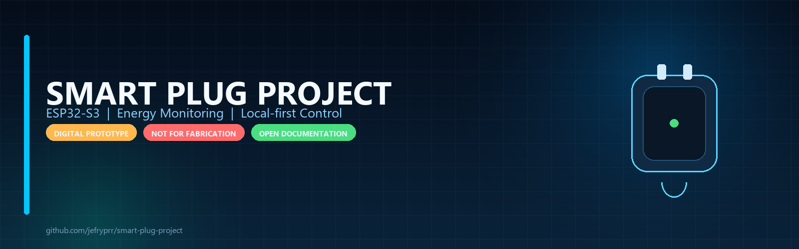

<p align="center">
  
</p>

<h1 align="center">SMART PLUG PROJECT</h1>

<p align="center">
  <a href="README.md">English</a> · <a href="README.id.md">Bahasa Indonesia</a>
</p>

<p align="center">
  <strong>Smart plug berbasis ESP32-S3 dengan pemantauan energi, kontrol lokal, dan dokumentasi teknik yang lengkap.</strong>
</p>

<p align="center">
  
  
  
</p>

> [!WARNING]
> **Ini prototipe digital, bukan produk jadi dan belum diuji dengan listrik 230 VAC.**
> Jangan menyambungkan tegangan listrik ke prototipe ini. Jangan menyentuh bagian mains. PE tidak boleh diputus. Baca [`docs/SAFETY.md`](docs/SAFETY.md) dan [`docs/tutorials/00_READ_FIRST.md`](docs/tutorials/00_READ_FIRST.md) sebelum melakukan apa pun dengan hardware.

---

## Apa itu SMART PLUG PROJECT?

Bayangkan sebuah colokan listrik pintar yang bisa:

- mengukur tegangan, arus, daya, dan energi pemakaian;
- menyalakan atau mematikan perangkat dari aplikasi web atau Android;
- membuat jadwal dan aturan otomatis;
- tetap bisa dikendalikan lewat tombol fisik saat internet mati;
- menyimpan bukti desain, pengujian, dan keputusan teknik secara terbuka.

Repo ini adalah **paket engineering lengkap** untuk ide tersebut: riset komponen, BOM, skematik, PCB, wiring, enclosure 3D, firmware, API, MQTT, dashboard web, aplikasi Android, simulator, dan dokumen keselamatan. Revisi aktif **REV_D_CORE_ONLY** tidak memakai OLED, RTC, atau RGB eksternal; tombol fisik tetap ada dan onboard RGB DevKitC-1 v1.0 (GPIO48) dipakai sebagai indikator status. Waktu memakai SNTP/NVS/API/MQTT/manual; schedule diblokir saat waktu invalid.

Namun, **belum ada alat fisik yang dirakit atau dinyalakan dengan 230 VAC**. Semua hasil saat ini adalah desain digital dan pengujian perangkat lunak.

---

## Untuk siapa repo ini?

| Kalau Anda... | Mulai dari |
|---|---|
| Penasaran dan ingin tahu cara kerjanya | [`docs/START_HERE.md`](docs/START_HERE.md) |
| Ingin menjalankan demo web/API | [`docs/SOFTWARE_GUIDE.md`](docs/SOFTWARE_GUIDE.md) |
| Ingin melihat hardware dan PCB | [`docs/HARDWARE_GUIDE.md`](docs/HARDWARE_GUIDE.md) |
| Ingin memahami keselamatan listrik | [`docs/SAFETY.md`](docs/SAFETY.md) |
| Ingin berkontribusi | [`CONTRIBUTING.md`](CONTRIBUTING.md) |
| Ingin membaca semua dokumen | [`docs/README.md`](docs/README.md) |
| Ingin tahu istilah teknis | [`docs/GLOSSARY.md`](docs/GLOSSARY.md) |

---

## Apa yang sudah jadi?

| Bagian | Status |
|---|---|
| Firmware core (C) | 75 host checks PASS; build ESP-IDF v6.1 PASS, belum di-flash |
| API + MQTT + simulator | 43 API + 12 MQTT + 6 simulator + 36 domain tests PASS |
| Dashboard web | Build + 5 Playwright tests + axe PASS |
| Android | Debug APK terbangun; belum diuji di HP/emulator |
| PCB carrier dan PSU | KiCad ERC 0; DRC 0/0; Gerber/drill provisional |
| Enclosure 3D | STEP/STL dan render tersedia; belum dicetak/diuji |
| Pengujian fisik | **BELUM** — thermal, PE, hipot, beban 8 A, dan uji mains masih BLOCKED |

Artinya: **software dan desain digital sudah cukup lengkap untuk dipelajari dan dikembangkan**, tetapi **belum aman untuk dipakai sebagai produk listrik**.

---

## Cara kerja singkat

```
230 VAC ──► PSU board (fuse, MOV, TCO, HLK-5M05) ──► 5 V untuk ESP32
      │
      ├──► PZEM-004T ──► UART ──► ESP32
      │
      └──► relay 2 channel ──► colokan output

ESP32 ──► MQTT ──► API ──► database
                         ├──► dashboard web
                         ├──► aplikasi Android
                         └──► notifikasi
```

- **PSU board** adalah satu-satunya pintu masuk 230 VAC. Di situ ada fuse, MOV, thermal cutoff, dan HLK-5M05.
- **Carrier ESP32** hanya berisi tegangan rendah (SELV).
- **PZEM** dan **relay** dipasang di area mains, bukan di PCB carrier.
- **API** menyimpan data dan mengirim perintah; **device** tetap menjadi sumber kebenaran untuk status nyala/mati.

Penjelasan lebih dalam: [`docs/ARCHITECTURE.md`](docs/ARCHITECTURE.md).

---

## Menjalankan demo software (tanpa listrik)

Prasyarat: **Node.js 22+**.

```powershell
git clone https://github.com/jefryprr/smart-plug-project.git
cd smart-plug-project
npm ci
npm run api:dev      # API di :4000
npm run web:dev      # web di :3000
```

Buka `http://localhost:3000`, lalu login dengan akun demo lokal:

```text
demo@example.com / demo1234
kode pairing: 123456
```

> Akun ini hanya untuk demo lokal. Jangan dipakai di produksi dan jangan diekspos ke internet.

Menjalankan tes:

```powershell
npm run typecheck
npm test
npm run build -w @smartplug/web
```

Panduan lengkap: [`docs/TESTING.md`](docs/TESTING.md).

---

## Peringatan keselamatan

Repo ini berisi desain yang berhubungan dengan **230 VAC**. Walaupun dokumentasinya lengkap, **desain ini belum diverifikasi secara fisik**.

- Jangan pernah bekerja dengan mains sendirian.
- Jangan menyambungkan USB saat mains aktif.
- Jangan menganggap modul murah otomatis aman.
- Jangan mencetak label rating atau logo sertifikasi.
- Jangan mengirim Gerber provisional ke pabrik sebagai board fungsional.
- PE harus tetap tersambung dan tidak boleh dilewatkan relay/fuse/sakelar.

Baca selengkapnya: [`docs/SAFETY.md`](docs/SAFETY.md) dan [`safety/`](safety/).

---

## Struktur repo

| Folder | Isi |
|---|---|
| `apps/` | API, web, simulator, Android |
| `packages/` | domain, API contract, MQTT contract |
| `firmware/` | C safety core + ESP-IDF |
| `hardware/` | KiCad, PCB PSU, carrier, wiring, enclosure, manufacturing |
| `research/` | riset komponen, harga Indonesia, bukti PSU, datasheet |
| `safety/` | isolasi, clearance, FMEA, rating, thermal |
| `security/` | threat model, ACL, SBOM, audit |
| `docs/` | panduan, tutorial, ADR, UI/UX, operasi |
| `reports/` | test matrix, log, laporan fase |
| `deliverables/` | manifest + laporan akhir |

---

## Lisensi

Kode dan dokumentasi asli dirilis dengan **MIT License**. Lihat [`LICENSE`](LICENSE). Merek dan datasheet pihak ketiga tetap milik pemiliknya; lihat [`NOTICE.md`](NOTICE.md).

---

<p align="center">
  <sub>Dokumentasi lengkap, status jujur, dan keselamatan lebih dulu.</sub>
</p>
