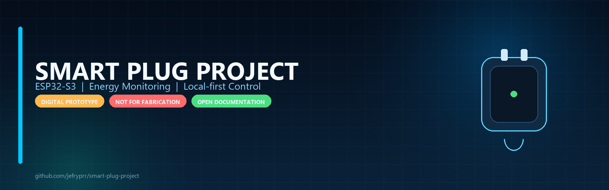
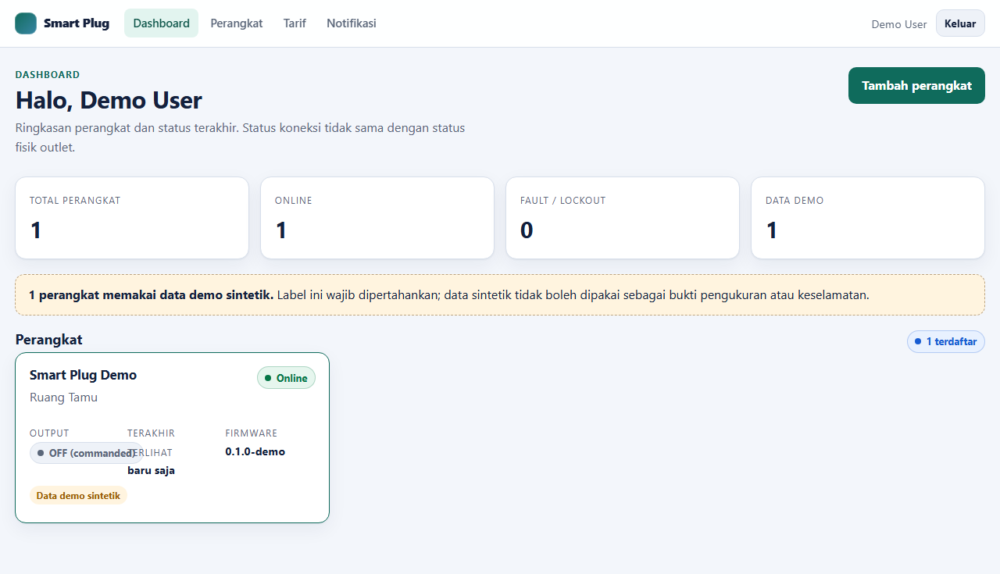
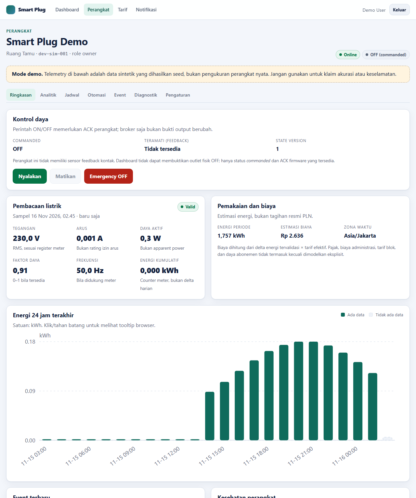
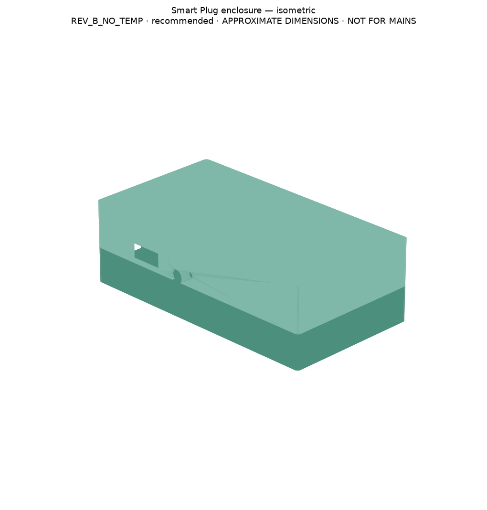
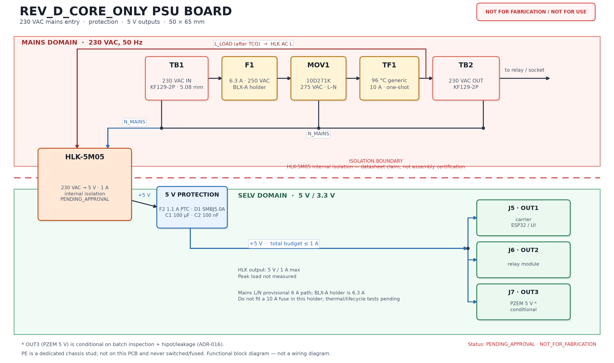
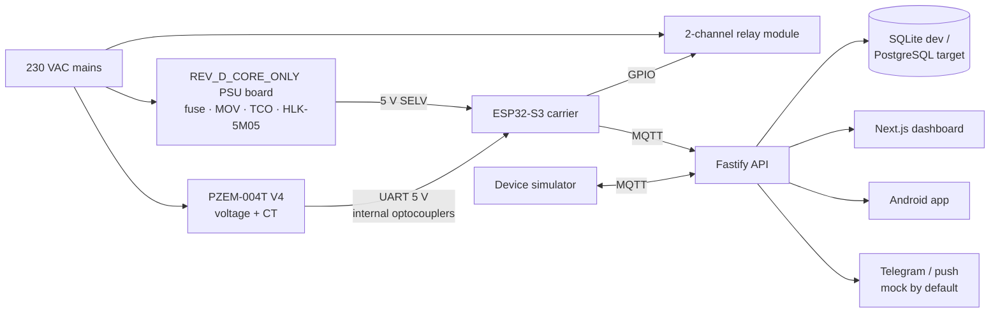

<p align="center">
  
</p>

<h1 align="center">SMART PLUG PROJECT</h1>

<p align="center">
  <a href="README.md">English</a> · <a href="README.id.md">Bahasa Indonesia</a>
</p>

<p align="center">
  <strong>An ESP32-S3 smart plug with energy monitoring, local-first control, and a complete open engineering package.</strong><br>
  Hardware research · KiCad PCB · firmware · MQTT · API · web dashboard · Android · simulator · safety dossier
</p>

<p align="center">
  <a href="https://github.com/jefryprr/smart-plug-project/actions/workflows/ci.yml"></a>
  
  
  
  
  
</p>

> [!WARNING]
> **This is a digital engineering prototype, not a certified or physically validated mains product.**
> No 230 VAC assembly has been built, energized, or tested. Do not connect mains to a 3D-printed enclosure or an unapproved prototype. PE must remain continuous and is never switched. Read [`docs/SAFETY.md`](docs/SAFETY.md) and [`docs/tutorials/00_READ_FIRST.md`](docs/tutorials/00_READ_FIRST.md) before doing anything with hardware.

---

## What this is

**SMART PLUG PROJECT** is a full, reproducible engineering package for an inline Wi-Fi smart outlet. The active **REV_D_CORE_ONLY** build measures voltage, current, power, and energy with a PZEM-004T V4, switches a load with a two-channel relay module, and exposes local firmware, an MQTT contract, a Fastify API, a Next.js dashboard, an Android app, and a device simulator.

CORE-only means **no OLED, no RTC, and no external RGB**. The physical button stays, and the onboard ESP32-S3-DevKitC-1 **v1.0 RGB (GPIO48)** is used as a status indicator. Time comes from SNTP/NVS/API/MQTT/manual set; schedules are blocked when time is invalid.

The repository is also an **evidence trail**: requirements, decisions, BOM, datasheets, wiring, PCB files, enclosure CAD, safety analysis, test logs, and a clear statement of what is still unproven.

**Start here if you are new:** [`docs/START_HERE.md`](docs/START_HERE.md) · **Versi Indonesia:** [`README.id.md`](README.id.md)

### What it is not

- Not a certified consumer product, not SNI/CE/UL approved, and not legal-for-trade metering.
- Not a finished mains appliance. The PCB, enclosure, firmware, and safety case still need engineering review and physical lab tests.
- Not a claim that a simulator, mock, or digital PASS is a hardware or HIL result.

---

## At a glance

| Layer | What exists | Status |
|---|---|---|
| **Hardware** | 100 × 70 mm SELV carrier + separate 50 × 65 mm mains-entry PSU board (HLK-5M05, fuse, MOV, TCO, 3× JST 5 V) | `ENGINEERING_REVIEW_REQUIRED` / `NOT_FOR_FABRICATION` |
| **Metering** | PZEM-004T V4 100 A CT, off-board; UART level-shifted with 74HCT125 + divider | Batch isolation `UNVERIFIED` |
| **Switching** | Off-board 2-channel optocoupler relay module, **6 A / ~1.380 W provisional** (BLX-A 6.3 A holder limit), not a linked DPST | `PROVISIONAL` |
| **Firmware** | Portable C safety core + time service (SNTP/NVS/API/MQTT/manual) + ESP-IDF v6.1 target build | Host tests PASS; not flashed |
| **Backend** | Fastify API, SQLite dev adapter, auth/RBAC, commands, telemetry, events, time endpoints | 43 tests PASS |
| **Contracts** | OpenAPI 3.1, Zod, MQTT topics/schemas/fixtures | 12 tests PASS |
| **Web** | Next.js dashboard, 12 real screenshots | Build + Playwright/axe PASS |
| **Android** | Expo source + time-status UI | Typecheck PASS; existing APK predates REV_D UI; not device-tested |
| **Simulator** | MQTT device twin with ACK/telemetry/time | 6 tests PASS |
| **Docs** | 26 tutorials, 17 ADRs, safety dossier, BOM, research log, REV_D conflicts | Digital complete, physical blocked |

Full status: [`docs/PROJECT_STATUS.md`](docs/PROJECT_STATUS.md) · Validation evidence: [`reports/VALIDATION_SUMMARY.json`](reports/VALIDATION_SUMMARY.json) · Latest release: [`v0.1.0`](https://github.com/jefryprr/smart-plug-project/releases/tag/v0.1.0)

---

## Screenshots

<table>
  <tr>
    <td width="50%"><br><sub><b>Web dashboard</b> — telemetry, energy, device state</sub></td>
    <td width="50%"><br><sub><b>Device overview</b> — commanded vs observed state</sub></td>
  </tr>
  <tr>
    <td width="50%"><br><sub><b>Enclosure</b> — 220 × 120 × 70 mm digital fit</sub></td>
    <td width="50%"><br><sub><b>REV_D_CORE_ONLY PSU board</b> — mains entry, protection, 5 V outputs</sub></td>
  </tr>
</table>

More: [`docs/ui-ux/screenshots/`](docs/ui-ux/screenshots/) · [`hardware/mechanical/render/`](hardware/mechanical/render/) · [`hardware/psu/psu_schematic.svg`](hardware/psu/psu_schematic.svg)

---

## How it works



- The **PSU board** is the only mains entry. It carries the 10 A fuse, MOV, 99 °C TCO, HLK-5M05, and three JST 5 V outputs.
- The **carrier** is SELV-only. It holds the ESP32-S3 DevKitC-1 v1.0 sockets, PZEM UART level shift, relay driver, button, and 5 V input. No OLED/RTC/external RGB.
- The **PZEM** and **relay module** stay off-board in the mains zone. The relay module is two independent SPDT channels, not a mechanically linked DPST.
- The **device** is the source of truth for `commanded_output` and fault/lockout. The API stores a shadow; the UI shows `APPLIED` only after a device ACK.

Deep dive: [`docs/ARCHITECTURE.md`](docs/ARCHITECTURE.md) · [`docs/HARDWARE_GUIDE.md`](docs/HARDWARE_GUIDE.md) · [`docs/SOFTWARE_GUIDE.md`](docs/SOFTWARE_GUIDE.md)

---

## Project status

**Digital gate (2026-11-19): 27 PASS / 11 BLOCKED / 0 FAIL.** PASS means digital evidence only.

| Verified digitally | Still blocked / unverified |
|---|---|
| 36 domain tests, 12 MQTT contract tests, 43 API tests, 6 simulator tests | Physical fit, thermal, PE continuity, hipot/leakage, 6 A load |
| 88 firmware host checks; ESP-IDF v6.1 target build | Firmware flash, boot waveform, PZEM/Wi-Fi/MQTT/OTA/time integration |
| Next.js build + 5 Playwright tests + axe | Android device/emulator install; production signing |
| KiCad ERC 0; carrier DRC 0/0; PSU DRC 0/0; Gerber/drill/POS exported | Component-level schematic/footprint review; fabrication release |
| WireViz 2 harnesses; CadQuery STEP/STL + fit report | Enclosure print, sealing, flammability, impact |
| Static wiring/GPIO/BOM crosschecks | PostgreSQL/Docker, production MQTT TLS/ACL |

No `READY_FOR_FABRICATION` or `READY_FOR_USE` claim is made. See [`reports/FAILURES.md`](reports/FAILURES.md).

---

## Quick start (software only, no mains)

### Prerequisites

- Node.js **22+**
- Python **3.11** (only for validation/CAD scripts)
- Optional: KiCad 10, ESP-IDF v6.1, Android SDK — see the tutorials

### Run the local demo

```powershell
git clone https://github.com/jefryprr/smart-plug-project.git
cd smart-plug-project
npm ci
npm run api:dev      # API on :4000, SQLite, seeded demo
npm run web:dev      # Next.js on :3000
npm run sim:dev      # device simulator (needs a local MQTT broker)
```

Open `http://localhost:3000` and sign in with the **local demo only** account:

```text
demo@example.com / demo1234
pairing code: 123456
```

> These credentials are seeded for local development. Never use them in production or expose this demo to the internet.

### Run the tests

```powershell
npm run typecheck
npm test
npm run build -w @smartplug/web
npx playwright test
powershell -ExecutionPolicy Bypass -File firmware\test\host\run_tests.ps1
.venv\Scripts\python.exe scripts\validate_all.py --e2e
```

The full digital validation gate, including KiCad/CAD/WireViz steps, is documented in [`docs/TESTING.md`](docs/TESTING.md). Logs and exit codes are in [`reports/`](reports/).

---

## Repository map

```text
apps/
  api/                 Fastify API, SQLite adapter, auth/RBAC, tests
  web/                 Next.js dashboard + 12 Playwright screenshots
  device-simulator/    MQTT device twin, state machine, ACK
  android/             Expo source + generated Android project
packages/
  domain/              command priority, energy, cost, schedule, freshness
  api-contract/        OpenAPI 3.1 + Zod schemas
  mqtt-contract/       topics, schemas, ACL direction, fixtures
firmware/              portable C safety core + ESP-IDF v6.1 skeleton
hardware/
  kicad/               native block schematic + routed carrier + routed PSU
  psu/                 REV_D_CORE_ONLY PSU schematic, netlist, placement
  carrier/             SELV carrier netlist/placement
  wiring/              2 WireViz harnesses + renders
  interfaces/          GPIO map
  mechanical/          CadQuery enclosure, brackets, STEP/STL, renders
  manufacturing/       provisional Gerber/drill/POS — NOT released
  pcb/render/          PCB preview
research/              component research, procurement, PSU evidence, datasheets manifest
bom/                   engineering BOM + dated procurement matrix + approvals
safety/                rating chain, isolation, clearance/creepage, FMEA, PE, thermal
security/              threat model, authorization, MQTT ACL, SBOM, audit
database/              PostgreSQL migrations + dev seed
infrastructure/        Docker/Mosquitto/Caddy templates
docs/                  start-here, FAQ, glossary, architecture, tutorials, decisions, UI/UX, operations
validation/            connectivity/GPIO/BOM/PSU crosschecks
reports/               phase reports, test matrix, failures, research log, build logs
deliverables/          manifest + final engineering report
```

---

## Documentation

| I want to... | Read |
|---|---|
| Understand the project without an engineering background | [`docs/START_HERE.md`](docs/START_HERE.md) · [`README.id.md`](README.id.md) |
| See every document in one index | [`docs/README.md`](docs/README.md) |
| See what every top-level file/folder is for | [`docs/REPOSITORY_MAP.md`](docs/REPOSITORY_MAP.md) |
| Understand the hardware | [`docs/HARDWARE_GUIDE.md`](docs/HARDWARE_GUIDE.md) · [`hardware/psu/README.md`](hardware/psu/README.md) · [`hardware/kicad/README.md`](hardware/kicad/README.md) |
| Understand the software | [`docs/SOFTWARE_GUIDE.md`](docs/SOFTWARE_GUIDE.md) · [`docs/software/README.md`](docs/software/README.md) |
| Run tests and read evidence | [`docs/TESTING.md`](docs/TESTING.md) · [`reports/TEST_MATRIX.csv`](reports/TEST_MATRIX.csv) |
| Read the safety case | [`docs/SAFETY.md`](docs/SAFETY.md) · [`safety/ISOLATION_PLAN.md`](safety/ISOLATION_PLAN.md) · [`safety/RESIDUAL_RISK_REGISTER.csv`](safety/RESIDUAL_RISK_REGISTER.csv) |
| See decisions and trade-offs | [`docs/decisions/ADR-INDEX.md`](docs/decisions/ADR-INDEX.md) · [`docs/decisions/ASSUMPTION_REGISTER.md`](docs/decisions/ASSUMPTION_REGISTER.md) |
| Follow a step-by-step tutorial | [`docs/tutorials/README.md`](docs/tutorials/README.md) |
| Check the BOM and Indonesian pricing | [`bom/BOM_MASTER.md`](bom/BOM_MASTER.md) · [`research/PROCUREMENT_INDONESIA.md`](research/PROCUREMENT_INDONESIA.md) |
| Read the final handoff | [`deliverables/FINAL_ENGINEERING_REPORT.md`](deliverables/FINAL_ENGINEERING_REPORT.md) · [`deliverables/manifest.json`](deliverables/manifest.json) |
| Understand a term | [`docs/GLOSSARY.md`](docs/GLOSSARY.md) |
| Get answers to common questions | [`docs/FAQ.md`](docs/FAQ.md) |

---

## Safety first

This repository deals with **230 VAC mains**. Treat every mains-side wire, terminal, PZEM pin, relay contact, fuse holder, and PSU pin as hazardous until a competent engineer has reviewed the assembly and a lab has tested it.

- **Never** work on mains alone. Use a qualified person and a lab procedure.
- **Never** connect USB or a debug probe while mains is present.
- **PE must remain continuous.** It is never switched, fused, or routed through a relay.
- **Do not** treat the HLK-5M05, PZEM internal optocouplers, or relay module optocouplers as certified isolation barriers by themselves.
- **Do not** print a rating label or CE/SNI/UL mark. The current label is `PROTOTYPE — NOT FOR USE`.
- **Do not** send the provisional Gerber files to a fab as a functional board.

Read the full safety dossier: [`safety/`](safety/) · [`docs/SAFETY.md`](docs/SAFETY.md) · [`docs/assembly/MAINS_ASSEMBLY_QUALIFIED.md`](docs/assembly/MAINS_ASSEMBLY_QUALIFIED.md)

---

## Contributing

Contributions are welcome, especially in these areas:

- primary-source research and datasheet corrections;
- KiCad footprint/layout review;
- firmware integration and test fixtures;
- API/web/Android tests;
- documentation for beginners;
- accessibility and Indonesian translations.

Please read [`CONTRIBUTING.md`](CONTRIBUTING.md) and [`CODE_OF_CONDUCT.md`](CODE_OF_CONDUCT.md) first. Need help? See [`SUPPORT.md`](SUPPORT.md) and [`docs/FAQ.md`](docs/FAQ.md). For security issues, use [`SECURITY.md`](SECURITY.md); do not open a public issue with a real secret.

Good first issues: documentation links, test coverage, translation, screenshot updates, and reproducing the digital validation gate.

---

## License

Code and original documentation are released under the **MIT License**. See [`LICENSE`](LICENSE). Third-party trademarks, datasheets, and linked documents remain the property of their owners; see [`NOTICE.md`](NOTICE.md). Citation metadata is available in [`CITATION.cff`](CITATION.cff).

---

<p align="center">
  <sub>Built as a digital engineering package. Verify before you energize. Measure before you claim.</sub>
</p>
