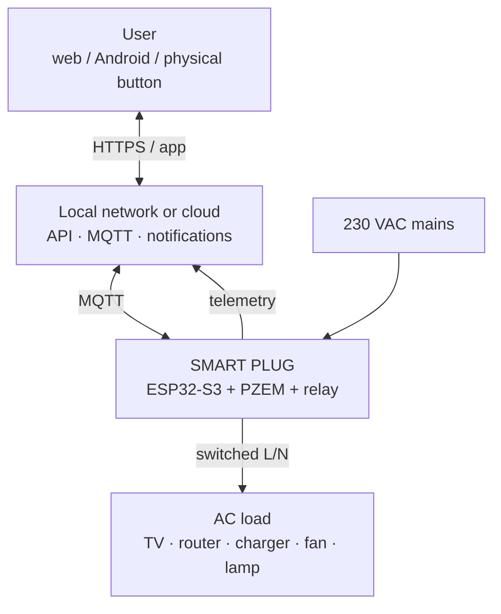
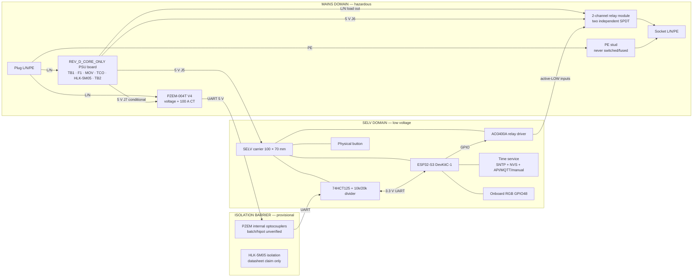
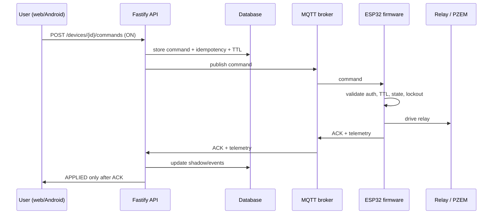
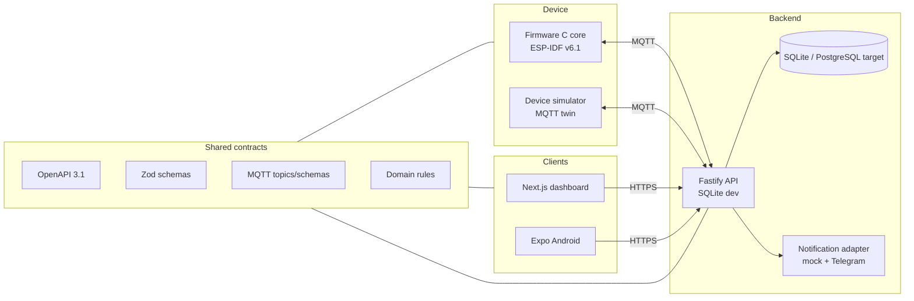

# Architecture

**Design revision:** `REV_D_CORE_ONLY`  
**Diagram:** [`hardware/SYSTEM_ARCHITECTURE.png`](hardware/SYSTEM_ARCHITECTURE.png) (also `.svg`, `.pdf`)  
**Note:** the diagram is functional, not a wiring diagram. For wiring see [`../hardware/wiring/`](../hardware/wiring/); for the native system block schematic see [`../hardware/kicad/`](../hardware/kicad/).

---

## 1. System context



The device is the source of truth for `commanded_output` and fault/lockout. The API stores a shadow. The UI shows `APPLIED` only after a device ACK and shows `observed` only when feedback exists.

---

## 2. Hardware blocks



### Power tree

```text
230 VAC L/N
  -> TB1
  -> F1 10 A 250 VAC time-lag fuse
  -> MOV1 275 VAC (L-N)
  -> TF1 SEFUSE SF96E 99 °C TCO (L path)
  -> TB2 L/N output to relay/load
  -> HLK-5M05 AC input

HLK-5M05 +Vo
  -> F2 1.1 A PTC
  -> +5 V
  -> D1 SMBJ5.0A TVS
  -> C1 100 uF + C2 100 nF
  -> J5 carrier / J6 relay / J7 PZEM (conditional)
HLK-5M05 -Vo -> GND
```

PE is **not** on the PSU board. It is a dedicated chassis stud: plug PE → stud → socket PE. It is never switched, fused, or routed through a relay.

---

## 3. Data and control flow



Rules:

- UTC timestamps; UI displays Asia/Jakarta.
- Cumulative meter counters; energy deltas handle reset/gap.
- Missing data is `null`, not zero.
- Tariff history is effective by interval start; no retroactive rewrite.
- Commands are idempotent, TTL-bound, replay-checked, and lockout-aware.
- `observed_output` requires verified feedback. The API does not invent it.

---

## 4. Software architecture



| Component | Path | Responsibility |
|---|---|---|
| Domain | `packages/domain` | Command priority, energy delta, cost, schedule, freshness, redaction |
| API contract | `packages/api-contract` | OpenAPI 3.1 + Zod schemas |
| MQTT contract | `packages/mqtt-contract` | Topics, schemas, ACL direction, fixtures |
| API | `apps/api` | Fastify, SQLite adapter, auth/RBAC, commands, telemetry, events |
| Simulator | `apps/device-simulator` | MQTT device twin, state machine, ACK, telemetry |
| Web | `apps/web` | Next.js dashboard |
| Android | `apps/android` | Expo source + generated project (debug APK built) |
| Firmware | `firmware/` | Portable C safety core + ESP-IDF skeleton |

---

## 5. Safety boundaries

| Boundary | Design intent | Status |
|---|---|---|
| Mains / SELV | PSU isolation, PZEM internal optocouplers, creepage/clearance, enclosure barrier | **NOT PROVEN** |
| PE | Dedicated stud, continuous, never switched/fused | Design rule; continuity not tested |
| Relay contact / coil | Off-board module; SELV coil driver; contacts in mains zone | Module batch/rating unverified |
| USB / service | USB restricted while mains present | Design rule; hardware not tested |
| Enclosure | 220 × 120 × 70 mm, mechanical barrier at x = −4 mm | Digital fit only; material/flame/impact unverified |
| Thermal | Fuse + 99 °C TCO; no firmware temperature sensor | Not tested at 8 A |
| PZEM UART | Internal optocouplers only in REV_D_CORE_ONLY; `OUT3` conditional | Batch/hipot unverified; external ADuM/B0505S is the fallback |

Read the full safety case: [`../safety/ISOLATION_PLAN.md`](../safety/ISOLATION_PLAN.md), [`../safety/PROTECTION_COORDINATION.md`](../safety/PROTECTION_COORDINATION.md), [`../safety/CLEARANCE_CREEPAGE_WORKSHEET.md`](../safety/CLEARANCE_CREEPAGE_WORKSHEET.md).

---

## 6. Revision note: REV_A vs REV_D_CORE_ONLY

| Revision | UART isolation | PSU | Status |
|---|---|---|---|
| `REV_A_PROVISIONAL` | External ADuM1201 + B0505S barrier | HLK off-board | Superseded for current design |
| `REV_D_CORE_ONLY` | PZEM internal optocouplers; no external barrier | HLK off-board | Transitional |
| `REV_D_CORE_ONLY` | PZEM internal optocouplers; `OUT3` conditional | Separate 50 × 65 mm mains-entry PSU board | Current digital revision |

REV_D_CORE_ONLY is documented in [`decisions/ADR-016-PZEM-ISOLATION-REV-C.md`](decisions/ADR-016-PZEM-ISOLATION-REV-C.md). Do not mix claims from different revisions without checking the artifact’s status.

---

## 7. Related documents

- [`HARDWARE_GUIDE.md`](HARDWARE_GUIDE.md)
- [`SOFTWARE_GUIDE.md`](SOFTWARE_GUIDE.md)
- [`../docs/hardware/SYSTEM_ARCHITECTURE.md`](hardware/SYSTEM_ARCHITECTURE.md)
- [`../hardware/psu/README.md`](../hardware/psu/README.md)
- [`../hardware/carrier/README.md`](../hardware/carrier/README.md)
- [`../hardware/wiring/README.md`](../hardware/wiring/README.md)
- [`../docs/decisions/ADR-INDEX.md`](decisions/ADR-INDEX.md)
