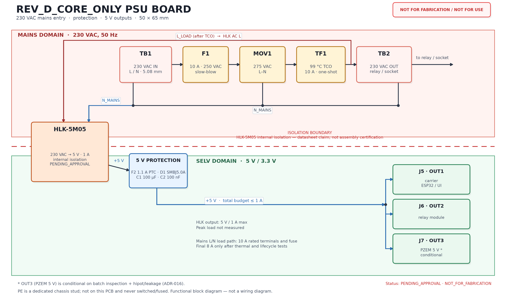
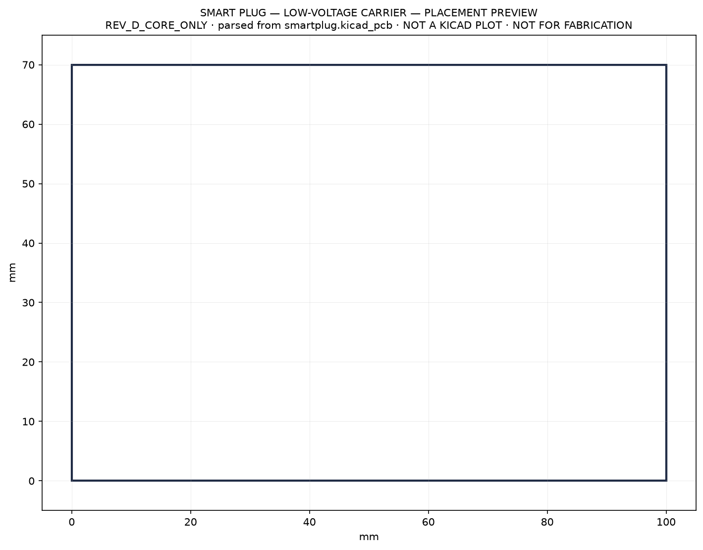

# Hardware Guide

**Design revision:** `REV_D_CORE_ONLY`  
**Status:** `ENGINEERING_REVIEW_REQUIRED` / `HARDWARE_VALIDATION_REQUIRED` / `NOT_FOR_FABRICATION`

This guide explains the hardware in plain language. It is not a build or energization procedure. Mains work is for qualified personnel with a lab procedure.

---

## 1. The three physical groups

The product is a 3D assembly, not a single PCB.

| Group | What it contains | Safety domain |
|---|---|---|
| **Mains-entry PSU board** | TB1/TB2 terminal blocks, F1 fuse, MOV, TCO, HLK-5M05, 3× JST 5 V outputs | MAINS + SELV output |
| **SELV carrier** | ESP32-S3 DevKitC-1 v1.0 sockets, 74HCT125 (PZEM only), divider, relay driver, button, 5 V input. No OLED/RTC/external RGB. | SELV |
| **Off-board modules** | PZEM-004T V4 + CT, 2-channel relay module, socket/plug, PE stud, enclosure | MAINS |

**Why the HLK-5M05 is on a separate board:** it is a 230 VAC module. Keeping it off the carrier preserves a clear SELV-only carrier, simplifies creepage/clearance, moves ~2.1 W of heat away from the ESP32, and makes PSU replacement possible without re-spinning the carrier. See [`../hardware/psu/README.md`](../hardware/psu/README.md).

---

## 2. REV_D_CORE_ONLY mains-entry PSU board

<p align="center">
  
</p>

| Item | Part / value | Function |
|---|---|---|
| **TB1** | 5.08 mm terminal block, L/N input | 230 VAC input from the plug/fuse chain |
| **F1** | 5 × 20 mm, 10 A, 250 VAC time-lag fuse | Overcurrent protection for the whole device |
| **MOV1** | 275 VAC-class MOV (S10K275 / 10D271K class) | Surge clamping across L/N after the fuse |
| **TF1** | SEFUSE SF96E, 99 °C rated functioning, 84 °C holding, 10 A / 250 VAC | One-shot thermal cutoff in the L path |
| **PS1** | Hi-Link HLK-5M05, 5 V / 1 A / 5 W | AC/DC conversion; isolation is a datasheet claim, not a batch certificate |
| **TB2** | 5.08 mm terminal block, L/N output | Switched-load feed to the relay/load |
| **F2** | 1.1 A PTC | Resettable current limit on the total 5 V output |
| **D1** | SMBJ5.0A TVS | 5 V transient clamp |
| **C1 / C2** | 100 µF + 100 nF | Bulk and high-frequency decoupling |
| **J5 / J6 / J7** | 3× JST-XH 2-pin | 5 V outputs: carrier, relay, PZEM (conditional) |
| **H1/H3/H4** | M3 mounting holes | Standoff mounting in the enclosure |

**Protection order:**

```text
TB1 L -> F1 -> MOV1 (L-N) -> TF1 -> TB2 L + HLK AC L
TB1 N -> TB2 N + HLK AC N + MOV1 N
HLK +Vo -> F2 PTC -> +5V -> J5/J6/J7 + D1/C1/C2
HLK -Vo -> GND
```

The TCO is after the MOV in the L path, so it removes both the load and the HLK input when it opens. The MOV is after the fuse, so a failed MOV is cleared by F1.

**PE is not on this board.** It is a dedicated chassis stud: plug PE → stud → socket PE. It is never switched, fused, or routed through a relay.

**Board facts:** 50 × 65 mm, 2-layer FR4 1.6 mm, 2 oz copper target, 8 nets, 13 assembled footprints + 3 mounting holes + 3 fiducials. DRC 0/0. 4 mm L/N traces and a 2 mm isolation notch are **provisional**, not IEC creepage claims.

**5 V output allocation:**

| Output | Connector | Load | Status |
|---|---|---|---|
| OUT1 | J5 | Carrier J8 (ESP32/UI) | `PROVISIONAL` |
| OUT2 | J6 | Relay module VCC | `PROVISIONAL` |
| OUT3 | J7 | PZEM V4 TTL 5 V | `PROVISIONAL`, conditional on PZEM batch/hipot |

Total 5 V load estimate is ≤1 A; HLK is 1 A. Peak is not measured. Do not add loads without a new budget and thermal check.

---

## 3. SELV carrier

<p align="center">
  
</p>

| Item | Function |
|---|---|
| **J1A / J1B** | Two 1×22 sockets for the ESP32-S3 DevKitC-1, 22.86 mm row spacing. Do not use a 2×22 IDC socket. |
| **J2** | PZEM TTL connector: 5 V, GND, TX, RX |
| **J3** | Relay module connector: 5 V, GND, IN1, IN2 |
| **J6** | Button connector |
| **J8** | 5 V input from PSU J5 |
| **U9** | 74HCT125 level shifter (3.3 V TX → 5 V PZEM RX) |
| **R4/R5** | 10k/20k divider (5 V PZEM TX → 3.3 V GPIO18) |
| **Q1** | AO3400A MOSFET relay driver, pulls both active-LOW inputs |
| **R2** | 100k pulldown on the relay gate (boot-safe OFF) |

**Board facts:** 100 × 70 mm, 2-layer FR4 1.6 mm, 23 footprints total (16 assembled + 3 fiducials + 4 mounting holes), 11 named nets, DRC 0/0 at 0.15 mm. Onboard DevKitC-1 v1.0 RGB = GPIO48; no external RGB. The carrier is **SELV-only by design**. No mains trace, terminal, or module pin is routed onto it.

The PZEM UART is level-shifted, not externally isolated in REV_D_CORE_ONLY. The PZEM-004T V4’s internal optocouplers are the single UART isolation barrier; this is conditional and unverified for the purchased batch. The external ADuM1201 + B0505S barrier remains a documented fallback.

---

## 4. Off-board modules

### PZEM-004T V4 + CT

| Item | Status / note |
|---|---|
| Voltage input | 80–260 VAC L/N; mains-referenced |
| Current | 100 A CT variant; clamp around **one conductor only (L)** |
| UART | 5 V TTL; exact batch pinout/baud/register map `UNVERIFIED` |
| Power | 5 V from PSU J7, conditional |
| Isolation | Internal optocouplers; batch/hipot `UNVERIFIED` |
| Accuracy | Not revenue-grade; low-current accuracy at 8 A with a 100 A CT unverified |

### 2-channel relay module

| Item | Status / note |
|---|---|
| Channels | Two independent SPDT relays, not a mechanically linked DPST |
| Inputs | Active-LOW IN1/IN2, 5 V coil |
| Contact claim | 250 VAC / 10 A per channel (vendor claim) |
| Final load | 8 A / ~1,840 W, electronics/SMPS only |
| Isolation | Optocoupler input; shared VCC/GND means it is not a certified galvanic barrier |
| Failure mode | One channel can weld while the other moves; no contact feedback |

### Socket, plug, PE, enclosure

- Socket/plug MPN, certification, and PE hardware are not verified.
- PE is a dedicated stud; continuity/fault-current test is blocked.
- Enclosure is 220 × 120 × 70 mm, 3D-printed prototype; flame rating, impact, sealing, and thermal performance are unverified.

---

## 5. Wiring and connectors

| Harness | File | Purpose |
|---|---|---|
| Main | [`../hardware/wiring/main_harness.yaml`](../hardware/wiring/main_harness.yaml) | Mains, PSU, carrier, relay, PE |
| Metering | [`../hardware/wiring/metering_harness.yaml`](../hardware/wiring/metering_harness.yaml) | PZEM UART/CT/power |
| Time status | firmware time service + web/Android | SNTP/NVS/API/MQTT/manual; no RTC |

Rendered harnesses: [`../hardware/wiring/renders/`](../hardware/wiring/renders/).

GPIO map: [`../hardware/interfaces/gpio_map.md`](../hardware/interfaces/gpio_map.md). GPIO assignments remain `UNVERIFIED` until the physical board revision is checked.

---

## 6. What is not proven

- Creepage/clearance to IEC 60664-1; working voltage/OVC/pollution degree/material group.
- HLK batch isolation, certificate, ripple, thermal.
- Fuse/MOV/TCO/terminal/JST ratings and breaking capacity.
- 8 A thermal rise, 2 oz fabrication, solder mask/barrier.
- Assembly hipot/leakage, PE continuity, relay/socket/load tests.
- PZEM batch internal isolation and OUT3.
- Physical fit, cable bend, enclosure sealing/flame/impact.
- Firmware flash and integration.

Do not energize this board from mains. Mains work is qualified-personnel/lab only.

---

## 7. Related documents

- [`../hardware/psu/README.md`](../hardware/psu/README.md)
- [`../hardware/kicad/README.md`](../hardware/kicad/README.md)
- [`../hardware/carrier/README.md`](../hardware/carrier/README.md)
- [`../hardware/wiring/README.md`](../hardware/wiring/README.md)
- [`../bom/BOM_MASTER.md`](../bom/BOM_MASTER.md)
- [`../research/PSU_BOARD_EVIDENCE.md`](../research/PSU_BOARD_EVIDENCE.md)
- [`../safety/ISOLATION_PLAN.md`](../safety/ISOLATION_PLAN.md)
- [`../safety/PROTECTION_COORDINATION.md`](../safety/PROTECTION_COORDINATION.md)
